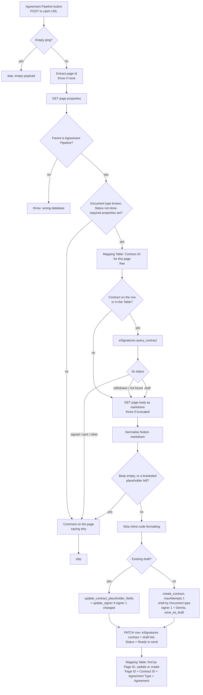

# agreement-send-for-signing

Press **Send to eSignatures** on a row in the Notion **Agreement Pipeline** database, and this Zap
turns the row's page body into an eSignatures.com **draft** contract. The draft link goes into
the row's `eSignatures contract` property and Status becomes `Ready to send`. Nothing goes to a
signer: you review the draft in eSignatures and send it from there.

One Zap for every agreement type. It replaces three per-type deployments
([`sow-send-for-signing` and `project-addendum-send-for-signing`](../esignatures-send-for-signing/),
and [`notion-nda-to-esignatures-draft`](../notion-nda-to-esignatures-draft/)), which stay live
until the cutover task retires them. Adding a document type is one entry in `DOC_TYPES` in
[`workflow.ts`](workflow.ts). Built in TKT-1088.

- **Trigger:** Webhooks by Zapier catch hook (`WebHookCLIAPI@1.2.2` / `hook_v2`). The sender is
  the Agreement Pipeline **Send to eSignatures** button property, whose *Send webhook* action
  points at `trigger.webhook_url` in [`zap.json`](zap.json) once the first publish has issued it.
- **Data source:** Agreement Pipeline, `42491b07-11ac-8198-b685-000bf23f6e17`. A page from any
  other data source throws. Nothing here touches the Signed Agreement Register.
- **Contract text:** the row's page body, via Notion's `GET /v1/pages/{id}/markdown`.
- **eSignatures app:** the public `EsignaturesioCLIAPI` app for every call. Its `create_contract`
  takes the body as `placeholder_fields_markdown_map.contract-body` plus two signers.
- **Signer 2** is always Dennis (`dennis@work.flowers`, Company Flow Pte. Ltd.), after the
  counterparty.

## Config by Document type

| Document type | eSignatures shell | Signer 1 | Required before drafting | Title |
| --- | --- | --- | --- | --- |
| SOW – Fixed project, SOW – Full retainer, SOW – Support retainer | Scope of Work (`6eaa0583…`) | Signatory contact | Signatory with a name and email | `Scope of Work – <Counterparty> (AGR-n)` |
| Order form | Scope of Work (`6eaa0583…`) | Signatory contact | Signatory with a name and email | `Order Form – <Counterparty> (AGR-n)` |
| Project addendum | Consultant Project Addendum (`443d6bed…`) | Consultant (Notion person) | Consultant with an email, Parent agreement | `Project Addendum – <Counterparty> (AGR-n)` |
| NDA | Mutual NDA (`6325d51d…`) | Signatory contact | Signatory with a name and email, Counterparty | `Mutual NDA – <Counterparty> (AGR-n)` |
| Consulting agreement | Scope of Work (`6eaa0583…`), **interim** | Signatory contact | Signatory with a name and email | `Consulting Agreement – <Counterparty> (AGR-n)` |
| Amendment | Scope of Work (`6eaa0583…`), **interim** | Signatory contact | Signatory with a name and email | `Amendment – <Counterparty> (AGR-n)` |

- **Override email** wins over the Signatory's `Signer email` rollup, and over the Consultant's
  Notion email, on every type.
- **Counterparty** is the registered legal name, typed by hand. It is signer 1's company and goes
  in the title. It is not derived from `Companies`, which often holds a trading name and has no
  entry for an individual consultant. With no Counterparty, the title uses `Agreement Name`.
- **The title ends with the row's pipeline ID**, e.g. `Mutual NDA – Acme Pte. Ltd. (AGR-12)`, so
  the signed copy carries the reference the Agreement File Analyzer links an executed copy by.
  Without it, the agent falls back to matching on content, which missed AGR-5 in the TKT-1089
  test. Drafts created before this change keep their old title (eSignatures cannot rename).
- **Shell templates** (read back 2026-11-27, unchanged): Scope of Work and Consultant Project
  Addendum are exactly `{{contract-body}}`. Mutual NDA is `{{ contract-body }}`, a page break,
  and a *Signatory Details* section with a required *Title / Designation* field for every signer.
  Consulting agreement and Amendment have no shell of their own yet, so they use the bare Scope of
  Work one until Dennis decides (see the PR). Changing that is one constant, `TPL_GENERIC`.

## Guards

| Case | What happens |
| --- | --- |
| Empty ping (`{}`, `null`, `""`, `{"querystring":{}}`, double-encoded) | Skip, no error |
| Payload with content but no page id (`{"foo":1}`, `{"data":{}}`, `{"data":{"id":""}}`) | Throws (repo default) |
| Page not in Agreement Pipeline | Throws: the button or a replay is wired to the wrong place |
| Document type empty, or not in the config | Page comment listing the supported types, skip |
| Status `Sent for signature`, `Signed`, `Cancelled` or `Lapsed` | Page comment, skip |
| A required property missing (table above) | Page comment naming each one, skip |
| Existing contract `signed`, sent, or any status other than draft/withdrawn | Page comment, nothing changed |
| Existing contract still a `draft` | Updated in place: body, and signer 1 if name, email or company changed. Never a second draft |
| Existing contract `withdrawn` or deleted | A new draft replaces it |
| Markdown export truncated, or blocks Notion could not export | Throws: a contract missing a clause is worse than none |
| Empty body, or a bracketed inline-code placeholder left (`` `[Short name]` ``) | Page comment listing them, skip |

A user mistake never throws; it gets a comment on the page and a clean skip. The comment call
never throws either.

## Maintainer notes

- **Contract with `esignatures-status-to-notion` (TKT-1089).** Mapping rows written here have
  Agreement Type = `Agreement` (exact string), Page ID = the pipeline page id, and Contract ID =
  the eSignatures contract id. `eSignatures contract` on the row holds the draft URL, which
  contains the contract id; the status sync's fallback search depends on that. This Zap sets
  Status to `Ready to send` only. Change none of these without changing that Zap too.
- **The markdown normaliser is copied verbatim** from
  [`esignatures-send-for-signing/shared.ts`](../esignatures-send-for-signing/shared.ts) (checked
  byte-identical 2026-11-27). A fix belongs in every copy until the old Zaps are retired.
- **Placeholders apply to every type**, not only NDAs: any inline-code span whose whole content
  is in square brackets stops the run. Inline-code formatting is then stripped from the whole
  body, because eSignatures' Extended Markdown reads a backticked span at the end of a line as a
  signer-field config. Fenced code blocks are left alone.
- **`create_contract` runs once.** It is not idempotent. A failed run is readable instead, and
  pressing the button again is the retry. The PATCH and the Table write keep default retries
  because replaying them lands in the same state.
- **On an update, signer 1 is matched by `signing_order` "1"**, not by email, so a test row
  addressed to Dennis's own email still updates the right signer. Neither eSignatures app can add
  a signer or rename a contract, so a draft missing Dennis (`wfSignerMissing`) or with a changed
  title (`titleStale`) is reported in the run output, not fixed.
- **Two quick clicks can create two drafts.** Both runs read an empty link before either writes
  one. Durables have no lock (see the shared rules); the cost is one stray draft to delete.
- The row is written with raw Notion REST (`PATCH /v1/pages`), not `update_database_item`,
  because the action's schema cache lags newly created databases.
- Repo rule 5 (default templates) does not apply: the Zap only updates an existing page.
- **A Notion divider becomes a PDF page break** in eSignatures (`---`).

## Cost

Every Notion read, Notion comment and eSignatures call is 1 task; Table reads and writes are free.

| Path | Tasks |
| --- | --- |
| First send (page, body, create, PATCH) | 4 |
| Resend of an unsent draft (page, query, body, update body, PATCH) | 5, or 6 when signer 1 changed |
| Resend after a withdrawn or deleted contract (page, query, body, create, PATCH) | 5 |
| Refused on properties (page, comment) | 2 |
| Refused on an existing signed or sent contract (page, query, comment) | 3 |
| Refused on the body (page, body, comment) | 3, or 4 on a resend |
| Empty ping | 0 |

**Expected volume:** a handful of agreements a month, each sent once or twice while it is
reviewed. That is roughly 10–20 runs and 40–100 tasks a month, the same as the three Zaps it
replaces put together.

## Verification

| Case | Result |
| --- | --- |
| Types: `tsc --strict --noUnusedLocals` against durable 0.14.1 + sdk 0.115.1 | Clean |
| Publish-time analyzer (`validate-workflow`) | No issues |
| Normaliser vs `esignatures-send-for-signing/shared.ts` | Byte-identical |
| Payload shapes, local harness | The five empty shapes skip; the four content-but-no-id shapes throw |
| Row reading, local harness: NDA, SOW with override, addendum, missing Counterparty / Signatory / Consultant + Parent, empty and unknown Document type, Signed status | Right title, signer and refusal for each |
| Placeholders, local harness | Bracketed span reported; one inside a fence ignored; filled values printed without backticks; tables and nested lists survive |
| Agreement Pipeline read with `notion_wf`, 2026-11-27 | 200; every property name matches the live schema |
| **End to end** | **Not yet run** — needs the merge, the catch URL in the button, and a test NDA row addressed to Dennis |

## Setup

1. Merge (Dennis's go-ahead). The publish pipeline creates the Zap **disabled** and writes the
   catch URL into `zap.json` `trigger.webhook_url`.
2. Point the Agreement Pipeline **Send to eSignatures** button's *Send webhook* action at that
   URL.
3. `enable-workflow <workflow_id>`, set `enabled: true` in `zap.json`, and run the end-to-end
   checks in TKT-1088: a test NDA row addressed to Dennis drafts with the right body, tables and
   signers; a row with a placeholder left gets a comment and no draft; a second press updates the
   same draft.
