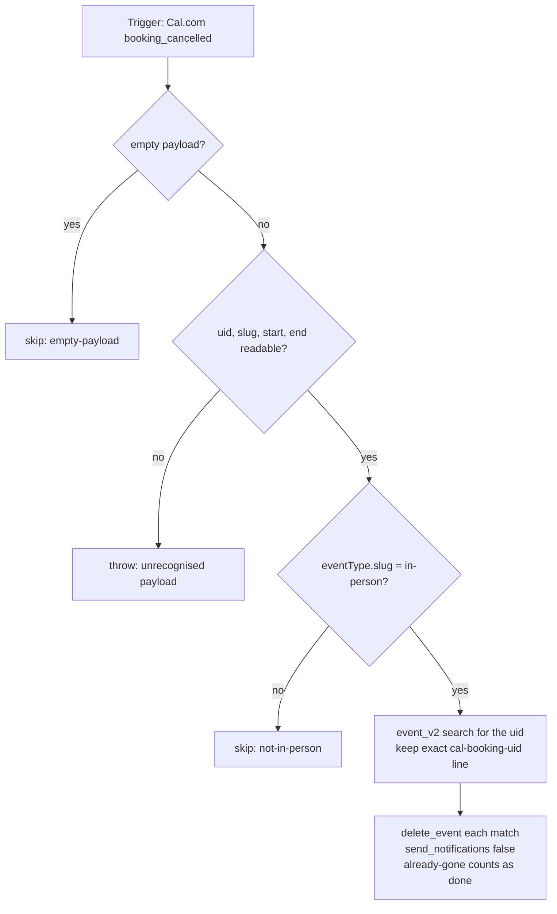

# calcom-booking-cancelled-to-travel-blocks

When a Cal.com **in-person** booking (slug `in-person`) is cancelled, delete the two travel blocks that [`calcom-booking-created-to-travel-blocks`](../calcom-booking-created-to-travel-blocks/) put on `dennis@work.flowers`. That README covers the block format, the shared helpers (keep them byte-identical across all three files) and the maintainer notes.

## Maintainer notes

- **Finding no blocks is not an error.** A booking made before these Zaps existed, or one whose blocks were deleted by hand, simply returns `deleted: []`.
- **A reschedule does not fire this trigger for the original booking** (verified 2026-10-20). Old blocks after a reschedule are removed by [`calcom-booking-rescheduled-to-travel-blocks`](../calcom-booking-rescheduled-to-travel-blocks/), not here.
- The payload is the same shape as `booking_created`, with `status: "CANCELLED"` and the cancellation reason in `cancellationReason`.
- Task cost per in-person cancellation: 1 search + 1 delete per block (normally 2). Any other event type: 0.

## Verified cases (run-durable pre-publish, then live, 2026-10-20)

| Case | Result |
| --- | --- |
| Real `booking_cancelled` payload for a booking with blocks | Both blocks deleted; a follow-up search finds no `cal-booking-uid` events |
| `{"querystring":{}}` | `skipped: empty-payload` |
| `{"data":{"id":""}}` | throws `Unrecognised Cal.com booking payload … top-level keys: data` |
| **Live (2026-10-20):** `n7jU…` cancelled | Both blocks deleted; no `cal-booking-uid` events left on the calendar |
