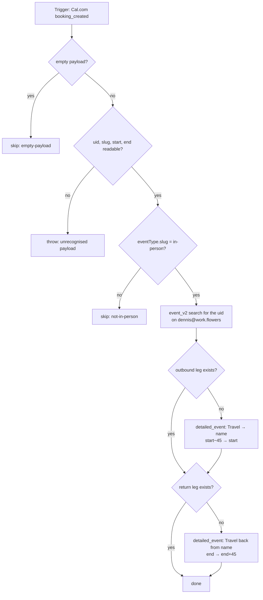

# calcom-booking-created-to-travel-blocks

When someone books Dennis's Cal.com **in-person** meeting (`cal.com/dennis-chiuten/in-person`, event type `7553094`, slug `in-person`), put two private, busy travel blocks on `dennis@work.flowers`:

| Block | Title | Time |
| --- | --- | --- |
| Outbound | `Travel → {attendee name}` | meeting start − 45 min → meeting start |
| Return | `Travel back from {attendee name}` | meeting end → meeting end + 45 min |

Cal.com's own 45-minute before/after buffers only stop Cal.com offering adjacent slots. They never reach Google Calendar, so without these blocks the travel time looks free to everything else.

This is one of three sibling Zaps that share the same helpers (keep them byte-identical):

- **this one** creates the blocks;
- [`calcom-booking-cancelled-to-travel-blocks`](../calcom-booking-cancelled-to-travel-blocks/) deletes them;
- [`calcom-booking-rescheduled-to-travel-blocks`](../calcom-booking-rescheduled-to-travel-blocks/) deletes the original booking's blocks and creates new ones.



## How the blocks are identified

Each block's description ends with two marker lines:

```
cal-booking-uid: <Cal.com booking uid>
travel-leg: outbound | return
```

The description also holds the meeting address (`payload.location`, which for this event type is the attendee-supplied address) and the meeting time in Singapore time. The siblings find blocks with Google Calendar's free-text search on the uid, then keep only events whose description has the **exact** `cal-booking-uid:` line. A probe on 2026-10-20 showed a just-created event is searchable immediately, with no time window needed.

Event settings: `visibility: private`, `transparency: opaque` (busy; Google omits the field on read-back because it is the default), `reminders__useDefault: false`, and no attendees, so no notifications go out.

## Maintainer notes

- **Time maths is plain integer arithmetic, not Formatter.** Cal.com sends UTC (`2026-10-23T05:00:00.000Z`); `epochMsFromIso` honours whatever offset is present and **rejects a timestamp without one** rather than guessing, since guessing is how an 8-hour shift happens. Output is written with an explicit `+08:00` (Singapore has no DST). The durable runtime's determinism guard forbids `new Date` in the workflow body anyway.
- **The event-type filter lives in code.** The Cal.com triggers have no input fields (`list-trigger-input-fields`, 2026-10-20), so every booking of any event type runs this Zap and skips for free at the slug check.
- **Idempotent.** It searches for existing blocks first and creates only a missing leg, so a duplicate trigger delivery doesn't double the blocks (verified by replaying the same payload). That search costs one task per booking.
- **The blocks are mirrored to SCW.** [`workflowers-events-to-scw-busy`](../workflowers-events-to-scw-busy/) treats them like any other busy work.flowers event and adds a private "Busy" block on the SCW calendar. That's intended: travel time is unavailable time.
- Task cost per in-person booking: 1 search + 2 creates. Any other event type: 0.
- Trigger connection: Cal.com `dennis-work` (`02f2779c-…`). The other Cal.com connection, `dennis-chiuten` (`02d05cb6-…`), fails token refresh with `invalid_grant`.

## Real payload (captured 2026-10-20)

Captured from a real test booking through a trigger inbox. Only the fields used here are shown:

```json
{
  "uid": "4xUhuuTeiqCajeNHvqEdiT",
  "startTime": "2026-10-23T05:00:00.000Z",
  "endTime": "2026-10-23T06:00:00.000Z",
  "location": "1 Raffles Place, Singapore 048616 (TEST)",
  "status": "ACCEPTED",
  "eventType": { "id": 7553094, "slug": "in-person", "length": 60 },
  "attendees": [{ "name": "Travel Test (Claude)", "email": "…", "timeZone": "Asia/Singapore" }],
  "responses": { "name": { "value": "…" }, "location": { "value": { "value": "attendeeInPerson", "optionValue": "…" } } }
}
```

There is no top-level `id`. The trigger payloads for `booking_rescheduled` and `booking_cancelled` have the same shape (see the siblings).

## Verified cases (run-durable, 2026-10-20, pre-publish)

| Case | Result |
| --- | --- |
| Real `booking_created` payload (13:00–14:00 SGT) | Outbound `12:15–13:00+08:00`, return `14:00–14:45+08:00`, private, busy, no attendees |
| Same payload replayed | No new events; the existing ids are returned |
| `eventType.slug` = `discovery-call` | `skipped: not-in-person` |
| `{"querystring":{}}` | `skipped: empty-payload` (tested on the cancelled sibling, which has the same guard) |
| `{"data":{"id":""}}` | throws `Unrecognised Cal.com booking payload` (tested on the cancelled sibling) |
