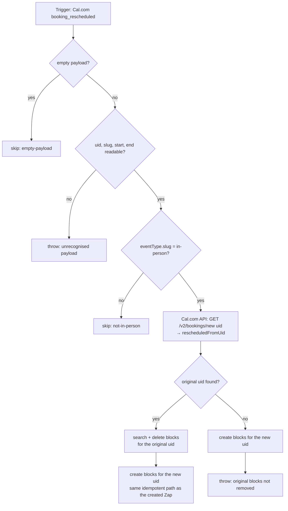

# calcom-booking-rescheduled-to-travel-blocks

When a Cal.com **in-person** booking (slug `in-person`) is rescheduled, delete the original booking's travel blocks on `dennis@work.flowers` and create fresh ones for the new time. The block format, the shared helpers (keep them byte-identical across all three files) and the maintainer notes are in [`calcom-booking-created-to-travel-blocks`](../calcom-booking-created-to-travel-blocks/).

## Where the original uid comes from

A Cal.com reschedule mints a **new** booking uid. Zapier's `booking_rescheduled` payload carries **only that new uid**. On a real reschedule on 2026-10-20 there was no `rescheduleUid`, `fromReschedule` or `rescheduledFromUid` field anywhere in it, and the old uid appeared nowhere in the payload. No `booking_cancelled` fires for the original booking either.

The Cal.com API does carry the link. `GET /v2/bookings/{new uid}` (`cal-api-version: 2024-08-13`) returns `rescheduledFromUid`, so this Zap reads it with `sdk.fetch` on the `calcom` connection. That call goes through Zapier's Relay and costs one task.

## Maintainer notes

- **No original uid means a red run, after the new blocks exist.** The new booking is covered, but the original's blocks may still be standing, so the run fails loudly rather than skipping. Delete the stale blocks by hand: search the calendar for `cal-booking-uid`.
- If a reschedule moves the booking to a *different* event type, the slug check skips it and the original blocks stay. Cal.com's normal reschedule flow keeps the event type, so this isn't handled.
- Task cost per in-person reschedule: 1 API read + 2 searches + 2 deletes + 2 creates. Any other event type: 0.

## Verified cases (run-durable pre-publish, then live, 2026-10-20)

| Case | Result |
| --- | --- |
| Real `booking_rescheduled` payload (new uid `4LBY…`, moved 13:00 → 14:00 SGT) | API returned `rescheduledFromUid: 4xUh…`; both original blocks deleted; new blocks `13:15–14:00` and `15:00–15:45+08:00` created |
| **Live (2026-10-20):** `tjvF…` rescheduled to 23 Oct 15:00–16:00 SGT (new uid `n7jU…`) | Old blocks deleted; new blocks `14:15–15:00` and `16:00–16:45+08:00` created |
