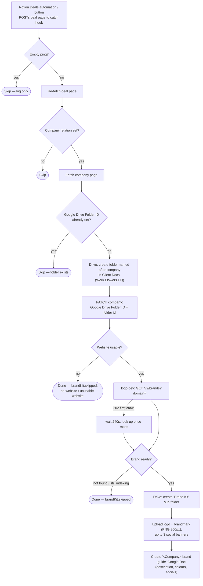

# deal-to-client-drive-folder

Deal webhook from Notion → create the client's Google Drive folder (named
after the company) under **Client Docs** in the Work.Flowers HQ shared drive,
write the folder id back to the Company, then save the client's **brand kit**
from [Logo.dev](https://logo.dev) into a `Brand Kit` sub-folder.

Migration of the classic Zap **"Create Google Drive Folder from Notion"**.
Supersedes the never-deployed
[`deal-won-set-up-client-workspace`](../deal-won-set-up-client-workspace/).

- **Workflow ID:** `019feb0a-9bff-7eed-9854-1759e13c9921` (account-visible)
- **Trigger:** Webhooks by Zapier catch hook —
  `https://hooks.zapier.com/hooks/catch/20495893/CpCVkwCvMa719a7BM/`
- **Editor:** <https://zapier.com/durables-editor/019feb0a-9bff-7eed-9854-1759e13c9921>

## Workflow

## Brand kit

Added 2026-10-19. After the client folder is created **and its id written
back**, the Zap looks the company's `Website` host up in the Logo.dev Brand API
and fills a `Brand Kit` sub-folder with:

| File | Source |
| --- | --- |
| `<Company> logo.png` | `logo` — square logo, re-requested as PNG at 800px (the asset URL serves JPEG by default, and 800px is Logo.dev's cap) |
| `<Company> brandmark.png` | `brandmark` — wordmark, same treatment. Logo.dev does not serve SVG downloads even when the source is vector |
| `<Company> social banner[ n].png` | up to 3 `social_banners` |
| `<Company> brand guide` (Google Doc) | name, description, colours (hex + rgb), social links, index date |

- **Only on the folder-creating path.** A company whose folder already exists
  is skipped at the guard as before, so existing clients get no kit, and a
  re-trigger never adds one.
- **Missing data is an outcome, not an error.** No `Website`, a `Website`
  that isn't a hostname, or a domain Logo.dev doesn't know returns
  `brandKit.skipped` and the run stays green — plenty of small clients aren't
  indexed. A first-ever lookup answers `202` while Logo.dev crawls; the Zap
  waits 240s (Logo.dev says a crawl settles within 300s) and asks once more.
- **A real API error throws** (bad key, plan gate, 5xx, a Drive failure). The
  client folder is already created and recorded by then, so the guard holds
  and no duplicate folder can result — but the kit then has to be added by
  hand, because a re-trigger stops at the folder guard.
- Asset URLs are signed and expire ~24h after the lookup, which is why the
  files are copied into Drive rather than linked.
- Lookups pass `nosubscribe=true`, so no Logo.dev webhook subscription is
  created per client.

## What changed vs the classic Zap

- **The idempotence guard reads the Notion page, not [Table] Company IDs** —
  the Table is a mirror of this same property (fed by
  [`notion-companies-to-zapier-table`](../notion-companies-to-zapier-table/)),
  so the page is fresher and already in hand. The find-or-create table row is
  gone; the mirror materialises it.
- **No write to the `Google Drive Folder` url property** — it is now a formula
  on Companies rendering the URL from `Google Drive Folder ID`.
- Empty-ping skip per repo convention (the classic Zap filtered on a rollup
  being non-empty, which also silently swallowed malformed events; a payload
  with content but no page id now throws).

## Testing

`run-durable` on 2026-08-10 (guard path, no side effects): deal
`9ca1f339-617f-4e08-946b-7bb00a475fa9` (Tannin Road) → fetched deal + company,
returned `skipped: folder-already-exists` with the live folder id. The Drive
`folder` action inputs (`drive`, `folder`, `title`) are field-verified against
the live connection; watch the first live run after cutover.

## Cutover

**Complete as of 2026-08-10.** The Notion Deals sender was repointed to the
`webhook_url` above and the classic Zap **"Create Google Drive Folder from
Notion"** was disabled — confirmed by Dennis. Not machine-verifiable: classic
Zap and Notion automation config are exposed by neither the SDK CLI nor the
MCP connector.

## Maintainer notes

- Connections: `notion_wf` = work.flowers Notion
  (`02b73654-15c8-85c3-b16a-07304d2beb17`), `gdrive_wf` =
  `02eb8724-3fc7-8edc-9b30-be83af0b327f` (dennis@work.flowers), `logo_dev` =
  `0275391e-224b-8f76-a809-f38843d3bf2e` — an *API by Zapier* connection
  holding the Logo.dev **secret** key (`sk_…`) as `Authorization: Bearer`,
  domain-filtered to `api.logo.dev`. The publishable key that
  [`notion-review-to-company-logo`](../notion-review-to-company-logo/) embeds
  only works on `img.logo.dev` and cannot read brand profiles.
- Fixed Drive targets are constants in [workflow.ts](workflow.ts): shared
  drive `0AHY_MJFjT0WtUk9PVA`, parent folder
  `109hgE0VmTpTFTGUXreEYCNf8xu-jSnc2`.
