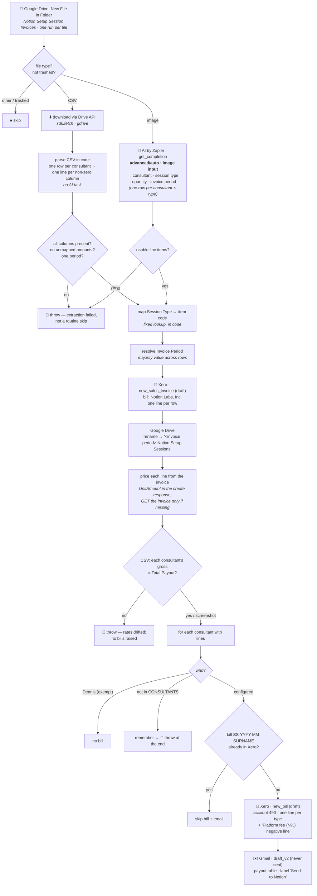

# Drive Screenshot → Xero Sales Invoice

Durable workflow (trigger **`read`** — "New File in Folder" — `GoogleDriveCLIAPI@1.22.0`) that turns
a monthly "Notion Setup Sessions" activity report — **a screenshot or the Notion CSV export** — into
a **draft sales invoice** billing Notion Labs, Inc., then one **draft bill per consultant** for their
share, with a **Gmail draft** telling them what they'll be paid. Migrated from the classic Zap *"Generate Setup
Session Invoice"*. (The directory name predates CSV support; it is kept because renaming a deployed
Zap's directory buys nothing.)

> **Invoices, bills and emails are always drafts.** Nothing here approves, sends, or pays anything.
> Dennis reviews the invoice and the bills together in Xero, and sends each payout email himself.

## What it does

1. **Trigger** — Google Drive *New File in Folder* on **Notion Setup Session Invoices**, one run per
   file.
2. **File gate** (plain code, no task cost) — a CSV (`text/csv` or a `.csv` name) takes the CSV
   path, an image takes the screenshot path, and anything else, or anything in the trash, is
   skipped. Widened from the classic Zap's "Image Only" filter.
3. **Get the line items** — one row per consultant/session-type combination, with quantity and the
   invoice period (the reporting period's last day):
   - **CSV → parsed in code, no AI task.** The file is downloaded through the Drive API (`sdk.fetch`
     on the `gdrive` connection) and parsed deterministically. See [CSV input](#csv-input).
   - **Screenshot → AI by Zapier.** The image goes to `get_completion` (`advanced/auto`, built-in
     credentials). Prompt:
     [`drive-screenshot-to-xero-sales-invoice-prompt.md`](drive-screenshot-to-xero-sales-invoice-prompt.md).
4. **Map session type → Xero item code** — a fixed lookup table, in code, ported from the classic
   Zap's Formatter "Lookup Table" step. See [Item codes](#item-codes).
5. **Resolve the invoice period** — every row on one screenshot reports the same month, so the
   majority value across rows becomes the invoice's `date`. Ported from the classic Zap's
   Formatter "Line-item to Text" step.
6. **Create the draft sales invoice** — Xero `new_sales_invoice`, billing **Notion Labs, Inc.**, one
   line per consultant/session-type row.
7. **Rename** — the screenshot becomes `<invoice period> Notion Setup Sessions`; a CSV becomes
   `<invoice period> Notion Setup Sessions.csv`.
8. **Consultant bills** — one draft Xero bill per configured consultant, priced from the invoice
   just created, less the platform fee, plus a Gmail draft with the breakdown. See
   [Consultant bills](#consultant-bills).



## CSV input

The CSV is Notion's export of the monthly payouts view (file name like
`Sep 1 - 30 2026 <hash>.csv`), **one row per consultant** with one column per session type:

| CSV column | Session Type | Item code |
| --- | --- | --- |
| `Calls Completed` | Calls Completed | `NOTION-CALL` |
| `No Shows` | No-Shows | `NOTION-NOSHOW` |
| `Late Cancellations` | Late Cancellations | `NOTION-CANCEL` |
| `Workspace Conversions` | Workspace Conversions | `NOTION-UPGRADE` |
| `Seats Added` | Seats Added | `NOTION-SEATS` |

- **Consultant name** is the `Name` column with its trailing reporting-month suffix removed:
  `Ernest Choo (WF) (Sep 2026)` → `Ernest Choo (WF)`, matching how names have always appeared on
  these invoices.
- **Invoice period** is the end date of `TIMEFRAME` (`Sep 1 - 30 2026` → `2026-09-30`), falling back
  to the file name when a cell is blank.
- **Each non-zero column becomes one line.** Empty or zero columns are skipped, as on the screenshot
  path.
- **Parsing is deterministic, so a surprise throws instead of being guessed at.** The run fails
  if an expected column is missing (the export changed shape), if rows report different periods,
  or if **`AE Assist Calls Completed` or `Custom Adjustment Amount` is non-zero**. Neither has a
  Xero item code yet, and dropping them would under-bill silently. When one fires, invoice that
  month by hand, or add the item code to `SESSION_TYPE_BY_CSV_COLUMN` in `workflow.ts`.
- **`Total Payout` is a cross-check, not an input.** Its sum is logged and returned as
  `csvTotalPayout`. The invoice is priced by Xero's item prices ($30 call / conversion / seat,
  $10 no-show / late cancellation), and for September 2026 those gave US$830, the same as the CSV.
  A mismatch on review means the item prices and Notion's payout rates have drifted apart.
- **Upload one or the other, not both.** A CSV and a screenshot for the same month are two files,
  so they produce two runs and two draft invoices.

## Consultant bills

Added 2026-11-24 (TKT-1075). Consultants who run setup sessions under workFlowers' PartnerStack
account no longer invoice us each month: the payouts report already says what they did, so this
run drafts their bill for them (self-billing).

- **Who gets a bill** is `CONSULTANTS` in `workflow.ts`, keyed by the lower-cased name as it
  appears after `stripPeriodSuffix`. Each entry holds the Xero contact name and id, the platform
  fee in whole percent, the email, and the surname for the bill number.

  | Consultant | Xero contact | Fee | Email | Bill number |
  | --- | --- | --- | --- | --- |
  | Nasri Nasir | `e2e623af-408b-4d11-941b-a015ef031f0e` | 10% | nasri@work.flowers | `SS-YYYY-MM-NASIR` |

- **Dennis Chiuten is exempt** (`BILL_EXEMPT`): he is the PartnerStack payee. Rows with no
  non-zero sessions (e.g. `Ernest Choo (WF)`, a former consultant) produce no lines, so no bill.
- **A consultant with billable lines who is in neither list fails the run**, but only after the
  invoice and every other bill are done, so nothing else is held up and nobody goes unpaid quietly.
  Add them to `CONSULTANTS`, then raise that bill by hand or replay.
- **Rates come from Xero's items, via the invoice.** The `new_sales_invoice` response carries each
  line's resolved `UnitAmount` (`LineItems.LineItem[]`), matched back on the line description
  `{name} - {type} (Month Ending …)`. If a price is missing the run GETs the invoice; if it's still
  missing it throws. There is no second rate card to drift.
- **CSV cross-check:** on the CSV path, each consultant's gross must equal their row's
  `Total Payout`, or the run throws before raising any bill (Notion's rates and Xero's item prices
  have drifted apart). The screenshot path has no payout figure to check against.
- **The bill:** draft, USD, dated the period end, due the last day of the following month, account
  **490** on every line, tax `NONE` / `NoTax`, `unit_amount` passed explicitly and no item codes.
  One line per session type, worded like the consultant's past invoices
  (`Notion Setup Sessions — Completed (Oct 2026)`, `Bonuses — Seat bonuses (Oct 2026)`), then
  `Platform fee (10%)` at −10% of gross, rounded to the cent. October 2026: US$900 gross −
  US$90 = **US$810**, the same as Nasri's own NIT-19.
- **No duplicates:** before creating, the run searches Xero for a bill with that number
  (`Type=="ACCPAY" AND InvoiceNumber=="SS-…"`, ignoring deleted and voided ones). If one exists it
  skips the bill **and** the email. Deleting a bill in Xero therefore lets a replay raise it again.
  The sales invoice has no such check: a second file for the same month still creates a second
  draft invoice (see [CSV input](#csv-input)).
- **Wrong contact guard:** `new_bill` binds the contact by name (it has no contact id input). If the
  created bill's `Contact.ContactID` isn't the configured one, Xero made a new contact. The run then
  skips the email and throws at the end, so the bill can be moved by hand.
- **The email** is a Gmail **draft** (`draft_v2`, never sent) from dennis@work.flowers to the
  consultant: subject `Notion Setup Sessions payout — Oct 2026`, an HTML table of sessions ×
  rate, gross, fee and net, saying it replaces their invoice and is paid when Notion's PartnerStack
  payout lands. It is created with the **Send to Notion** label (`Label_10`), so Notion's email
  sync agent files it in the Emails database.
- **Paying stays manual** (pay-when-paid, once Notion's PartnerStack payout includes their share).

**Tested live 2026-11-24** with `run-durable`, replaying the real October 2026 CSV (Drive file
`1Cco8POKHiqtXZ7LsKN1HAy0is7cQN9aj`):

| Run | Result |
| --- | --- |
| 1 | Draft invoice US$1,060 (same 7 lines as INV-0099); draft bill `SS-2026-10-NASIR` on Nasri's existing contact `e2e623af…`, 4 session lines + `Platform fee (10%)` −US$90 = **US$810** (matches NIT-19), account 490, due 2026-11-30; one Gmail draft to Nasri labelled Send to Notion; no bill for Dennis or Ernest |
| 2 | Same file again: `existing-bill-skipped`, no second bill or email (a second draft invoice, as documented) |
| 3 | After deleting the bill: raised again, with the HTML email (run 1's padded plain-text table had its spacing collapsed, hence the switch) |

No Emails page appeared in Notion from either labelled draft within ~10 minutes, so the email sync
looks like it picks the thread up once sent, not as a draft. Every test invoice (INV-0101..0103),
both test bills and both Gmail drafts were deleted afterwards. **Not yet tested: a screenshot
run.**

## Cost

About one run a month (one report per month; two if both a screenshot and a CSV go in).

| Path | Tasks |
| --- | --- |
| CSV, invoice + rename | 3 (Drive download, invoice, rename) |
| Screenshot, invoice + rename | 2 + AI by Zapier at `advanced/auto` (3×) |
| Per billed consultant | +3 (find bill, create bill, Gmail draft) |
| Per consultant whose bill already exists | +1 (find bill) |
| Invoice response without unit prices | +1 (read the invoice back) |
| Skip (wrong file type, trashed, empty) | 0 |

With Nasri as the only consultant, a CSV month costs 6 tasks.

## Item codes

Ported verbatim from the classic Zap's Formatter "Lookup Table" step (`util.lookup`):

| Session Type | Xero item code |
| --- | --- |
| Calls Completed | `NOTION-CALL` |
| No-Shows | `NOTION-NOSHOW` |
| Late Cancellations | `NOTION-CANCEL` |
| Workspace Conversions | `NOTION-UPGRADE` |
| Seats Added | `NOTION-SEATS` |
| Referral Bonuses | `NOTION-REFERRAL` |

A line whose Session Type doesn't match one of these six (or whose quantity is empty or ≤ 0, per
the classic Zap's own instruction) is silently dropped from the invoice rather than raised as an
error — the AI's category output is already constrained to this exact enum via `options_Session
Type`, so this is a defensive backstop, not the expected path.

## Invoice details

| Field | Value | Note |
| --- | --- | --- |
| Organisation | `62699a8c-3351-40e8-9265-bdca5e037b03` | work.flowers — same Xero tenant as [`drive-invoice-to-xero`](../drive-invoice-to-xero/) |
| Contact | `Notion Labs, Inc.` | Fixed literal, not read off the screenshot — no vendor-spelling drift for Xero's by-name match to trip over |
| Status | `draft` | Never auto-approved or sent |
| Currency | `USD` | |
| Branding theme | `742441f1-81a7-498b-9f8b-bc685bb0183c` ("USD Payments") | Verified live against the org |
| Account code | `460` ("Affiliate / Referral Income") | Verified live against the chart of accounts |
| Tax type | `NONE` ("No Tax") | Verified live |
| Reference | `PO #8900` | Fixed, per Dennis — the classic Zap held this in a Zap Component variable whose value the exported Zap JSON didn't carry, so it couldn't be recovered from the migration source and was supplied directly |

## AI model

**`advanced/auto`, not the repo's default `standard/auto`.** Flagged and tested before publishing,
per the repo's AI-tier convention — never silently upgraded.

A/B'd against three real screenshots already in the Drive folder (2026-04-30, 2026-05-31,
2026-06-30), each run at both tiers:

| Screenshot | `standard/auto` | `advanced/auto` |
| --- | --- | --- |
| 2026-04-30 | 12 lines | 12 lines — **identical** |
| 2026-05-31 | 8 lines | 8 lines — **identical** |
| 2026-06-30 | **9 lines** | **10 lines** |

On 2026-06-30, `standard/auto` silently dropped a real row — **Ernest Choo, Calls Completed: 2** —
that `advanced/auto` caught both times it was run. Reproduced on a second `standard/auto` run of the
same screenshot (still 9 lines, still missing Ernest Choo's Calls Completed row), so this isn't a
one-off flake. `advanced/auto` agreed with itself and with `standard/auto` on the other two screenshots.

A dropped line here is under-billed revenue with no error anywhere — the invoice would simply have
been short one line item, silently. That is the exact failure mode the repo's AI-tier convention
exists to catch before it ships, so the tier is `advanced/auto` despite the extra task cost.
Re-run this comparison (offline, via `run-action`, against real screenshots — not by running the
durable) before ever considering a downgrade.

## Determinism

The only calendar arithmetic is the consultant bill's due date (`lastDayOfNextMonth`: next
month, wrapping the year, then `daysInMonth`), done in integers. The AI already returns the
reporting month's last day, so unlike [`drive-invoice-to-xero`](../drive-invoice-to-xero/) there's
no `daysFromCivil` / `isoDateFromEpochMs` pair needed. `toIsoDate` still exists, purely to validate the AI's date string
is a real calendar date via integer math (`daysInMonth`) before it reaches Xero — because the
durable runtime's `Date` guard rejects even a deterministic `new Date(Date.UTC(...))` in the
workflow body (see that Zap's README for the production incident this caused). `Date` is not
referenced anywhere in `workflow.ts`.

## Publishing

Published directly (no draft — brand-new workflow, nothing to publish past):

```bash
zapier-sdk --experimental publish-workflow-version 019fd190-ba8f-73be-a6c0-555cc4c79f68 "$SOURCE_FILES" \
  --dependencies '{"@zapier/zapier-sdk":"0.94.0","zod":"4.4.3"}' \
  --zapier-durable-version '0.12.3' \
  --connections '{"gdrive":{"connectionId":"02eb8724-3fc7-8edc-9b30-be83af0b327f"},"xero_wf":{"connectionId":"02336808-1736-878b-a0a8-87e02bb0aec3"}}' \
  --trigger '{"selected_api":"GoogleDriveCLIAPI@1.22.0","action":"file_in_folder_v2","authentication_id":"02eb8724-3fc7-8edc-9b30-be83af0b327f","params":{"drive":"0AHY_MJFjT0WtUk9PVA","folder":"1ptd7K3cVnDG_FZWjq3xxPmKKnbizbJfM","includeDeleted":"false","includeSubfolders":false}}' \
  --enabled \
  --json
```

- **Gate every publish on `npm run build`.** Publishing does not typecheck.
- **No catch URL.** Polling trigger; cutover was just disabling the classic Zap (done by Dennis
  before this migration started).
- **Tested with a real screenshot before publishing**, not a skip-path payload — see
  [AI model](#ai-model) and [Maintainer notes](#maintainer-notes). The first `run-durable` attempt
  hit the rename bug below and created a real draft invoice (`a773938c-…`); the second, after the
  fix, created another (`0cda0de5-…`) and completed cleanly — 10 lines, invoice period
  `2026-06-30`, `periodUnanimous: true`, renamed to match the file's already-correct name. **Both
  test invoices were deleted from Xero** (`update_sales_invoice` with `invoice_status: "deleted"`,
  confirmed via a raw `GET`) before this was reported done — production runs start with a clean
  ledger.
- **Verified after publish:** `get-workflow` shows `enabled: true`, `triggers[0].status: "active"`,
  `is_private: false`.

## Maintainer notes

- **The publish-time analyzer misreads `line_items`.** It treats the fieldset's children as flat
  required inputs and refuses `new_sales_invoice` / `new_bill` with "leaves required input
  'Quantity' (`line_quantity`) unset" even when every entry sets it (seen 2026-11-24; a literal
  one-element array fails too). Both calls therefore pass `line_items` through a spread
  (`...{ line_items: … }`), which makes the analyzer skip the required-field check, as it does for
  `expense-claim-to-xero-bill`. Don't "tidy" the spread away. The same refusal would hit
  [`drive-invoice-to-xero`](../drive-invoice-to-xero/) on its next republish.
- **Two consultants with the same `billSurname` would collide** on step ids and bill numbers. Give
  the second one a distinct surname string (e.g. `NASIR-A`).

- **`update_file_name`'s `file` input wants the plain Drive file ID, not the AI step's hydrate
  token.** The trigger payload's `file` field is a hydrate reference meant for content-fetching
  actions (the AI step's image input) — passing that same token to `update_file_name` 404s
  (`"Error 404 (Not Found)!!1"`). Use `file.id` there, exactly like `drive-invoice-to-xero`'s rename
  step. Caught live during pre-publish testing, not in code review — `tsc` has no way to know a
  `string` field wants one specific string shape over another.
- **`new_sales_invoice` has no `contact_id` field** — same shape as `new_bill` on the bill side.
  `contact_name` is the only handle it offers. Unlike `drive-invoice-to-xero`'s vendor problem, this
  is safe here because `CONTACT_NAME` is a fixed constant, never text read off a document — every
  run sends the exact same literal, so there's no spelling variance for Xero's by-name match to
  fork into a duplicate contact.
- **`line_items` is a nested fieldset of objects**, not five parallel top-level arrays — confirmed
  live via `list-action-input-fields XeroCLIAPI write new_sales_invoice`. Each object carries its
  own `line_item_code`, `line_description`, `line_quantity`, `line_account_code`, `line_tax_type`,
  `line_items_type`. This differs from how the classic Zap's UI expressed it (one flat field per
  key, each bound to an `items[]`-prefixed array reference) but resolves to the same wire shape.
- **The Drive connection is bound twice** — on the trigger (which polls the folder) *and* as the
  `gdrive` alias, because the code renames the file. Both are the same connection id
  (`02eb8724-3fc7-8edc-9b30-be83af0b327f`), same as `drive-invoice-to-xero` and
  `drive-paid-receipts-to-table`.
- **Tested against a real screenshot before publishing**, not the empty-payload skip path — the
  2026-06-30 file already in the folder, via `run-durable`. That test genuinely creates a draft Xero
  invoice and (harmlessly, since the file was already correctly named) attempts a no-op rename.
- **A polling trigger consumes a file once.** A run that fails is not retried and the trigger will
  not re-deliver that file, so a fix has to be paired with a manual replay — re-fire the workflow
  with the failed run's original trigger payload (the `file` hydrate reference stays valid for
  hours afterward, per `drive-invoice-to-xero`'s experience).
- **No vendor-contact resolution needed.** `drive-invoice-to-xero` had to resolve vendor names
  against the real Xero contact list because vendor spelling comes off a scanned document; this Zap
  bills one fixed contact with a fixed literal name, so that whole problem doesn't apply here.
