# Enrich Contact Records

Durable replacement for the "Enrich Contact Records" parent Zap and its
"[Sub-Zap] Update Contact Record" sub-Zap. The sub-Zap is collapsed into an
inline function (`updateContactRecord`) — no separate Durable needed.

**Enrichment sources: HarvestAPI first, Apollo as the fallback** (since
2026-11-03; BetterContact was the fallback from 2026-10-07). HarvestAPI is
tried whenever the contact has a LinkedIn URL; Apollo covers everything it
cannot — and when Apollo finds a LinkedIn URL the contact lacked, HarvestAPI
is asked again with it. See [Sources](#sources) and
[Back to Apollo](#back-to-apollo-2026-11-03).

## What it does

1. **Trigger** — Notion webhook on the Contacts DB (same `hook_v2` trigger as
   the original Zap): a database automation on page creation and on edits to
   the `Linkedin` property, plus an "Enrich" button automation. An **empty
   ping** (pasting the catch URL into a Notion automation and hitting "test",
   opening it in a browser, curling it) is skipped with a log line instead of
   throwing, per the repo-wide rule — a payload with content but no page id
   still throws, loudly. (Added 2026-08-10.)
2. **Skip our own echo** — a run fired by this workflow's own `Linkedin`
   write is skipped before any lookup. See [Loop guard](#loop-guard).
   (Added 2026-11-03.)
3. **Extract the contact** — first name, last name, LinkedIn URL, Primary and
   Secondary emails, and the company domain. When the `First Name` / `Last
   Name` properties are empty, the name is parsed from the page **title**
   instead (auto-created contacts often carry the person's name only there); a
   title that is just an email address is not treated as a name. (Added
   2026-07-27, TKT-811.) Neither is the Contacts template's own default title,
   "New Contact" (`isPlaceholderTitle`, 2026-10-20): on 2026-09-28 a contact
   created without a name was sent to BetterContact as *New Contact* at
   du.edu, which answered with a guessed `new.contact@du.edu` that was then
   written to the contact and indexed.

   **Domain** comes from the `Domain` rollup on the linked Company page, taking
   the **first entry that is a real corporate host** — the rollup often carries
   several URLs and consumer domains leak in from loosely-linked companies.
   When the rollup is empty or unusable, the domain falls back to the **Primary
   Email's own host** (skipped for freemail addresses, which name no
   employer). (Added 2026-07-28.) The domain is both an Apollo match input and
   the strongest corroboration signal for what Apollo returns.

   **The name sent to Apollo is a rendering** (`matchName`): a parenthesised
   alternate-script aside is dropped (`Alice SY Peng (彭思瑀)` → Alice Peng),
   and so are initials in a name split from the title. The contact's own name
   is what gets written back.
4. **Enrich via HarvestAPI** — only when the `Linkedin` property is set.
   `find_profile` (search) is called with the URL (non-ASCII runs
   percent-encoded), `findEmail: "true"` and `skipSmtp: "false"`, and answers
   **synchronously** (usually 6–25 s) with the profile: name, `currentJobTitle`, `about`,
   parsed city + country, the current employer's website, and `emails[]`. An
   address is written only when HarvestAPI marks it `deliverable: true` and
   `status: "valid"`. An unknown URL returns an empty result, not an error.
   Errors are caught inside the step and become a reason. A lookup killed by
   Zapier's **30 s action limit is retried once** first; see
   [The 30-second action limit](#the-30-second-action-limit). (Added 2026-10-15.)
   **If this produced a verified address, Apollo is not called.**
5. **Fallback: enrich via Apollo** — when HarvestAPI was not tried, found no
   profile, errored, or found the profile **without** a verified address. One
   synchronous `POST /api/v1/people/match` with every identifier the contact
   holds (Primary Email, LinkedIn URL, rendered name, domain;
   `reveal_personal_emails` and `reveal_phone_number` off). The match is then
   [corroborated](#identity-corroboration) against the CRM; an
   **uncorroborated match loses its LinkedIn URL and photo on the spot**.
   - HarvestAPI found the profile but no address → HarvestAPI's profile is
     kept and only Apollo's address is taken, judged on **Apollo's** record.
   - **Handoff:** the contact had **no** LinkedIn URL and Apollo's
     corroborated match carries one → HarvestAPI `find_profile` is called with
     that URL, and its profile wins (it reads LinkedIn better than Apollo
     does). Its address, or else Apollo's, is written. If HarvestAPI finds
     nothing, Apollo's data stands.
   - Otherwise Apollo's match is the enrichment.
   - Apollo's address is written only with `email_status: "verified"`; the
     `email_not_unlocked@…` placeholder of a credit-locked record is no
     address. A non-2xx (out of credits, rate limit) is a reason in the
     comment, not a failed run.
6. **Update contact** — Inline function that replaces the sub-Zap:
   - **Corroborate the enriched address first** (Path U): an enriched email that
     cannot be tied to this contact is **not written anywhere** — not Primary,
     not Secondary, not the Table — and is named in the outcome comment instead.
     The other properties still update. See [Identity
     corroboration](#identity-corroboration). (Added 2026-08-12.)
   - **Same or no prior email** (Path D): sets Primary Email to the enriched
     email; leaves Secondary Email untouched.
   - **Work address over a consumer mailbox** (Path G-promote): when the existing
     Primary Email is on a **freemail** domain and the enriched address is not,
     the enriched (work) address takes Primary and the personal one moves to
     Secondary. See [Email paths](#email-paths).
   - **New/different email** (Path G): keeps the existing Primary Email, adds
     the enriched email to Secondary Email.
   - **`Linkedin` is written only on a real change** — a contact with no
     profile URL gets the found one; one whose URL HarvestAPI resolved to a
     different slug (a renamed profile) gets the current one; the same slug
     spelled differently is left alone; an Apollo URL never replaces one the
     contact holds. See [Loop guard](#loop-guard).
   - **Page icon and cover from the profile photo** (Path C): HarvestAPI's
     `photo`, else a corroborated Apollo match's `photo_url`, is imported once
     (`file_uploads` `external_url`) and set as both icon and cover.
     LinkedIn's placeholder silhouette is filtered, and a photo that fails to
     import is named in the comment, never failing the run. See [Path C:
     profile photo → page icon and cover](#path-c-profile-photo--page-icon-and-cover).
   - **Index the email in the email→contact Zapier Table**
     (`01JYEPSEARXB2Z6BJRCMFGXBC2`): whenever a new email lands on the contact
     (Path G secondary, or a first-ever primary via Path D), upsert-if-missing a
     row (`Email` → `Page ID`, `Type` Secondary/Primary, `Trigger Contact
     Creation: false`). The Luma guest workflows resolve contacts through this
     Table — an email on a contact but missing from the Table produces a
     **duplicate contact** when that person registers with it (bug observed
     2026-07-24). Best-effort: a Table error logs and never fails the run.
     **Path U never reaches this step.**
   - Properties the source does not return are written as `""`, which the
     Notion action treats as **no change** — a contact keeps whatever it
     already has. Bio comes from HarvestAPI's LinkedIn "about", or Apollo's
     role descriptions / headline (capped at 2,000 characters).
   - **Names only fill blanks.** A HarvestAPI name is LinkedIn's *display*
     name, which people decorate (`Jane Doe, MBA`, `Jane Doe 🚀`), and an
     Apollo name may belong to a fuzzy match, so neither replaces a first or
     last name the contact already has.
7. **Add outcome comment** — Posts a brief comment on the triggering Notion
   page stating the outcome. A transient Notion failure (429, 409, 5xx) is
   retried by the step; a definite rejection is reported in the run output as
   `commentPosted: false` — see [The outcome comment retries transient
   failures](#the-outcome-comment-retries-transient-failures). The comment
   names the source (**HarvestAPI**, **Apollo**, `HarvestAPI (LinkedIn profile
   found by Apollo)`, `HarvestAPI (email via Apollo)`), what changed (incl.
   `LinkedIn URL`), and **why** each earlier source fell short — e.g.
   `(HarvestAPI: no profile found)`, `Apollo: found x@y.com but its status is
   unverified; not written`, or on a skip `Enrichment skipped — Apollo: skipped
   — no email, LinkedIn URL or first + last name to match on.` A Path U run
   names the uncorroborated address: `Email grace@leaps.sg NOT written — … Add
   it by hand if it is really theirs.`

   The comment **mentions nobody**. It used to @mention the payload's acting
   user, falling back to the page's last editor / creator — often Notion's
   system user or an integration bot, which makes Notion reject the whole
   comment (`400 Cannot mention bots`). That lost the comment on 18 of 45 runs
   from 2026-09-22 to 2026-10-02; the mention was removed on 2026-10-03.
8. **Return** — `{ pageId, enriched, source, emailPath }` (plus `emailSource`
   when the address came from a different source than the profile,
   `linkedinViaApollo` on a handoff, `linkedinWritten`), plus
   `unverifiedEmail` and `identity` on a Path U run, and `reasons` on a skip.
   An echo run returns `{ skipped: "own-write-echo", pageId }`.

## Workflow

```mermaid
flowchart TD
    A["Webhook: Contacts DB automation<br/>(page added / Linkedin edited)<br/>or Enrich button (hook_v2)"] --> P{"Empty ping?<br/>(URL test, browser hit, curl)"}
    P -- yes --> PS(["Log and skip<br/>(no error raised)"])
    P -- no --> B["Extract contact page<br/>(name falls back to page title;<br/>domain falls back to email host)"]
    B --> EC{"Echo of our own write?<br/>not a button press, last edit by<br/>our Notion bot within 5 min<br/>of Last Enriched"}
    EC -- yes --> ECS(["Log and skip<br/>(no lookup, no comment)"])
    EC -- no --> L{"LinkedIn URL set?"}
    L -- yes --> H["HarvestAPI find_profile<br/>(sync, findEmail on;<br/>one retry on the 30s timeout)"]
    H -- "profile + deliverable,<br/>valid email" --> E
    H -- "profile, no verified email<br/>(kept; email from Apollo)" --> AP
    H -- "no profile / error" --> AP
    L -- no --> AP
    AP["Apollo people/match<br/>(email, LinkedIn URL,<br/>rendered name, domain)"]
    AP -- "no match / error / skipped" --> D{"HarvestAPI profile?"}
    D -- yes --> E
    D -- no --> DX(["Comment the reasons, return"])
    AP -- "match" --> CO{"Apollo match corroborated?<br/>shared address · LinkedIn slug ·<br/>known company domain"}
    CO -- "no" --> STRIP["Drop its LinkedIn URL + photo;<br/>its address → Path U"]
    STRIP --> E
    CO -- "yes" --> HO{"Contact had no LinkedIn URL<br/>and Apollo found one?"}
    HO -- "no" --> E
    HO -- "yes (handoff)" --> H2["HarvestAPI find_profile<br/>with Apollo's URL"]
    H2 -- "profile (its address,<br/>else Apollo's)" --> E
    H2 -- "no profile / error" --> E
    E{"Enriched email corroborated?<br/>shared address · contact's LinkedIn ·<br/>known company domain ·<br/>HarvestAPI on the contact's own URL ·<br/>handoff vouched by Apollo's match"}
    E -- "no (Path U)" --> U["Write NO email anywhere —<br/>no Primary, no Secondary, no Table row.<br/>Other properties still update;<br/>address named in the comment"]
    E -- "yes" --> EP{"Enriched email vs existing<br/>Primary Email?"}
    EP -- "same or no prior email (Path D)" --> F["Set Primary Email<br/>to enriched email"]
    EP -- "different, and Primary is freemail<br/>while enriched is corporate<br/>(Path G-promote)" --> GP["Enriched work address → Primary,<br/>personal address → Secondary"]
    EP -- "new/different email (Path G)" --> G["Keep Primary Email, add enriched<br/>email to Secondary Email"]
    F --> LW
    GP --> LW
    G --> LW
    U --> LW
    LW["Write Linkedin only if the<br/>profile slug changed"] --> J
    J{"Profile photo?<br/>(placeholder filtered)"}
    J -- yes --> IC["Path C: import into Notion<br/>(file_uploads external_url),<br/>set as page icon + cover"]
    J -- no --> JC
    IC --> JC
    JC["Post outcome comment on the page<br/>(no @mention)"]
    JC --> K(["Return pageId, enriched, source, emailPath, iconUpdated"])
```



## Sources

| Situation | What happens |
|---|---|
| LinkedIn URL; HarvestAPI profile **with** a `deliverable` + `valid` address | written; **Apollo not called** |
| LinkedIn URL; HarvestAPI profile, address unverified or none | Apollo asked; HarvestAPI's profile fields kept, Apollo's fill only blanks; Apollo's address written only if **Apollo's own record** is corroborated |
| LinkedIn URL; HarvestAPI no profile or an error | Apollo's match is the enrichment; its LinkedIn URL never replaces the contact's |
| **No** LinkedIn URL; Apollo's corroborated match carries one | **handoff:** HarvestAPI with that URL; its profile wins, its address or else Apollo's is written, and the URL is written to `Linkedin` |
| No LinkedIn URL; handoff finds nothing | Apollo's data, URL included |
| No LinkedIn URL; Apollo match **not** corroborated | no handoff; its URL and photo dropped; its address → Path U; title/city/country/bio still written |

**Select values never carry a comma.** Notion rejects a `select` option
containing one, and the rejection fails the whole contact update. HarvestAPI's
`location.parsed.country` uses ISO names, so the first live HarvestAPI run
(2026-10-07, `Korea, Republic of`) failed all five attempts of
`update-contact-record`. ISO forms are now mapped to the common names the
`Country` select already holds (`COUNTRY_ALIASES`: `Korea, Republic of` →
`South Korea`, `Viet Nam` → `Vietnam`, …), for Apollo's `country` too, and
`selectOption` drops any remaining comma from Country and City before writing.
A country that lands as a new option is worth adding to `COUNTRY_ALIASES` if
it duplicates an existing one.

**Verified live 2026-10-07 (HarvestAPI):** `find_profile` on a public profile
returned the row in ~17 s with `emails[0]` = `{ deliverable: true, status:
"valid", … }`; a non-existent URL returned `data: []`; a throwaway
`run-durable` bound the `harvestapi` connection (a *private* connection, owned
by Dennis) and ran the lookup from the durable sandbox.

**Verified live 2026-11-03 (Apollo):** `people/match` for Dennis Chiuten @
work.flowers through the `apollo-api` connection returned `person` with
`email_status: "verified"`, `organization.primary_domain`, `city`/`country`,
`match_confidence`, and `linkedin_url: null` (a record with no URL is
normal). A throwaway `run-durable` binding the connection as `apollo` made the
same call from the durable sandbox (`200`, verified address). One credit per
match.

### The 30-second action limit

Zapier kills any single app action at **30 s**, and `find_profile` with the
SMTP check does not always fit: it took 6–25 s on most runs but hit the limit
on 2 of the 5 timed between 2026-10-07 and 2026-10-14 (Alan Liang 2026-10-08,
Meighan O'Toole 2026-10-14). The error reads `Action execution failed:
RequestId: … Error: Task timed out after 30.00 seconds`. When Alan Liang's run
was re-triggered a minute after its timeout, the same lookup answered in ~6 s,
evidently from HarvestAPI's cache.

So `isActionTimeout` matches **that message only**, and the step calls
`find_profile` once more, inside the same `ctx.step`. A second timeout, or any
other error, falls through to Apollo. The lookup is a read, so a repeat cannot
double-write. Both HarvestAPI calls (the first lookup and the handoff) share
`findHarvestProfile`, and so this retry.

## Loop guard

Added 2026-11-03. The Contacts automation fires this workflow when `Linkedin`
is edited, and this workflow writes `Linkedin`, so its own write can fire it
again. **That was already happening before Apollo:** a person pasting
`linkedin.com/in/x` got HarvestAPI's `https://www.linkedin.com/in/x` written
back, the automation fired, and a second full run (a second HarvestAPI lookup,
a second outcome comment) followed seconds later — 12 contacts between
2026-10-24 and 2026-11-02. The handoff would make it the normal case, since it
writes a URL onto a contact that had none.

Two layers:

1. **Write only a real change.** `Linkedin` is written only when the found
   profile's `/in/<slug>` differs from the contact's (`linkedinToWrite`), so
   the respelling above no longer writes anything and most runs never fire
   the automation.
2. **Skip the echo.** A run is the echo of our own write when all hold:
   - the payload's `source` has no `user_id` — a button press carries one, the
     property automation does not, so an explicit request is never skipped;
   - `data.last_edited_time` is 0–5 minutes after `Last Enriched` (both in
     the payload; minute precision, one minute of slack);
   - `data.last_edited_by` is this Notion connection's own bot — `GET
     /v1/users/me`, read only when the first two hold (`142d872b-…`, the
     "Zapier" bot, on 2026-11-03).

   The echo returns `{ skipped: "own-write-echo" }` with a log line and no
   comment. The run that wrote the URL already did everything the echo would
   (the handoff runs in-run), so nothing is lost. A person correcting the URL
   afterwards is the last editor, so their edit still runs. A failed
   `users/me` read fails open: the run proceeds.

What every observed echo looked like (2026-11-02, phoebekee): run 1 by a
person at 02:23 with `…/in/phoebekee/`, run 2 at 02:24 with `last_edited_by` =
`142d872b-…`, `last_edited_time` 02:24, `Last Enriched` 02:24, URL
`https://www.linkedin.com/in/phoebekee`.

## Back to Apollo (2026-11-03)

Apollo `people/match` was the primary source until 2026-09-18 (out of credits
from 2026-08-12), when BetterContact replaced the Apollo → Lusha → NinjaPear
cascade; HarvestAPI became the first source on 2026-10-07 with BetterContact as
its fallback. On 2026-11-03 Apollo replaced BetterContact as the fallback.

Gained:

- **One synchronous call.** BetterContact's async job — `ctx.createCallback`,
  a 10-minute park, a `get_contact` polling fallback and the `on_hold`
  out-of-credits state — is gone.
- **A LinkedIn URL for contacts that had none**, which is what makes the
  HarvestAPI handoff possible, and Apollo matches on an email or a LinkedIn URL
  alone, so contacts without name + domain are no longer skipped outright.
- **Bio and photo** from Apollo when HarvestAPI is not involved.
- **No HTTP-header name problem.** BetterContact's Zapier integration put the
  name in a header, so non-Latin names had to be folded or refused
  (2026-10-01, `Alice SY Peng (彭思瑀)`); Apollo takes a JSON body.

Given up or changed:

- **Apollo is fuzzy.** BetterContact's lookup was gated on name + domain, so
  its results were exempt from corroboration; Apollo's are not — it was
  Apollo's name-only match that caused the
  [Grace Tang collision](#what-went-wrong). Every Apollo match must show
  evidence in its own record, and an uncorroborated one keeps no address, no
  LinkedIn URL, no photo and triggers no handoff.
- **Verification.** BetterContact wrote `deliverable` and `catch_all_safe`;
  Apollo writes only `email_status: verified`.
- **Credits.** Apollo charges per match revealed; BetterContact only per
  deliverable address.

The BetterContact implementation (callback, polling, header-safe names) is in
this directory's git history up to version `01a15936`.

**Which Apollo connection.** Two exist. The native `ApolloCLIAPI` connection
(`02be390b-…`, "Zapier Master Key's Account") has no enrichment action in its
catalog — the previous Apollo code reached `people/match` through its hidden
`_zap_raw_request` "API Request (Beta)" action. The *API by Zapier* connection
(`02b3ee04-…`, `apollo-api`) carries the master key as a header for
`sdk.fetch`, the same pattern as the `typesafe` connection, so that one is
bound.

## Path C: profile photo → page icon and cover

Live 2026-08-12 → 2026-09-18 (Apollo / NinjaPear photos, icon **and** cover),
removed when no source returned photos, and back on **2026-10-07** with
HarvestAPI's `photo`, again as **icon and cover** (briefly icon-only on
2026-10-07 until asked for the cover too). The code was restored from the
removed version with the same guards; the lessons that shaped it:

- **Upload, never link.** Enrichment photo URLs were signed, time-limited
  LinkedIn CDN links (`…?e=<unix-expiry>&t=<sig>`). Setting them as an
  `{type:"external"}` icon left the page with an icon and cover that rendered
  as blank white space once the link expired — 210 of 962 contacts by the
  2026-08-12 audit. The fix was `POST /v1/file_uploads {mode:"external_url"}`
  → poll until `uploaded` → `PATCH /v1/pages/{id}` with `file_upload` for both
  icon and cover (one upload backs both). `filename` is required in that mode.
  Re-verified 2026-10-07 with a HarvestAPI photo URL: imported as a 57 KB
  `image/jpeg`, `uploaded` within seconds.
- **The durable cannot download the bytes itself.** A bare `fetch` fails for
  every host and `sdk.fetch` with a connection is domain-filtered to that app;
  `sdk.fetch` with **no connection** is the escape hatch. `external_url` makes
  Notion probe with `HEAD` first, which LinkedIn answers and presigned-for-GET
  S3 links (eSignatures) do not — hence the opposite choice in
  [`esignatures-status-to-notion`](../esignatures-status-to-notion/).
- **Filter LinkedIn's placeholder silhouette.** A profile with no photo came
  back as `https://static.licdn.com/aero-v1/sc/h/9c8pery4andzj6ohjkjp54ma2`, a
  489-byte SVG, not `null`; 7 of 43 runs put a picture of nobody on the page.
  Guard by host (`static.licdn.com`) at extraction, and by content after import
  (reject SVG or anything under 1 KB via the upload's `content_type` /
  `content_length`).
- **Never fail the run over a photo.** Catch the import inside the step and
  report it in the outcome comment; leave only the Notion PATCH to throw.
- **Every enrichment overwrites the icon and cover** when a real photo comes
  back, replacing the Contacts default-template icon and any existing cover
  (an older photo, a Clay banner). Contacts whose icon or cover is one of the
  210 expired `external` links from the 2026-08-12
  audit are repaired the next time they are enriched with a LinkedIn URL.

## The outcome comment retries transient failures

The comment is the **last Notion call of every run**. When the Contacts
automation enriches new pages in a batch, several runs fire within a second
and the comment is the call most exposed to `429 rate_limited`, `409
conflict_error` and the odd 5xx. Until 2026-09-03 any failure was logged and
swallowed — two bursts on 2026-09-02 lost 3 of 4 and 3 of 5 comments with green
runs. Now a **transient** status (408, 409, 429, 5xx) or network error
**throws**, so the durable's step retry (5 attempts, ~155 s of backoff) posts it
again; the record updates are memoised steps, so only the comment re-posts. A
**definite** rejection (400, 403 missing *Insert comments*, 404) returns
`posted: false` and the run output carries `commentPosted: false` with
`commentError`.

## Identity corroboration

**Added 2026-08-12.** An enriched email is the one field this workflow writes that
carries **identity**. It lands in `Primary Email` or `Secondary Email`, and from
there into `CONTACT_EMAIL_TABLE` — which is how the
[Luma guest workflows](../luma-guest-registered-to-event-attendance/) decide *who
a registration belongs to*. An address written here **defines** the contact for
every other Zap.

### What went wrong

Two different Grace Tangs ended up as one contact (diagnosed 2026-08-12). The
then-primary source, Apollo `people/match`, is **fuzzy** and matched a
subcontractor with a personal Gmail Primary, no Company relation and no LinkedIn
URL to *a different Grace Tang* at an unrelated company. Path G-promote did
exactly what it was written to do; the stranger's address became the contact's
Primary and was indexed into the Table, and from then on her Luma
registrations, a company page, 25 email threads and a signed agreement all
attached to the wrong contact. **Nothing errored at any point.**

### The bar

Before an enriched address is written, the match must be corroborated against
something the CRM already knows. Any one of these clears it:

| Signal | Evidence |
|---|---|
| **Shared address** | the returned record carries an address already on the contact (Primary or any Secondary), compared case-insensitively |
| **LinkedIn** | the returned profile URL and the contact's reduce to the same `/in/<slug>` |
| **Company domain** | the enriched address's host, or the record's employer domain, equals the `Domain` the CRM already holds |
| **Keyed lookup** | **HarvestAPI** looked up the contact's **own** LinkedIn URL, so the record returned is this contact (the backstop for a renamed slug) |
| **Vouched handoff** | HarvestAPI looked up a URL Apollo found, and Apollo's match cleared one of the rows above; the comment names which |

**Apollo gets no exemption** — it was the source behind the Grace Tang
collision, so its match must show evidence in its own record. The address is
always judged on the record it came from: when HarvestAPI found the profile and
Apollo the address, Apollo's record has to vouch for it, even though the
HarvestAPI profile beside it is right. The keyed-lookup row needs the contact
to *hold* a URL, so a handoff lookup on an Apollo-found URL cannot take it; it
carries Apollo's corroboration explicitly instead (`EnrichedData.identity`).

**Corroboration also gates Apollo's LinkedIn URL and photo.** A URL on the
contact is identity too — it keys every later HarvestAPI lookup and satisfies
the LinkedIn row above — so an uncorroborated Apollo match keeps neither, and
no handoff runs. In the Grace case that is the difference between one wrong
address named in a comment and a wrong LinkedIn URL that would have vouched
for the stranger forever after.

**The known false negative:** a contact on a personal mailbox with no Company
and no LinkedIn URL whom Apollo matched genuinely by that personal address.
Apollo is called with `reveal_personal_emails: false`, so the address we sent
usually is not echoed back and the match reads as uncorroborated. That costs an
enrichment — visibly, in the comment — rather than silently writing a
stranger's identity.

An uncorroborated address goes nowhere — not Primary, not Secondary, not the
Table (**Path U**) — and is named in the outcome comment for a person to judge.
Title, city, country and bio are still written: those carry no identity downstream.

### Side effect on `emailPath`

`noPriorEmail` requires an enriched address to exist. A run where the contact
has no Primary **and** the source returned no email reports
`emailPath: "no-new-email"` rather than `"same-or-no-prior"`.

## Email paths

Which slot an enriched address lands in depends on what the contact already has —
**after** it clears its source's verification and
[identity corroboration](#identity-corroboration):

| Existing `Primary Email` | Enriched address | Result | Path |
|---|---|---|---|
| — | not verified (Apollo `unverified` / `extrapolated` / …, HarvestAPI not `deliverable`+`valid`) | **nothing written; comment names the address and status** | — |
| — | **uncorroborated** | **nothing written; comment names the address** | **U** |
| empty, or the same address (**compared case-insensitively**) | corporate or consumer | enriched → Primary | D |
| **freemail** (`gmail.com`, `hotmail.co.uk`, `outlook.*`, `yahoo.*`, `icloud.com`, …) | **corporate** | **enriched → Primary, personal → Secondary** | **G-promote** |
| already corporate | corporate | Primary untouched, enriched → Secondary | G |
| freemail | also freemail | Primary untouched, enriched → Secondary | G |

**Why G-promote exists (added 2026-07-26).** Path G originally covered every
"different email" case, so a contact who signed up with a personal address kept
it in `Primary Email` while the real work address was buried in `Secondary
Email` — inverted on ~26 contacts, and the opposite of the rule the
[Luma guest workflows](../luma-guest-registered-to-event-attendance#work-email--primary-email)
apply to a `Work Email` registration answer.

**Why it's narrow.** An enriched address is a *guess*, so it must never overwrite
a `Primary Email` someone chose deliberately. A consumer mailbox in Primary is a
signup artefact, which is the one case where the guess is reliably better.

**Addresses compare case-insensitively (added 2026-07-27).** Both write paths run
their Secondary list through `dedupeAddresses` and drop anything matching the
Primary, so an address appears at most once and never in both slots; the Path G
filter also strips a redundant Primary an earlier run left behind.

Freemail detection is a domain list (`FREEMAIL_EXACT` plus `FREEMAIL_PREFIXES`
for families with many country TLDs). To cover a domain the list misses, add it
to `FREEMAIL_EXACT`.

The address G-promote **demotes** needs no new Table row: it was this contact's
Primary, so it already resolves. Its row keeps `Type: "Primary"` and goes
stale, which is harmless — lookups match on `Email` only.

## Connections

| Alias | App key | Connection | Connection id |
|---|---|---|---|
| `notion_wf` | `NotionCLIAPI` | `work.flowers \| Dennis` | `02b73654-15c8-85c3-b16a-07304d2beb17` |
| `harvestapi` | `App242893CLIAPI` (HarvestAPI, `@1.0.0`) | `HarvestAPI (Standard)` (private) | `0252e8c9-0045-8728-ac09-cec85dadbc13` |
| `apollo` | `App235435CLIAPI` (API by Zapier) | `apollo-api` | `02b3ee04-e9e5-88ba-929d-5fc5f76b65b1` |

> ⚠️ **Notion connection:** `notion_wf` **must** be the `work.flowers | Dennis`
> connection (`02b73654-…`) — it's the one with the Contacts DB shared. Do **not**
> bind the `Knoxx | Dennis #2` connection (`02b95b31-…`); that's the Knoxx Foods
> *client* workspace and the write-back fails with `Could not find data_source …
> shared with your integration "Zapier"`. See the root `CLAUDE.md`.
>
> Rebinding `notion_wf` changes the bot that writes the page, which is fine:
> the loop guard reads the bot id live from `GET /v1/users/me` rather than
> hardcoding it.

The Notion connection must have the **Insert comments** capability enabled so
the workflow can post outcome comments on the triggering page.

**HarvestAPI action surface** (`list-actions App242893CLIAPI`): `search
find_profile` (inputs `url`, `findEmail`, `skipSmtp`; booleans as the strings
`"true"` / `"false"`) and one trigger, `new_received_connection`, unused here.

## Trigger configuration

```json
{
  "selected_api": "WebHookCLIAPI@1.1.1",
  "action": "hook_v2",
  "authentication_id": null,
  "params": {}
}
```

Two Notion database automations on the Contacts DB send to the catch URL: the
property automation (page added / `Linkedin` edited; its `source` carries no
`user_id`) and the Enrich button (`source.user_id` = the person who pressed
it). The trigger payload has the shape `{ source, data: { id, properties,
last_edited_by, last_edited_time, … } }`.

## Test

Offline: [`names.test.mjs`](names.test.mjs) (`npm test`; no Zapier calls)
covers name rendering, the payload extraction, and the whole workflow body
against fake HarvestAPI, Apollo and Notion: source order, the merge judged on
Apollo's record, the handoff (profile + address, profile only, nothing found),
the Grace-shaped uncorroborated match (no handoff, no URL, no photo, Path U),
Apollo's unverified/locked addresses and HTTP errors, the `Linkedin`
write-only-on-change rule, and the loop guard (echo skipped; another bot, a
button press, a late edit and a person's correction all run).

Live:

```bash
SOURCE_FILES="$(jq -n --rawfile workflow workflow.ts '{"workflow.ts": $workflow}')"

zapier-sdk --stability experimental run-durable "$SOURCE_FILES" \
  --dependencies '{"@zapier/zapier-sdk":"0.79.0","zod":"4.4.3"}' \
  --zapier-durable-version '0.6.1' \
  --connections '{"notion_wf":{"connectionId":"<notion-conn-id>"},"harvestapi":{"connectionId":"<harvestapi-conn-id>"},"apollo":{"connectionId":"<apollo-conn-id>"}}' \
  --input '{"data":{"id":"<contact-page-id>","properties":{"First Name":{"rich_text":[{"plain_text":"Test"}]},"Last Name":{"rich_text":[{"plain_text":"User"}]},"Domain":{"rollup":{"array":[{"url":"https://example.com"}]}}}}}' \
  --private
```

A run against a real page **writes to that contact** and spends a HarvestAPI
lookup (when it has a LinkedIn URL, or on a handoff) and an Apollo credit per
match. Use a page you own.

## Deploy

Publishing goes through the merge pipeline (see the repo rules). For reference,
the direct publish shape is:

```bash
zapier-sdk --stability experimental publish-workflow-version <workflow-id> "$SOURCE_FILES" \
  --dependencies '{"@zapier/zapier-sdk":"0.79.0","zod":"4.4.3"}' \
  --zapier-durable-version '0.6.1' \
  --connections '{"notion_wf":{"connectionId":"<notion-conn-id>"},"harvestapi":{"connectionId":"<harvestapi-conn-id>"},"apollo":{"connectionId":"<apollo-conn-id>"}}' \
  --trigger '{"selected_api":"WebHookCLIAPI@1.1.1","action":"hook_v2","authentication_id":null,"params":{}}' \
  --enabled --json
```

**Connection bindings changed on 2026-11-03** (`bettercontact` dropped,
`apollo` added). The publisher reconciles the bindings `zap.json` declares
against the deployed version and publishes the declared set when they differ,
logging the change in the run summary.

## Architectural changes vs the original Zaps

- **HarvestAPI, then Apollo, in-run** — the original Zap used NinjaPear as its
  sole synchronous source; a later cascade added Apollo and Lusha. This
  Durable asks HarvestAPI synchronously when there is a LinkedIn URL, otherwise
  (or for a missing address) Apollo, and hands an Apollo-found URL back to
  HarvestAPI.
- **No sub-Zap** — the sub-Zap's four-path branching logic (Path D / G / C / E)
  collapses into a single inline function with if/else blocks.
- **No retry** — the original parent Zap retried enrichment after a 1-minute
  delay on error. This Durable logs and skips instead.
- **Page icon and cover, uploaded** — the sub-Zap's Path C icon/cover update
  was carried over, removed on 2026-09-18 when no photo source remained, and
  restored on 2026-10-07, uploaded to Notion rather than linked.
- **Outcome comment** — after every run, a brief comment on the triggering page
  (no @mention since 2026-10-03). Transient Notion failures are
  retried, not swallowed.
- **Loop guard** — the workflow recognises the echo of its own `Linkedin`
  write and skips it (2026-11-03).

## References

- `exported-zap-2026-07-22T01_26_39.602Z.json` — original parent Zap (Enrich Contact Records).
- `exported-zap-2026-07-22T01_26_44.566Z.json` — original sub-Zap (Update Contact Record).
- Apollo People Enrichment: <https://docs.apollo.io/reference/people-enrichment>.
