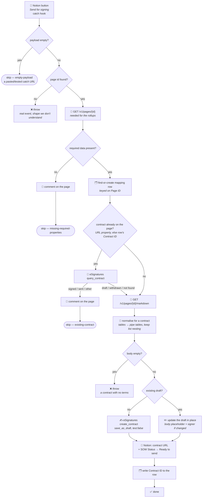

# esignatures-send-for-signing

A Notion **Send for signing** button turns a SOW or Project Addendum page into an eSignatures
draft contract, using the page's own body as the contract text.

**Status:** ✅ Enabled and live — both Notion buttons were repointed to these durables on
2026-08-04, so this is the code that runs when someone clicks **Send for signing**. Replaces the
classic **Send SOW for Signing** and **Send Project Addendum for Signing** Zaps. Two follow-ups
remain, neither affecting behaviour — see [Cutover](#cutover).

**Durable ×2.** One shared [`shared.ts`](shared.ts) deployed twice:

| Deployment | Entry file | Data source |
| --- | --- | --- |
| `sow-send-for-signing` | [`workflow.sow.ts`](workflow.sow.ts) | SOWs |
| `project-addendum-send-for-signing` | [`workflow.addendum.ts`](workflow.addendum.ts) | Project Addendums |

The two flows differ only in configuration, so they share one code path and one config table rather
than being two near-identical workflows that drift apart. **Republish both together** whenever
`shared.ts` changes.

Each entry file calls `defineDurable` itself, with its deployment name as a **string literal**, and
delegates the whole body to `runSendForSigning(ctx, kind, rawInput)` in `shared.ts`. Don't fold that
back into a factory in `shared.ts`: Zapier's publish-time analyzer only looks for `defineDurable` in
the file published as `/workflow.ts`, so a `defineSendForSigning(kind)` factory — the shape these
deployments were first published with on 2026-08-04 — is refused with `missing-define-durable`.
Same fix as [`esignatures-status-to-notion`](../esignatures-status-to-notion/).

## Workflow

### Per-kind configuration

| | `sow` | `addendum` |
| --- | --- | --- |
| Data source | `SOWs` | `Project Addendums` |
| Contract URL property | `eSignature contract` | `eSignatures Contract` |
| Status set on draft | `Ready to send` | none — left as it is |
| Title | `Agreement Name` | `[Project Addendum] ` + `SOW Name` rollup |
| Signer name | `Signatory Name` rollup | `Consultant` person's name |
| Signer email | `Override Email (Optional)` ?? `Signatory Primary Email` rollup | `Consultant` person's email |
| Validation | a signatory email (either source) | `Consultant` **and** `Client SOW` both set |
| eSignatures template | `6eaa0583…` "Scope of Work" | `443d6bed…` "Consultant Project Addendum" |

Note the property names genuinely differ in case and number — `eSignature contract` (singular,
lowercase c) versus `eSignatures Contract` (plural, capital C). A mismatch fails silently, so they
live in one config table rather than being typed out at each call site.

**Drafting is not sending.** Until 2026-11-25 this Zap set `Sent for signature` / `Sent for signing`
and moved the SOW's Deal to `In signing` the moment the *draft* was created, which was carried over
from the classic Zap. But a draft is often exported as a PDF for the client to review before
anyone sends it, so the page claimed a send that had not happened. Now a SOW goes to `Ready to send`
(an existing option), and a Project Addendum's Status is left alone, since its data source has no
pre-send option. The "sent" status and the Deal's `In signing` are both written by
[`esignatures-status-to-notion`](../esignatures-status-to-notion/) when eSignatures reports the
contract actually went to the signer.

## Trigger

Each deployment has a catch hook. **The URL a Notion button must POST to is the
`hooks.zapier.com/hooks/catch/…` one**, which lives at `triggers[0].details.webhook_url` — *not*
the top-level `trigger_url`, which is Zapier-internal and needs a JWT.

| Deployment | Catch URL for the Notion button |
| --- | --- |
| `sow-send-for-signing` | `https://hooks.zapier.com/hooks/catch/20495893/CU1FC7PIztrRJjZzu/` |
| `project-addendum-send-for-signing` | `https://hooks.zapier.com/hooks/catch/20495893/ASihmbdguE4cPXFb/` |

An empty payload **skips** rather than raising: these URLs get pasted into Notion button
properties and "tested" long before they are used properly, and every one of those touches
delivers `{"querystring":{}}`.

## Three things worth knowing before touching this

**The classic Zap's page-to-markdown step cannot be ported.** It used `ae:577300`, a hidden Zapier
*action extension*, which `runAction` refuses outright (`ZAPIER_RESOURCE_NOT_FOUND_ERROR`). The
replacement is Notion's own `GET /v1/pages/{id}/markdown`, which is also more faithful than the
Zapier `block_children` converter that extension wrapped.

**The markdown normaliser earns its keep on tables and nested lists.** It is adapted from
[`notion-newsletter-to-buttondown`](../notion-newsletter-to-buttondown/)'s `notionMarkdownToEmail`,
but agreements are table-heavy in a way newsletters are not, and two bugs surfaced in testing that
would have mangled every real contract:

- Notion exports tables as `<table><tr><td>` HTML. The inherited block-separation pass put a blank
  line between every tag, shredding each table into fragments. They are now converted to Markdown
  pipe tables, so rendering does not depend on eSignatures passing raw HTML through.
- Notion indents nested list items with tabs, and the inherited tab-strip removed them all —
  **promoting a sub-clause to a clause**, which changes what the agreement says. Tabs on list items
  now become the 4 spaces Markdown wants; tabs directly under a blockquote carry the `> ` prefix
  down so a callout's body stays in its callout.

**`test` must be set explicitly.** On `App236843CLIAPI`'s `create_contract`, `test` is a *required*
field whose own default is `"true"`. Leaving it out would make every run produce a throwaway test
contract. `save_as_draft: true` is also deliberate — nothing reaches a signer until a human sends
the draft.

## Clicking Send for signing again

Since 2026-11-25, a second click updates the existing contract instead of always drafting a new
one. Before that, every click created a fresh draft and repointed the page and the mapping row at
it, leaving the old contract orphaned in eSignatures. If that one had already gone to the signer and
was then signed, the signature never reached Notion.

The existing contract is the one in the page's contract URL property. If that is empty, it is the
mapping row's Contract ID. Its eSignatures status decides what happens:

| Status | What the Zap does |
| --- | --- |
| none on the page | Creates a draft, as before |
| `draft` | **Updates it in place:** the body placeholder gets the page's current body, and the signer's name and email are updated if they changed. The contract id and URL stay the same. |
| `withdrawn`, or the contract no longer exists | Creates a new draft and repoints the page and row at it |
| `signed` | Comments on the page and changes nothing. To send a new version, clear the URL property and click again. |
| anything else, such as out with the signer | Comments on the page, naming the status, and changes nothing. Withdraw it in eSignatures, then click again. |

Facts behind this, probed on the live account on 2026-11-25:

- **A draft cannot be withdrawn or deleted.** `withdraw_contract` answers `contract-status-error:
  Contract is in draft status, not active`, and neither app has a delete action. So replacing a
  draft would always leave one behind, and updating it is the only clean option.
- **A draft's content is still the bare `{{contract-body}}` shell.** The body lives in the
  placeholder's value, so `update_contract_placeholder_fields` with
  `placeholder_fields_markdown_map: {"contract-body": …}` replaces the whole body. Reading it back
  with `query_contract_placeholder_fields` returns exactly what was written.
- **`update_signer` works on a draft.** It needs the signer id, which `query_contract` returns. An
  empty name leaves the current one in place.
- **Neither app can rename a contract.** A changed `Agreement Name` / `SOW Name` leaves the draft's
  old title in place. The run logs it and returns `titleStale: true`.
- **`withdrawn` is assumed, not seen.** No withdrawn contract was available to read, so if
  eSignatures uses a different word, a withdrawn contract falls to the "anything else" row. That
  means a comment instead of a new draft, never a silent replacement.

## Two eSignatures apps, on purpose

| App | Used for | Why |
| --- | --- | --- |
| `App236843CLIAPI` — "eSignatures.com (Unofficial)" | `create_contract` here | The only one whose `create_contract` takes a single `markdown` body plus a placeholder name |
| `EsignaturesioCLIAPI` — public "eSignatures" | triggers, in [`esignatures-status-to-notion`](../esignatures-status-to-notion/); here, `query_contract`, `update_contract_placeholder_fields` and `update_signer` on a resend (connection alias `esign_public`) | Owns `contract_sent_to_signer` / `contract_signed`; the private app has no usable trigger and only one action |

Both point at the same eSignatures account, and template ids are portable between them.

`create_contract` returns a **doubly nested** result —
`{ data: [ { status: "queued", data: { contract: { id } } } ] }`. `runAction` supplies the outer
`data` array and the app's envelope adds a second `data` inside each row; the classic Zap's
`gives[...]["data"]["contract"]["id"]` was addressing that inner one. `extractContractId` checks
both nestings and throws rather than writing a wrong id.

## Fixed on migration

The classic **Send Project Addendum for Signing** Zap generated addenda from the **SOW** template
(`6eaa0583…`), even though a `443d6bed…` "Consultant Project Addendum" template exists. Confirmed
as a bug with Dennis on 2026-08-04 and fixed here. Both shells use the same `{{contract-body}}`
placeholder, so the fix was one constant.

## Verification

Verified 2026-08-04 with `run-durable`. Every real mapped record is a live client agreement, so the
main-path runs used purpose-made scratch records, deleted afterwards.

| Case | Result |
| --- | --- |
| `sow` main path | Draft created. Signer name `Kelvin Tan` from the rollup, email from the override — **override precedence confirmed**. Status `Sent for signature` (now `Ready to send`, see above), 575 chars of body. |
| `addendum` main path | Draft created against the addendum's own template. Title `[Project Addendum] <SOW Name>`, signer from the `Consultant` person, Status `Sent for signing` (no longer written at draft time). |
| Retry idempotency | A re-run after a mid-flow failure returned `tableRowCreated: false` — reused the existing mapping row instead of duplicating it. |
| Empty ping | `{"skipped":"empty-payload"}`, no error raised. |
| Normaliser, real page | The live NUS (LKYSPP) addendum renders with clean pipe tables, its D1–D8 list intact, and the "Variation from standard terms" clause kept inside its blockquote. |
| Types | `npm run build` (tsc, durable 0.12.3 + sdk 0.93.0) | Clean |

Resend handling, verified 2026-11-25 with `run-durable` against a scratch SOW page and a
`test: true` probe draft:

| Case | Result |
| --- | --- |
| Page points at a `draft` | `mode: "updated-draft"`, same contract id. Read back: body placeholder holds the page's new body, signer email changed to the override. `signerUpdated: true`, `titleStale: false`. |
| Page points at a `signed` contract | `{"skipped":"existing-contract","contractStatus":"signed"}`, one page comment, nothing written to eSignatures |
| Status → action, URL → id, query error envelopes | Unit-checked: `contract-not-found` → create new; any other error envelope throws rather than reading as "no contract" |
| Analyzer | `validate-workflow` clean for both entry files |
| Draft status (2026-11-25) | Scratch SOW at `In client review` with a scratch Deal at `Proposal`: after a resend the SOW read `Ready to send` and the Deal was untouched. The status sync's sent phase then set `Sent for signature` and the Deal to `In signing`. |

**Not verified:** the `withdrawn` / not-found → new draft path end to end (it is the unchanged
create path, reached through a unit-checked branch), and that eSignatures' renderer substitutes `{{contract-body}}` exactly as expected —
that needs a human eye on a draft. Open one of the drafts below and check the body rendered.

## Cutover

- [x] Notion **SOWs** → `Send for signing` button repointed to
      `https://hooks.zapier.com/hooks/catch/20495893/CU1FC7PIztrRJjZzu/` — **done 2026-08-04**
- [x] Notion **Project Addendums** → `Send for signing` button repointed to
      `https://hooks.zapier.com/hooks/catch/20495893/ASihmbdguE4cPXFb/` — **done 2026-08-04**
- [ ] Turn off the two classic Zaps once a real signing round has gone through end to end.
- [x] Delete the three test drafts left in eSignatures: `1041daf2-d152-4d21-8084-5dca1e6448b8`,
      `2a875453-37cf-4c8a-a55e-5443f7720187`, `c9738320-214b-44dd-b310-8adba581f1ae` — **gone by
      2026-11-25**: `query_contract` answers `contract-not-found` for all three.

**No double-drafting risk while the classic Zaps stay on.** Each button posts to one URL, so the
classic Zaps' catch URLs now simply never fire — they are dead weight rather than a duplicate. The
one thing that *would* duplicate is a button configured to POST to both the old and new URL, which
would create two contracts per click; worth a glance at the button config if a stray draft ever
appears.

**Still worth a human eye on the first real draft:** that eSignatures substitutes
`{{contract-body}}` as expected is the one thing that could not be verified from here, since the app
exposes no Get-Contract action.

## Maintainer notes

- **`Status` is a `status`-type property and `update_database_item` writes it fine** — confirmed
  with `list-action-input-fields NotionCLIAPI write update_database_item --inputs
  '{"datasource":"…"}'`, which exposes `properties|||Status|||status`. No raw PATCH needed.
- **The page is fetched, not read from the payload**, because the signer lives behind rollups
  (`Signatory Name`, `Signatory Primary Email`, `SOW Name`). Those appear in the data source's
  `notAvailableInQuerySql`, so a SQL-mode query cannot see them.
- The mapping row is claimed **before** the contract is created, so the contract id always has
  somewhere to go. Read and create happen in one `ctx.step` so a retry re-reads rather than
  committing over state a previous attempt already wrote.
- Repo rule 5 (default templates) does not apply — these workflows only update existing pages.
- **2026-09-28: restructured for the publish-time analyzer, no behaviour change.** Probing
  `validate-workflow` with the old entry file plus a factory `shared.ts` returned
  `missing-define-durable`, so the next republish of either deployment would have failed the publish
  job. The entry files now call `defineDurable` with a literal name; every step id is unchanged.
- **Cost.** A first send is unchanged. A resend adds one task for `query_contract`, then on a draft
  one for the body update and one more only when the signer changed. A refused resend costs that read
  plus the page comment.
- Missing data is a **skip with a comment on the page**, not an error. A person has to fix it, and
  an error alert nobody can action is just noise.
