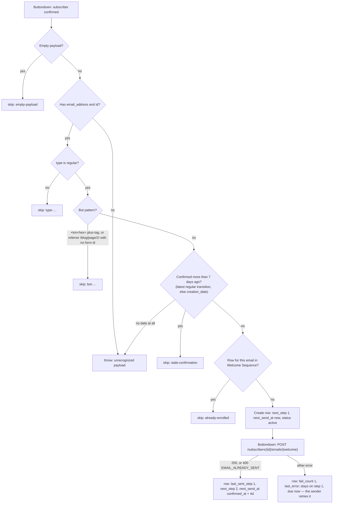

# flow-statements-welcome-enrol

Enrols each newly confirmed Flow Statements subscriber in the five-email welcome sequence. It writes one row to the **Welcome Sequence** Zapier Table and sends the welcome email (step 1) straight away. [`flow-statements-welcome-sender`](../flow-statements-welcome-sender/) sends steps 2–5 from there, once a day. The sender's README covers the sequence itself and the reason it runs as Zaps rather than Buttondown Automations.

**Status: enabled 2026-10-24**, together with the sender.

## Trigger

**Buttondown — New Confirmed Subscriber** (`ButtondownCLIAPI@2.0.9` `confirmedSubscriber`), on the `workflowers` Buttondown connection. It uses the same app version, trigger and connection as [`new-buttondown-subscriber-update-in-notion`](../new-buttondown-subscriber-update-in-notion/), so both Zaps fire on each confirmation. The trigger is *confirmed*, not *created*, because double opt-in keeps unconfirmed bot signups out.

## What it does

- **Insert-only upsert on the lowercased email.** An existing row holds that subscriber's sequence state: they may be mid-sequence, or paused or stopped by hand. A second confirmation therefore never resets it, and no subscriber ever gets a second row. Find-then-create isn't atomic, but the trigger fires once per subscriber, so a duplicate row would need a duplicate event.
- **`confirmed_at` is when this Zap saw the confirmation**, not Buttondown's own timestamp. The trigger has delivered a confirmation weeks late before (a 28 Aug confirmation reached the sibling Zap on 16 Sep). Anchoring on the real date would make the first three steps due at once.
- **The welcome goes out at once (since 2026-10-31).** Until then the hourly sender sent it, within the hour. When the sender moved to daily to save tasks, sending step 1 here kept the welcome immediate. The send uses the same `buttondown_api` connection and the same `EMAIL_ALREADY_SENT`-as-success rule as the sender. If it fails, the run stays green and the row is left on step 1, due now, so the sender's next daily run retries it, with its usual pause and alert after three failures. `WELCOME_EMAIL_ID` and the 4-day step-2 offset are copies of the sender's `SEQUENCE`; change them together.
- **Staleness guard (since 2026-11-23).** A confirmation more than 7 days old is skipped and logged as `stale-confirmation`, never welcomed. The age is taken from the latest `transitions[]` entry of type `regular`, or `creation_date` when there is none (API, import and Zapier signups have no transition). A payload with neither throws. The guard exists for the move from Buttondown app 2.0.4 to 2.0.9: per Buttondown support (2026-11-23), 2.0.4's `confirmedSubscriber` only polled the **oldest 100** subscribers, so newer ones could be missed for good, and 2.0.9 polls newest-first. The first 2.0.9 polls may therefore deliver confirmations the old version never saw. Without the guard, each would get the welcome straight away, weeks or months after they signed up. A real confirmation reaches this Zap within minutes, so 7 days only filters out the backlog. Anyone it skips can be enrolled by hand with a Table row.
- **Bot filter.** The two known list-bombing patterns are skipped and logged: a `+km<hex>` plus-tag, and a `/blog/page/2/` referrer with a null `form_id`.

## Testing (2026-10-23, `run-durable`, live Table)

| Payload | Result |
| --- | --- |
| `{}`, `null`, `""`, `{"querystring":{}}` | `skipped: empty-payload` |
| `{"foo":"bar"}`, `{"data":{"id":""}}` | throws, naming the keys it got |
| `type: unsubscribed` | `skipped: type-unsubscribed` |
| `jane+km3fa9c@gmail.com` | `skipped: bot-plus-tag` |
| referrer `…/blog/page/2/`, `form_id: null` | `skipped: bot-referrer-no-form` |
| Dennis's real subscriber record, `Dennis@work.flowers` | row created, email lowercased |
| same again | `skipped: already-enrolled` |

The staleness guard (2026-11-23) was checked offline: `confirmedAtIso` returns the transition date for an embedded-form signup, `creation_date` for a Zapier-source signup with no transitions (both from real runs), the latest of several `regular` transitions, and an empty string (→ throw) when there is no date at all. Not yet run with `run-durable`.

The test row was deleted afterwards.

## Maintenance notes

- **Unrecognized-payload posture: throw** (repo default).
- **Cost:** one `sdk.fetch` (the welcome send) per enrolled subscriber, so 1 task a run from 2026-12-01. Skipped runs cost nothing: on 2026-11-12 Zapier dropped the planned 1-task floor (per a Zapier PM in the NoCodeOps Discord, not yet on the pricing page): a run that exits without running an app action is free. The Table reads and writes are free.
- The Table id, `WELCOME_EMAIL_ID` and the step-2 offset are also in the sender. Change them together.
