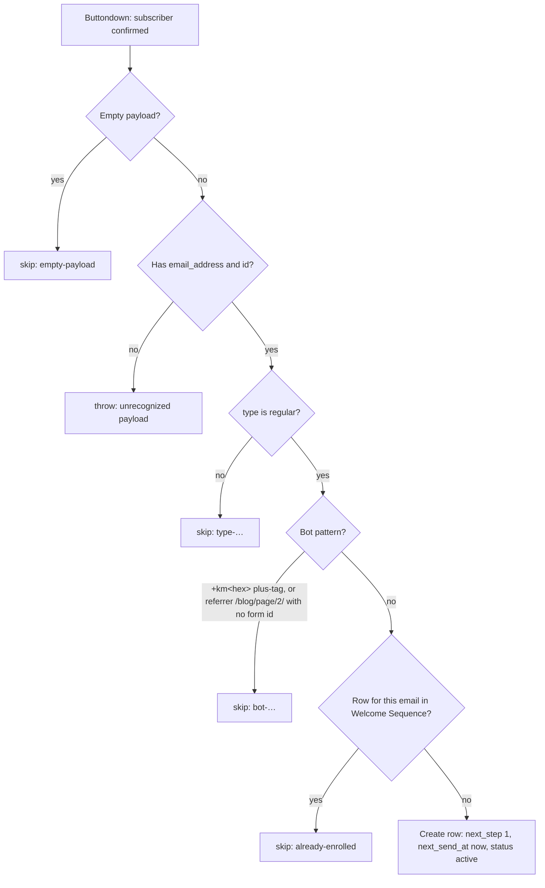

# flow-statements-welcome-enrol

Enrols each newly confirmed Flow Statements subscriber in the five-email welcome sequence. It writes one row to the **Welcome Sequence** Zapier Table, and [`flow-statements-welcome-sender`](../flow-statements-welcome-sender/) sends the emails from there. The sender's README covers the sequence itself and the reason it runs as Zaps rather than Buttondown Automations.

**Status: enabled 2026-10-24**, together with the sender.

## Trigger

**Buttondown — New Confirmed Subscriber** (`ButtondownCLIAPI@2.0.4` `confirmedSubscriber`), on the `workflowers` Buttondown connection. It uses the same app version, trigger and connection as [`new-buttondown-subscriber-update-in-notion`](../new-buttondown-subscriber-update-in-notion/), so both Zaps fire on each confirmation. The trigger is *confirmed*, not *created*, because double opt-in keeps unconfirmed bot signups out.

## What it does

- **Insert-only upsert on the lowercased email.** An existing row holds that subscriber's sequence state: they may be mid-sequence, or paused or stopped by hand. A second confirmation therefore never resets it, and no subscriber ever gets a second row. Find-then-create isn't atomic, but the trigger fires once per subscriber, so a duplicate row would need a duplicate event.
- **`confirmed_at` is when this Zap saw the confirmation**, not Buttondown's own timestamp. The trigger has delivered a confirmation weeks late before (a 28 Aug confirmation reached the sibling Zap on 16 Sep). Anchoring on the real date would make the first three steps due at once.
- **Bot filter.** The two known list-bombing patterns are skipped and logged: a `+km<hex>` plus-tag, and a `/blog/page/2/` referrer with a null `form_id`.

## Testing (2026-10-23, `run-durable`, live Table)

| Payload | Result |
| --- | --- |
| `{}`, `null`, `""`, `{"querystring":{}}` | `skipped: empty-payload` |
| `{"foo":"bar"}`, `{"data":{"id":""}}` | throws, naming the keys it got |
| `type: unsubscribed` | `skipped: type-unsubscribed` |
| `jane+km3fa9c@gmail.com` | `skipped: bot-plus-tag` |
| referrer `…/blog/page/2/`, `form_id: null` | `skipped: bot-referrer-no-form` |
| Dennis's real subscriber record, `Dennis@work.flowers` | row created, email lowercased |
| same again | `skipped: already-enrolled` |

The test row was deleted afterwards.

## Maintenance notes

- **Unrecognized-payload posture: throw** (repo default).
- **Cost:** no app-action tasks. The only steps are a Table read and write, which are free.
- The Table id is also in the sender. Change both together.
