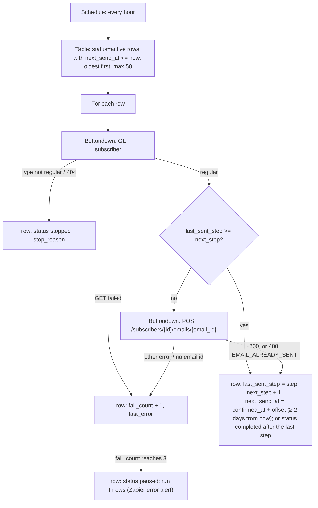

# flow-statements-welcome-sender

Hourly sender for the **Flow Statements welcome sequence**: a welcome email plus four refreshed evergreen posts, sent to each new subscriber over about a month. Buttondown is on the Basic plan, which has no Automations (`/v1/automations` returns a permission error), so the sequence runs as two Zaps. Buttondown still does all the sending, so its unsubscribe link and suppression rules apply to every email.

- [`flow-statements-welcome-enrol`](../flow-statements-welcome-enrol/) adds a row to the **Welcome Sequence** Table when a subscriber confirms.
- This Zap works through that Table every hour and sends whatever is due.

**Status: parked (disabled).** All five emails exist in Buttondown (created 2026-10-24) and their ids are in `SEQUENCE`. What's left is enabling both Zaps; see *Going live*.

## The sequence

| Step | Days after `confirmed_at` | Email | Buttondown id |
| --- | --- | --- | --- |
| 1 | 0 | [Welcome to Flow Statements](emails/01-welcome.md) (new) | `em_7xspe63xkp8qf9cx6tzeyg776c` |
| 2 | 4 | [Five practical WhatsApp automations for small teams](emails/02-whatsapp-automations.md) (refreshed from `em_2ps5r1kk548bvryp1d9dyq560w`) | `em_7n1k088fjy8vjvn8e97ce8f8kw` |
| 3 | 11 | [Why Notion Workers + Dashboards are my New BI Stack](emails/03-notion-workers-bi-stack.md) (from `em_4tsdpj2bjq8xh9tmzma3tnr26m`) | `em_0pyqbbr72298jry887gskf5a1e` |
| 4 | 18 | [How Knoxx Foods Built the Operational Foundations for AI](emails/04-knoxx-foods.md) (from `em_6kppy625nv8cp8nzan86h4fyq2`) | `em_6dtst7n8pp887rwpz2bpy7s1vb` |
| 5 | 25 | [AI Is Writing Faster Than We Can Read](emails/05-ai-writing-faster.md) (from `em_32ng61zqng88na5dmfxe0nhf90`) | `em_0h0nzs4vft99ttxaffpq3s75xk` |

The copy for each email is in [`emails/`](emails/), one Markdown file per step with its subject in the front matter. Buttondown holds the live copy: edit an email there with `PATCH /v1/emails/{id}` (an `imported` email stays editable after it has been sent) and keep the file in step. "I'm Not Vibe-Coding the Next Salesforce" was in the original plan and was dropped on 2026-10-24.

The step map is the `SEQUENCE` constant in `workflow.ts`. **Never point a step at an original sent issue**, even though the endpoint would accept one. Each step needs its own new email, with refreshed copy, a 2–3 line intro and the full body. Each must be created in this order:

1. `POST /v1/emails` with `"status": "draft"`, set explicitly. Never rely on the default status.
2. `PATCH` it to `"status": "imported"`, `"archival_mode": "disabled"`, `"email_type": "private"`.

The send endpoint rejects drafts ("You can't programmatically send emails with status 'draft'"). An `imported` email is never sent to the list, and its body can still be edited with `PATCH` after it has gone out.

## Trigger

**Schedule by Zapier** `everyHour` at `:00`, weekends included. The tick payload is ignored, and the clock is read in a step.

Manual runs (`trigger-workflow <id> --input '…'`) take:

| Input | Effect |
| --- | --- |
| `"dryRun": true` | list what is due and what would happen, write nothing |
| `"only_email": "<address>"` | handle that one row only |
| `"now": "<RFC 3339>"` | treat that instant as the current time, to walk a test row through the sequence without waiting days |

## What it does

- **Offsets are relative to `confirmed_at`**, so a late run doesn't push every later email back. Changing an offset in `SEQUENCE` reschedules everyone still waiting on that step.
- **Catch-up spacing.** A subscriber who fell behind (because the Zap was off, or because sends kept failing) gets their overdue steps at least **2 days apart** (`MIN_GAP_MS`), not one an hour. The scheduled gaps are all 4 days or more, so this only applies when catching up.
- **Repeat sends are impossible.** Buttondown answers a second send of one email to one subscriber with `400 {"detail":"EMAIL_ALREADY_SENT"}` (found during testing). `isAlreadySent` reads that exact error as success. If a send lands but the row update after it fails, the next run gets this answer and advances the row instead of failing three times. The `last_sent_step` guard covers the same case without making the call.
- **Failures are counted, not thrown.** Each per-row step returns its error instead of throwing, so one bad row can't exhaust a step's retries and stop every other row from sending. The row stays on its step and the next hourly run retries it. On the **3rd consecutive failure** the row is set to `paused` and the run throws once, which raises Zapier's error alert (the repo's throw posture). Because the row is paused, the alert doesn't repeat every hour. To resume a row, set `status` back to `active` (and clear `fail_count`, or the next failure re-pauses it immediately).
- **Unsubscribes stop the sequence.** The subscriber is re-fetched before every send. Any `type` other than `regular` (or a 404) stops the row with a `stop_reason`.

## Operating the Table

Table `01M5M4KH7C1KCFD3CDRSAF46XA` (**Welcome Sequence**), one row per subscriber:

| Column | Meaning |
| --- | --- |
| `email` | lowercased; the upsert key |
| `subscriber_id` | Buttondown `sub_…` id, used for every API call |
| `confirmed_at` | when enrol saw the confirmation; the anchor for all offsets |
| `next_step` / `next_send_at` | what goes out next, and when |
| `last_sent_step` / `last_sent_at` | idempotency guard and audit |
| `status` | `active` · `completed` · `stopped` · `paused` |
| `stop_reason`, `fail_count`, `last_error` | why a row stopped or paused |

- **Pause someone:** set `status` to `paused`. **Skip a step:** bump `next_step` (and `next_send_at` if they should get it now). **Stop:** `stopped`.
- **Backfill existing subscribers:** add rows (`next_step` 1, `next_send_at` and `confirmed_at` set to when they should start, `status` active, `last_sent_step` 0). Nothing else is needed. Existing subscribers are not backfilled for now.

## Going live

1. ~~Create the five `imported` emails and put their ids into `SEQUENCE`.~~ Done 2026-10-24.
2. Optionally walk a test row through the real emails with `only_email` + `now`. Each email can only be sent to one subscriber once, so use an address that hasn't had it.
3. `enable-workflow` on this Zap, then on `flow-statements-welcome-enrol`, and update both `zap.json` files and the root README.

## Testing (2026-10-23, `run-durable`, live Table and Buttondown)

The tests ran on the original six-step plan, against a copy of the workflow whose `SEQUENCE` pointed at two private `[TEST]` emails, with step 3 left `null`. They used a test row for dennis@work.flowers.

| Case | Result |
| --- | --- |
| `dryRun` | `would-send` step 1, nothing written |
| step 1, fresh `imported` email | sent (200), row → step 2, due `confirmed_at` + 4d |
| run again straight away | 0 due |
| `now` = +4d1h, email already sent to Dennis | `EMAIL_ALREADY_SENT` read as sent, row → step 3 |
| `now` = +11d1h, step 3 has no id | `failed`, `fail_count` 1, run stays green |
| 3 consecutive failures (before the fix, `EMAIL_ALREADY_SENT` counted as failure) | row `paused`, run threw once |
| step 5 at +31.5d | sent; step 6 due +33.5d (2-day catch-up gap, not +32d) |
| step 6 | `completed` |
| `last_sent_step` ≥ `next_step` | `repaired`: advanced without sending |
| row with a nonexistent `subscriber_id` | `stopped`, `subscriber type missing` |

Both test rows were deleted afterwards. The two `[TEST]` emails (`em_7mpx0k3aqe8rcvgcfr191kfz1v`, `em_7mn8mbfedm8vbsvgwtvxe8kh5r`) are still in Buttondown, waiting for the open checks below.

## Open questions from the build handoff

- Whether per-subscriber sends of `imported` emails record opens and clicks anywhere. Analytics read `null` straight after the send.
- `secondary_id` read `19` straight after each `PATCH` to `imported` (on all five sequence emails on 2026-10-24 too), then `null` on read-back. Still to confirm: that sequence emails don't consume issue numbers for regular sends.
- Delete the `[TEST]` emails once both are settled.

## Maintenance notes

- **Cost:** an idle hour costs nothing beyond the free Table read. Each row handled costs two `sdk.fetch` tasks (the subscriber GET and the send), so about 12 tasks per subscriber over the whole sequence.
- **Concurrency:** runs are hourly and short. Two overlapping runs could both pick up a row, but the second send would get `EMAIL_ALREADY_SENT`, so no one gets an email twice.
- `MAX_ROWS_PER_RUN` (50) bounds a run. If more rows are due, the rest wait an hour.
