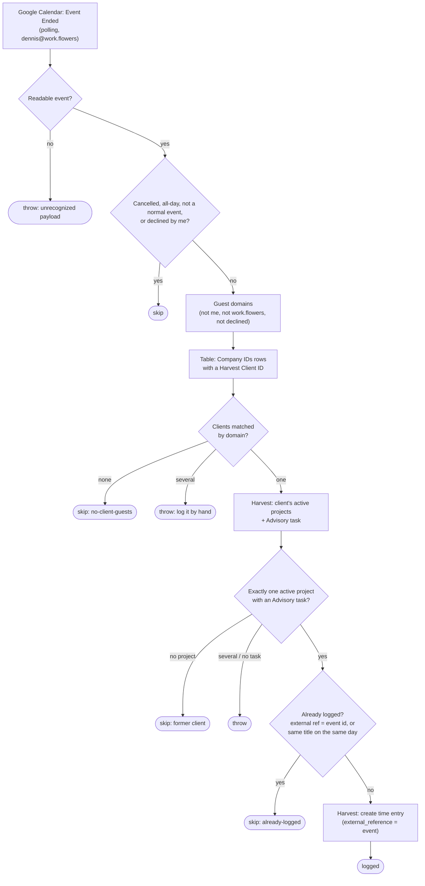

# gcal-client-meeting-to-harvest-time

When a meeting on `dennis@work.flowers` ends, this Zap logs it as a Harvest time entry if one of the guests works for a Harvest client. The entry is filed on that client's active project under the **Advisory** task. Its notes are the event title and its hours are the event's duration, the same as an entry made with Harvest's own "import from calendar".

**Status:** ⏸️ Ships disabled (`enable_on_publish: false`). Enable it with `enable-workflow <id>` once the first live write has been checked (see [Not yet verified](#not-yet-verified)).

## What it does

## Trigger

The trigger is Google Calendar `event_ended_v2` (`GoogleCalendarCLIAPI@1.16.0`) on the `dennis@work.flowers` calendar. It fires once per event instance. Each instance of a recurring meeting has its own id, so the durable polling-dedupe bug described in `CLAUDE.md` does not affect it: an ended event is never "updated". Zapier adds `duration_minutes` to the event, which is what the hours come from.

## How a meeting is matched to a client

The Zap reuses the **Company IDs** Zapier Table (`01JM8PH8YM93A482M8BFZ6WKW6`), which [`notion-companies-to-zapier-table`](../notion-companies-to-zapier-table/) mirrors from Notion Companies. A row with a **Harvest Client ID** counts as a client, and its **Domain** decides who belongs to it. A guest at `sai@knoxxfoods.com` matches the row whose Domain is `https://knoxxfoods.com`, and so do subdomains. To make a client's meetings log, set the Website and Harvest Client ID on the company in Notion. There is nothing to maintain in this repo.

Guests on a personal address (gmail.com and the like) never match, so a client contact who joins from a personal address does not make a meeting loggable.

The project is the client's single **active** Harvest project, read live from the Harvest API, and the task is the one named `Advisory` on that project. Both choices copy how calendar imports were filed by hand on 2026-10-26.

## Dedupe

Harvest's calendar import keeps **no** link to the event: `external_reference` is `null` on those entries, and only the title survives as `notes`. So before creating an entry, the Zap looks for an existing one in two ways:

1. **An entry whose `external_reference.id` is this event's id.** The Zap writes that id on every entry it creates, along with the series id as `group_id` and the event link as `permalink`. This catches replays. The create step checks it again before posting, so a step retry cannot log the meeting twice.
2. **An entry on the same project and day whose notes equal the event title** (case-insensitive). This catches a meeting you already imported by hand.

The reverse case is not covered. If the Zap logs a meeting and you then import the same meeting through the Harvest UI, you get two entries. Once this Zap is enabled, stop importing client meetings by hand.

## Maintainer notes

- **All Harvest calls go through `sdk.fetch` to the v2 API**, using the `harvest_wf` connection. The Zapier Harvest app's *Create Time Entry* action cannot set `external_reference`, and dedupe depends on it.
- **A 4xx from Harvest on create fails the run immediately** with Harvest's message. It is returned out of the step rather than thrown inside it, so the step does not retry three times and hide the message.
- **The billable flag comes from the task assignment.** Advisory is non-billable on the Knoxx and SCW retainers today.
- **Throws are deliberate.** Several clients in one meeting, several active projects, or a project without an Advisory task are all cases where a person should decide. A former client with no active project is skipped instead, because meeting them is not billable work.

## Verified cases

These ran through `run-durable` against the live runner on 2026-10-26. None of them wrote anything.

| Input | Outcome |
| --- | --- |
| Real "IT & Data Team - Weekly Sync" payload (Knoxx guests), already imported by hand | `skipped: already-logged` via `same-title-same-day`, matched to entry `3035265920` |
| Same event with only a gmail.com guest | `skipped: no-client-guests` |
| Same event with my attendance declined | `skipped: declined` |
| `{"foo":1}` | throws `Unrecognized Google Calendar event payload` |

## Not yet verified

The **create** path has not run yet, because running it writes a real Harvest entry. In particular, Harvest has not yet been seen to accept `external_reference` on a time entry created with a personal connection (the filter on `external_reference_id` was verified, and returns nothing for an unknown id). If Harvest rejects it, the run fails with Harvest's 4xx message. The fix would then be to drop `external_reference` and keep a Zapier Table of logged event ids instead.
