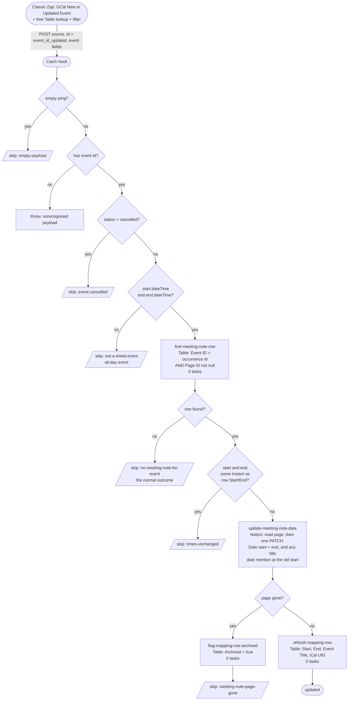

# gcal-event-updated-to-meeting-note

Keeps a Notion **meeting note**'s `Date`, and the time shown in its title, in step with the Google Calendar event it came from. When a meeting is rescheduled, this writes the new start/end onto the existing note. It is **update-only**: it never creates a note, and touches only `Date` and the title's date mention.

Replaces the classic Zap **“Updated Meeting → Update Meeting Note in Notion”**, which had been silently failing since May 2026 (see [Why the classic Zap stopped working](#why-the-classic-zap-stopped-working)).

- **Trigger:** a `WebHookCLIAPI` catch hook, fed by the **classic hand-off Zap** *"Updated Meeting → hand off to durable"*, which watches Google Calendar → *New or Updated Event* on `dennis@work.flowers` and forwards only real reschedules of meetings that have a note (see [Classic hand-off](#classic-hand-off)). Until 2026-10 this durable polled `event_updated` itself. On durables that trigger fires **only on an event's first sighting**, so this update-only Zap never saw a reschedule.
- **Catch URL:** filled into `zap.json` `trigger.webhook_url` by the publish pipeline on merge.
- **Workflow ID:** `019fb770-139b-74ca-bf9b-fec7ea0c9c3b` · [editor](https://zapier.com/durables-editor/019fb770-139b-74ca-bf9b-fec7ea0c9c3b)
- **Cost:** about 2–3 tasks per *actual* reschedule: the classic Zap's Webhooks POST plus this workflow's Notion read and write. The classic Zap's Table lookup and filters are free, and they stop everything else before the POST.

## Workflow



## Classic hand-off

**Why it exists:** durables add a dedupe layer keyed on the trigger record's raw `id` (Zapier bug W6ZE93-VMEWP, filed from this Zap among others, confirmed 2026-09-08, no ETA). `event_updated` sends the bare occurrence id, so this workflow saw each event only once, on its first sighting: 300 runs, 300 distinct ids (2026-09-07 → 2026-10-14). A reschedule, the one thing it exists for, never arrived. Classic Zaps dedupe on `id` + `updated`, so a classic Zap watches the calendar and forwards each real reschedule here. Zapier Support recommended this workaround on 2026-09-08 and again on 2026-10-14.

**The catch hook dedupes too.** A raw catch hook drops a second POST whose top-level `id` it has already seen (proven 2026-10-01 on [`save-tagged-docs-to-notion`](../save-tagged-docs-to-notion/)). So the hand-off must **not** send the event id as `id`. It sends `<event id>_<updated>`, and the event id goes in `event_id`. On this path the workflow never reads `id`.

**Filter in the classic Zap, not here.** The raw trigger fires about 60 times a day: cancelled tombstones, Gemini touching a whole series, RSVPs. Only the POST costs a classic task, so the free steps in front of it must drop everything that isn't a reschedule of a meeting with a note. This workflow still re-checks each condition, so a filter that lets too much through only wastes a task.

**Payload contract** (Webhooks by Zapier POST, Payload Type `json`, every value a plain mapped field):

| Key | Mapped from the trigger |
| --- | --- |
| `source` | `classic-handoff` (literal) |
| `id` | `{{id}}_{{updated}}`: the dedupe key, which must change on every edit |
| `event_id` | `{{id}}`: the **occurrence** id, the Table's lookup key |
| `updated` | `{{updated}}` |
| `iCalUID` | `{{iCalUID}}` |
| `summary` | `{{summary}}` |
| `status` | `{{status}}` |
| `start_dateTime` | `{{start.dateTime}}` (*Event Begins*) |
| `end_dateTime` | `{{end.dateTime}}` (*Event Ends*) |

**Setup (Zapier UI; the CLI and MCP can't create classic Zaps).** The quickest path is to duplicate the old classic Zap *"Updated Meeting → Update Meeting Note in Notion"*. It already has the trigger, the Table lookup and the date filter, so the only change is replacing its Notion step with the POST. Otherwise, build it new and name it **"Updated Meeting → hand off to durable"**:

1. **Trigger:** Google Calendar → *New or Updated Event*. Account `dennis@work.flowers` (connection `02a752ba-…`), calendar `dennis@work.flowers`. If the trigger offers *Expand Recurring Events*, set it to **No**, matching the old durable trigger (see "What it deliberately does not do").
2. **Filter:** continue only if *Status* (text) does not exactly match `cancelled` **and** *Event Begins* (`start.dateTime`) exists. All-day events have no `dateTime` and never have notes.
3. **Zapier Tables → Find Record:** table **[Table] Meeting Note IDs** (`01JZCVG73MBWWB0357CEPS4903`), field **Event ID** exactly matches `{{id}}`. Leave *success when nothing is found* **off**, so an event with no note halts here quietly (the normal case).
4. **Filter:** continue if **any** of these OR groups passes. Each group is one Date/time condition comparing the trigger to the row found in step 3:
   - *Event Begins* is after **Start**
   - *Event Begins* is before **Start**
   - *Event Ends* is after **End**
   - *Event Ends* is before **End**
   - **Start** does not exist (a row written without times; let the durable decide)

   Zapier compares these as instants, so `+08:00` against `Z` is not a false change.
5. **Webhooks by Zapier → POST:** URL = the catch URL from `zap.json` `trigger.webhook_url`. Payload Type `json`. Data = the table above. *Wrap Request in Array* and *Unflatten* both **No**.
6. **Test:** move a past meeting that has a note by 30 minutes, then check `list-workflow-runs` for `updated: true`. Move it back and confirm a **second** run. That second run is the whole point of the hand-off.
7. Turn the classic Zap on, and make sure the *old* classic Zap stays off. Otherwise both write the note.

**When Zapier fixes W6ZE93-VMEWP:** switch back to the native trigger kept under `zap.json` `handoff.previous_trigger`, re-verify with two reschedules of one event, then turn the classic Zap off. The raw-event input path still works (`run-durable` replays use it), so the workflow needs no change.

## The two Google Calendar ids — and why it matters

This is the whole story of the bug, so it is worth stating plainly. A Google event carries **two** identifiers, and they are not interchangeable:

| | `id` — the **occurrence** | `iCalUID` — the **series** |
| --- | --- | --- |
| One-off event | `020m73h4pol31v2vml5scfchmp` | `020m73h4pol31v2vml5scfchmp@google.com` |
| Recurring occurrence | `48759896…_20260730T033000Z` | `48759896…@google.com` |
| Recurring, series since revised | `rljatc0qotko…_20260730T033000Z` | `rljatc0qotko…_R20260622T033000@google.com` |

- **`id`** is Google's key for *one occurrence*. For a recurring meeting it is `<seriesId>_<originalStartUTC>` — a different value every week. **This is the only id that is unique per meeting note**, so it is the lookup key, and it is what the Worker stamps on the note as `Google Calendar Event ID`.
- **`iCalUID`** is the RFC 5545 UID: the cross-system identity of the *series*, therefore **shared by every occurrence**. The `_R<stamp>` segment changes only when the series itself is edited. For an externally-created booking it keeps the origin system's UID (e.g. `7TnnAYZ5vtPgPDbQBtcdxf@Cal.com`), which is the one thing it is genuinely useful for.

A trap worth knowing: **you cannot tell recurring from one-off by looking at an iCalUID.** A recurring series that has never been revised gets a bare `<seriesId>@google.com`, identical in shape to a one-off's.

## Why the classic Zap stopped working

The classic Zap looked the note up in `[Table] Meeting Note IDs` by matching **`Event ID` (f3)** exactly against the trigger's **`id`**. Correct as designed — but from May 2026 the `meeting-note-db-updates` Notion Worker began writing the **`iCalUID`** into that column. For the 31 July 2026 standup:

```
trigger id      17o8m8ek1bfnt6vsdg64v0ov2l_20260731T034500Z
table Event ID  17o8m8ek1bfnt6vsdg64v0ov2l_R20260706T034500@google.com
```

Never equal → “only continue if found” stopped every run → no Notion update, no error, no alert. **92 of 849 rows** were in this state. Note this broke one-off events too, not just recurring ones: `<id>@google.com` never equals `<id>`.

It also caused a second, quieter fault: because one iCalUID covers every occurrence, the Worker's find-or-create kept matching the *same* row and overwriting its `Page ID`. A year of weekly standups became one row. `AI COE Daily Sync` — a daily meeting — had a single row whose Page ID had been overwritten continuously since 14 May.

**Both were fixed by re-keying the table**, not by changing this workflow's logic — see [`scripts/backfill-meeting-note-event-ids.mjs`](../scripts/backfill-meeting-note-event-ids.mjs). The table now carries the occurrence id in `Event ID` (f3) and the iCalUID in a new `iCal UID` (f9) column, so nothing was thrown away.

> **Keep this invariant:** `Event ID` (f3) is the **occurrence** id. Anything writing to this table — this workflow, the Notion Worker, a future backfill — must respect that, or the lookup silently returns nothing again.

## Design notes

- **Why the Table and not a Notion search.** A Notion `find_data_source_item` on `Google Calendar Event ID` finds the same page and needs no mapping table at all — but it costs a task on *every* calendar edit, and most edits are for meetings with no note. The Table lookup is free, so the one task is spent only on a real reschedule.
- **Instant comparison, not string comparison.** Google sends local time plus offset (`2026-07-31T16:00:00+08:00`); Zapier Tables normalises to `Z` (`2026-07-31T08:00:00Z`). Those are the same moment, so the “did the time actually change?” guard reduces both to epoch milliseconds. A string compare would see a change on every single run and rewrite Notion endlessly.
- **No `Date` in the workflow body.** `@zapier/zapier-durable` runs the body in GUARDED mode and its `Date` proxy throws in the `construct` trap *before* reading its arguments, so even `new Date(isoString)` fails. `epochMsFromRfc3339` is integer maths only — same approach as [`drive-invoice-to-xero`](../drive-invoice-to-xero/).
- **A dead page is flagged, not deleted.** The classic Zap *deleted* the mapping row when the Notion update errored. Any transient Notion failure would therefore have destroyed a good mapping. Here the error is caught **inside** the `ctx.step` (so it cannot spin the retry loop), matched against a narrow "page is gone" pattern, and the row is flagged `Archived` — the column already existed for exactly this. Every other error rethrows and gets the step's normal retries.
- **The title's time is a date mention, and it moves too (2026-10-15).** The Worker titles notes `<meeting> @<start>`, where `@<start>` is a Notion date mention inside the title's rich text. Updating `Date` alone left the title showing the old time. The update step now reads the page and rewrites only the date mentions whose start matches the row's **previous** start. A hand-typed date elsewhere in a title is left alone, and so is a title edited by hand so that nothing matches. A retry after the write has landed finds nothing to rewrite, because the mention already shows the new start. Everything goes out in one `PATCH` through `sdk.fetch` (Notion API `2026-03-11`). The test for which mentions move is the pure exported `rewriteTitleDateMentions`. Notes rescheduled before this change keep their stale title time: their row already holds the new start, so the old mention no longer matches.
- **Write-back keeps the change-detection honest.** After a successful update the row's `Start`/`End` are refreshed, so the next edit compares against current values. This also backfills `iCal UID` on rows that predate that column.

## What it deliberately does not do

- **A whole-series edit does not propagate.** With `expand_recurring: false` (matching the classic Zap), editing the *series* delivers the master event, whose id matches no note, so the run skips cleanly. Only single-occurrence edits and one-off events propagate. This is the right trade for this data: notes exist only for meetings at or after their start, so retro-updating past occurrences is rarely wanted, and `expand_recurring: true` would fan a single series edit out across every future instance, almost all of which have no note.
- **It never creates a meeting note.** Notes are created by the [`meeting-note-db-updates`](https://github.com/work-flowers/notion-worker-meeting-note-db-updates) Notion Worker, from a Notion DB automation. No mapping row means no note, which means nothing to do.
- **It only writes `Date` and the title's date mention.** The rest of the title, attendees, contacts, call link and description stay owned by the Worker.
- **Notes whose row was already overwritten stay unreachable.** Where the collapse had already reused a row, the earlier occurrences' Page IDs are gone from the table; the migration could only re-key the surviving one.

## Verified cases

Run against production on 2026-07-31 via `run-durable`:

| Case | Input | Result |
| --- | --- | --- |
| Real reschedule (the reported failure) | 31 Jul standup, `id …_20260731T034500Z`, moved to `16:00–16:30+08:00` | `updated: true` — Notion `Date` went `03:45–04:15Z` → `08:00–08:30Z`; row refreshed, `iCal UID` populated |
| Re-run of the same event | identical payload | `skipped: times-unchanged` — proves the offset-vs-`Z` comparison does not see a phantom change |
| Event with no meeting note | `id: no-such-event-id-abc123` | `skipped: no-meeting-note-for-event` |
| Cancelled occurrence | same id, `status: cancelled` | `skipped: event-cancelled` |
| All-day event | `start.date` only, no `dateTime` | `skipped: not-a-timed-event` |
| **First live trigger run** (`019fb772-a39d…`, 09:12Z) | a real edit to the recurring `💛 SG HK TW Ambassador Quarterly` occurrence on 5 Aug | `skipped: no-meeting-note-for-event` — correct; that meeting has not happened, so it has no note |

**Classic hand-off live (2026-10-15).** The Busy note (event `3c7cdd60bd6456b59d6220681b56f0b6`) was moved 11:00 → 11:30 → 11:00 SGT. That produced two runs, `01a13d16-2759…` (01:03Z) and `01a13d19-4987…` (01:07Z), both `updated: true`, and the note's `Date` followed both moves. Two updates to one event both arriving is the bug fix proven.

**Title mention rewrite (2026-10-15), checked before merge.**
- An offline harness covered the rewrite on eight title shapes: the Busy note's `+08:00` mention against the row's `Z` time, a matching end, an unrelated end, an unrelated date-only mention, a plain-text title, a retry after the write, a user mention alongside a date mention, and an empty title.
- Against a fake Notion it checked the step's exact `PATCH` body, plus 404, in-trash, `400 archived` (all flag the row) and `500` (throws, so it retries).
- A title containing "is archived in the trash" as plain text is **not** read as a dead page; only error bodies are matched.
- One live `PATCH` to the Busy note wrote back its own current Date and title in the new request shape, and Notion answered `200` with nothing changed.

**Hand-off path (2026-10-15).** Before merge, `run-durable` was given a classic-handoff payload for the real row `v2c1j276h2o0t27pm4909443mc` with unchanged times written in `+08:00` (the Table stores `Z`). The result was `skipped: times-unchanged` (run `01a13c97-835f-…`), so the envelope maps onto the lookup correctly and nothing was written. An offline harness also covered `{}`, `null`, `""`, a wrapper-only body, an unrelated object, `{"data":{}}` and `{"data":{"id":""}}`: the four empty shapes skip and the rest throw. A hand-off with no `event_id` throws instead of falling back to the composite `id`. Cancelled and all-day hand-offs skip, and a raw Google event replay still works.

That last row of the table above settles the design's central premise with production evidence rather than inference: the trigger delivered `id: d839afd543fc469494cd72dfc5beacd4_20260805T050000Z` — the **per-occurrence** id — for a recurring instance with `expand_recurring: false`. So a single-occurrence edit really does arrive keyed the way the table is keyed. (Its `iCalUID` was the bare `d839afd543fc469494cd72dfc5beacd4@google.com`, another example of a recurring series whose UID looks exactly like a one-off's.)

## Maintainer notes

- **Upstream dependency:** the `Event ID` column must hold the occurrence id. The Notion Worker at [`notion-workers/workers/meeting-note-db-updates`](https://github.com/work-flowers/notion-worker-meeting-note-db-updates) writes that column when it enriches a new note — if it ever reverts to writing the iCalUID, this workflow goes silently dead again. That is the single most important thing to know before touching either side.
- **Hand-off cutover: done 2026-10-15.** The classic Zap "Updated Meeting → hand off to durable" is live and POSTs to `…/omxtpUyRac5QSs8W/`.
- **Original cutover:** the classic Zap must be turned off in the Zapier UI. Note that the re-keying migration *also* repaired the classic Zap's lookup, so until it is disabled both it and this workflow will fire on the same event and write the same value twice.
- The table's `Archived` (f7) column is now meaningful: `true` means the linked Notion note no longer exists.
- **Historical (native `event_updated` trigger, before the hand-off).** The classic Zap's pre-filter now absorbs this noise for free. **The native trigger fired far more often than it "should," and that's expected — verified against `list_workflow_runs` on 2026-08-05.** A 200-run sample (2026-08-02 to 2026-08-05, ~60 runs/day average) was dominated by a handful of bursts, not a steady trickle: 78 runs (39%) were `status: cancelled` tombstones with no `updated` field at all, and single bursts of 39–41 runs landed at the identical millisecond for one long-running daily/weekly series. Two Google-side behaviors cause this, and `expand_recurring: false` does not suppress either one (it only stops Zapier from *proactively generating* synthetic future-occurrence triggers for a still-open series):
  - **"Edit this and following" series splits.** Changing a recurring meeting's guests/settings for "this and following" ends the old recurrence and cancels *every remaining already-materialized instance* under the old `recurringEventId`, replacing them with a new `_R<timestamp>` id. Each cancelled instance is its own separate `event_updated` delivery — one edit produced 41 runs in a day across three successive revision splits of one series.
  - **Bulk metadata touches.** Gemini auto-attaching "Notes by Gemini"/recording links after a meeting concludes (or a guest-list sync) bumps the `updated` field on every already-created occurrence of a series at once, including occurrences months in the past — one such touch produced 39 runs sharing one timestamp for a daily standup series.
  - **None of this costs anything.** Every sampled run from every burst type hit a zero-task early exit (`event-cancelled`, `no-meeting-note-for-event`, or `times-unchanged`) before the one paid Notion step; no errors, no spurious writes. If this shows up again as "why is this Zap running so much," it's upstream trigger noise from actively-edited recurring meetings, not a bug here — check `list_workflow_runs` for burst patterns (many runs sharing one `input.updated` timestamp, or `status: cancelled` inputs with no `updated` field) before assuming otherwise.
  - **Zapier does not yet expose billed-task counts per run** (checked `list_workflow_runs`, `get_run_output`, `get_workflow_version` — no task/cost field on any of them), so "is this actually free" can only be confirmed by reading each run's `output.skipped` reason, not by a task-count field. Revisit this note if that ever changes.
