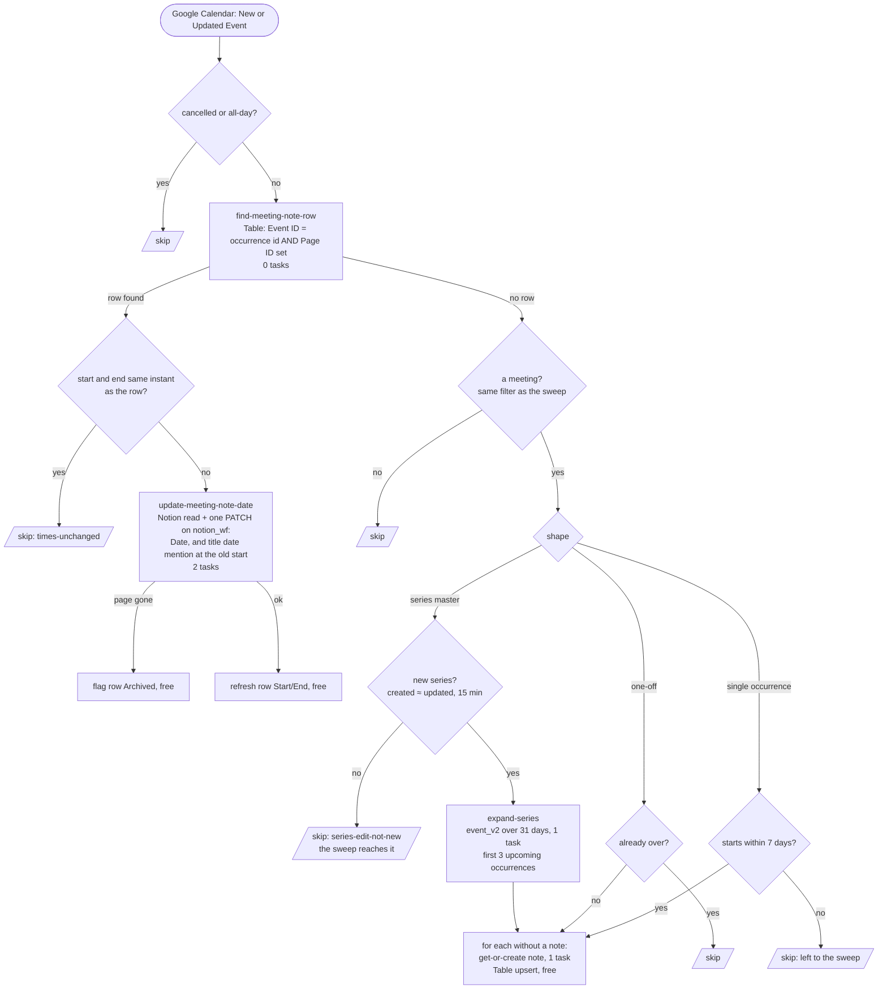
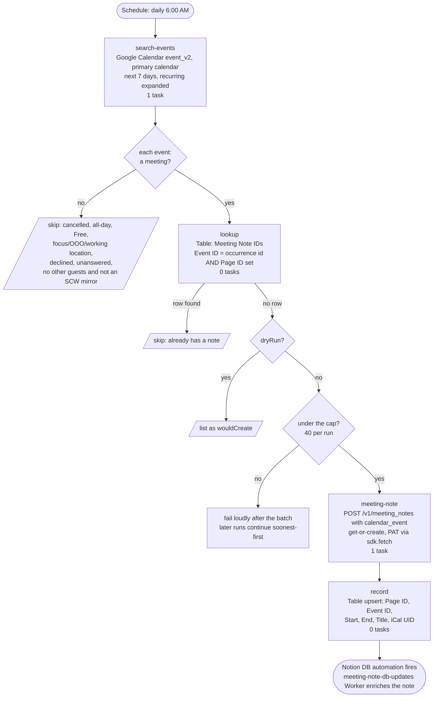

# gcal-meetings-to-meeting-notes

Owns the life of a Notion **full-page meeting note** for every meeting on Dennis's work calendar. It creates the note, linked to its Google Calendar event, before the meeting (so it is already enriched when the meeting starts), and moves it when the meeting is rescheduled.

One `workflow.ts`, **two deployments** (see `zap.json` → `deployments[]`):

| Deployment | Trigger | Does |
| --- | --- | --- |
| `calendar-event` | Google Calendar *New or Updated Event* (`primary`, `expand_recurring: false`) | **Reschedule:** an event that already has a note and whose time moved gets the note's `Date` and title date mention updated. **Create:** a new **one-off** meeting gets its note at once, however far ahead; a **new recurring series** gets notes for its **first 3** occurrences only; a single occurrence with no note is noted if it starts within 7 days. |
| `sweep` | Schedule by Zapier, daily 6:00 AM, weekends included | Notes every meeting in the next 7 days that has no note yet. This is what reaches the 4th and later occurrences of a series, one day at a time. |

**This replaces [`gcal-event-updated-to-meeting-note`](../gcal-event-updated-to-meeting-note/)** (merged 2026-11-17). Its trigger already delivered every new event as that event's first sighting, so one deployment now creates notes and moves them. Its reschedule logic is ported unchanged; see [Cutover](#cutover-from-gcal-event-updated-to-meeting-note).

- **Workflow IDs:** assigned on first publish.
- **Cost:** each meeting's note is created once, by whichever path reaches it first, for 1 task. A reschedule costs 2 tasks (Notion read and write), as before. The sweep adds ~1 task a day, and a new series adds 1 search task. The ~60 calendar edits a day that are neither exit at free steps. Table reads and writes are free.

## Workflow

### `calendar-event` deployment



### `sweep` deployment



## What counts as a meeting

`classifySkip` in [`workflow.ts`](workflow.ts) keeps an event when all of these hold:

| Rule | Why |
| --- | --- |
| `status` is not `cancelled` | Tombstones of deleted occurrences. |
| `eventType` is `default` | Drops focus time, out of office and working location. |
| Has `start.dateTime` and `end.dateTime` | All-day events are never meetings. |
| `transparency` is not `transparent` | A "Free" event is a reminder, not a meeting. |
| Dennis has not declined and has answered | Same rule as the calendar-blocking Zaps: `declined` and `needsAction` skip. |
| At least one other non-room guest, **or** the description starts with `[gcal-block]` | Solo blocks and webinars that list only Dennis are not meetings. SCW client meetings arrive as guest-less mirrors from [`scw-events-to-workflowers-block`](../scw-events-to-workflowers-block/), and they were already getting notes by hand, so they count. |

On the 2026-11-17 dry run this kept 15 of 24 events in the coming week, skipping 4 declined invites and 5 with no other guests (solo blocks, a Vanta webinar, the Community Hangout).

## Recurring meetings and the cap

A recurring invite with no end date is the obvious way to burn tasks, so three fences hold it:

1. **The `calendar-event` path notes only the first 3 occurrences** of a new series (`SERIES_FIRST_INSTANCES`), found with one search over the 31 days from its next occurrence (`SERIES_SEARCH_DAYS`). It treats a master as new only when Google's `created` and `updated` are within 15 minutes (`NEW_SERIES_WINDOW_MS`), because *New or Updated Event* also fires on every RSVP or edit to a series, and each expansion costs a search task. An old series that is edited skips for free. A series whose next occurrence is more than 31 days out gets no notes from this path; the sweep reaches it as it comes within 7 days.
2. **The sweep's window bounds it.** The search asks Google for events between now and 7 days out with `expand_recurring: true`, so a series can only ever contribute the occurrences inside that window, about one a day at most. Each day the next day rolls in.
3. **`MAX_CREATES_PER_RUN` = 40** on the sweep. A normal week here is around 15 meetings, so 40 is well above routine. Past the cap the run still creates and records the first 40 (soonest first), then throws, so the run shows red and Zapier sends an error alert. The rest roll into later runs. A cap hit means something abnormal, such as a mass import or a calendar shared by mistake, and someone should look before raising it.

## How a note is created

`POST https://api.notion.com/v1/meeting_notes` with `Notion-Version: 2026-03-11` and

```json
{ "calendar_event": { "calendar": { "account_id": "<Notion Calendar account id>", "calendar_id": "<Google calendar id>" }, "event_id": "<Google occurrence id>" } }
```

- **Get-or-create.** If the event already has a note, Notion returns it (`created: false`) instead of making another. That makes the step safe to retry and makes overlap with hand-made or Notion-made notes harmless. Verified 2026-11-17 on an event that already had a note.
- **Filing and title come from Notion.** With `calendar_event` you may not pass `parent`, `title` or `markdown`. A note for an event with no other notes lands in the **Meeting Notes** data source, titled `<summary> @<start>`, the same as one made in the app.
- **The response's `meeting_note.id` is the page id**, which is what goes into the Table's `Page ID`.
- **`account_id`** is Notion Calendar's own id for the work Google account (`9c2abc99-…`, from `calendar.accountId` in Notion MCP's `notion-calendar-list-events`). **`calendar_id`** is the Google calendar id. The workflow reads it at run time from the events (the attendee, organizer or creator marked `self`), so no address is hardcoded. **`event_id`** is the plain Google occurrence id (`<seriesId>_<startUTC>` for a recurring occurrence).

### Why a PAT and not the Notion connection

The meeting-notes endpoints accept only a personal access token or a Notion Worker. Zapier's Notion connection, including the app's **API Request (Beta)** action, is refused for both the create and the link endpoint with:

```
403 restricted_resource: This tool is not available to user_owned_guest_bot actors.
```

(probed 2026-11-17). The call therefore goes through `sdk.fetch` on `notion_pat`, an **API by Zapier** connection holding Dennis's PAT as a Bearer token, which keeps the token out of source. Notes are created as Dennis. A Notion Worker could do it without a PAT, but a Worker may not pass `calendar_event`, so it would need a create call and then a link call, and would show as the note's creator.

## Shared Table

[`[Table] Meeting Note IDs`](https://tables.zapier.com/app/tables/t/01JZCVG73MBWWB0357CEPS4903) is shared with three other automations:

- the [`meeting-note-db-updates`](https://github.com/work-flowers/notion-worker-meeting-note-db-updates) Worker upserts a row for every note it enriches;
- this Zap's own reschedule path looks notes up here (it absorbed [`gcal-event-updated-to-meeting-note`](../gcal-event-updated-to-meeting-note/));
- [`notion-page-deleted-to-zapier-tables`](../notion-page-deleted-to-zapier-tables/) flags a deleted note's row `Archived`.

This Zap writes the same upsert the Worker does (find-or-create on `Event ID`, then update), so whichever of the two runs second updates the row rather than adding one; the live test left exactly one row. **`Event ID` (f3) must stay the occurrence id**, never the iCalUID (see [the two Google Calendar ids](../gcal-event-updated-to-meeting-note/#the-two-google-calendar-ids--and-why-it-matters)).

The skip check matches any row with a Page ID, including one flagged `Archived`. So a note Dennis deletes is **not** re-created the next morning.

## Interaction with the enrichment Worker

Creating the note fires the Meeting Notes "page added" automation, so the Worker enriches it straight away: Date, Google Calendar Event ID, Description, Call Link, Contacts, Internal Attendees, Companies, Deals and Type. In the live test that took about 13 seconds. Notes are therefore enriched up to a week before the meeting rather than at the meeting. A meeting rescheduled after that is handled by this Zap's own `calendar-event` deployment, which moves the note's Date and title.

## Manual runs

```bash
npx zapier-sdk --stability experimental trigger-workflow <workflow-id> --input '{"dryRun":true}'
```

Either deployment accepts any of these (the code is the same):

| Input | Default | Meaning |
| --- | --- | --- |
| `event_id` | | Replay the `calendar-event` path for one Google event id (1 task to fetch it): a moved meeting with a note is rescheduled, a one-off is noted, a series master gets its first 3 occurrences. The new-series guard is lifted, so a missed series can be noted by hand. |
| `dryRun` | `false` | List `wouldCreate` without writing anything. The search still costs 1 task. |
| `from_days` / `to_days` | `0` / `7` | Window in days from now. Fractions are allowed (`0.1` ≈ 2.4 h); max 31. |
| `max_creates` | `40` | Cap for this run, 1..200. |
| `now` | the tick time | RFC 3339 anchor for the window. |

## Cutover from gcal-event-updated-to-meeting-note

1. Merge. The pipeline creates both deployments, enabled.
2. Confirm on the `calendar-event` deployment (`list-workflow-runs`):
   - one real reschedule: output `path: "reschedule", updated: true`;
   - one real new meeting: output `path: "one-off"` or `"series"`.
3. `npx zapier-sdk --stability experimental disable-workflow 019fb770-139b-74ca-bf9b-fec7ea0c9c3b`, then mark [`gcal-event-updated-to-meeting-note`](../gcal-event-updated-to-meeting-note/) retired in its README, `zap.json` and the root index.

Running both until step 3 is safe: on a reschedule both write the same `Date` and refresh the same row, and only this Zap creates notes.

## Known limits

- **SCW mirrors are one-off events.** [`scw-events-to-workflowers-block`](../scw-events-to-workflowers-block/) mirrors each SCW occurrence as its own event, up to 30 days ahead, so each mirror is noted by the trigger as it is created, up to 30 days ahead, rather than by the sweep. Same total cost, earlier notes.
- **A series split with "this and following"** gets a new master (`<id>_R<date>`) that keeps the original `created`, so the new-series guard skips it. Its occurrences are noted by the sweep as they come within 7 days.
- **An externally organised recurring invite** may carry the organizer's `created`. If that is older than 15 minutes at first sighting, the guard skips it and the sweep notes its occurrences instead. That is a later note, not a lost one.
- **Reschedules run for any event with a note**, whether or not it passes the meeting filter, exactly as the retired Zap did.
- **The search returns one page.** Ordered by start time, a truncated page would drop the far end of the window, which later runs reach, so it is logged rather than fatal. The busiest week checked returned 24 events.
- **Sync lag is not a problem:** Notion accepted a brand-new event's id 0 s after creation (probe 2026-11-17), so the trigger calls Notion without waiting.

## Verified behaviour (2026-11-17)

| Check | Result |
| --- | --- |
| Get-or-create on an event that already had a note | `200`, `created: false`, existing page id returned |
| Dry run over the next 7 days | 24 events → 15 meetings → 2 already noted → 13 to create |
| Live create (one event, window 0..0.1 days) | Note created in Meeting Notes as Dennis, titled `AI COE - Weekly Long Sync @12:00`; Worker enriched it within ~13s; one Table row |
| Search truncation | 20–24 Nov returned 8 events; no page limit hit |
| Notion sync lag on a brand-new event | Free, guest-less test event created and POSTed at once: `200` on the first try (event deleted and note trashed afterwards) |
| `{event_id}` replay: mirror that already ended | skipped `already-over` |
| `{event_id}` replay: webinar listing only Dennis | skipped `no-other-guests` |
| `{event_id}` replay: one-off that already has a note | skipped at the free Table check |
| `{event_id}` replay: new recurring series (Procurement and Operations Automation, weekly) | notes for exactly the first 3 occurrences: 18 Nov, 25 Nov, 2 Dec |
| `{event_id}` replay: one-off four weeks out (15 Dec) | note created |
| Sweep dry run after the trigger tests | 15 meetings, 4 already noted, 11 to create: it skips what the trigger made |
| Consolidated path: noted event, time unchanged | `times-unchanged`, no paid call |
| Consolidated path: reschedule write (Table Start set to a wrong time, then replayed) | `updated: true`; Date written back to the true 12:00–13:00, row refreshed, title untouched (its mention did not match the fake start) |
| Consolidated path: new one-off (Lunch & Laptops, 23 Nov) | note created |
| Consolidated path: edit to a 2025 series (The Weekly Pulse) | `series-edit-not-new`, no search task |
