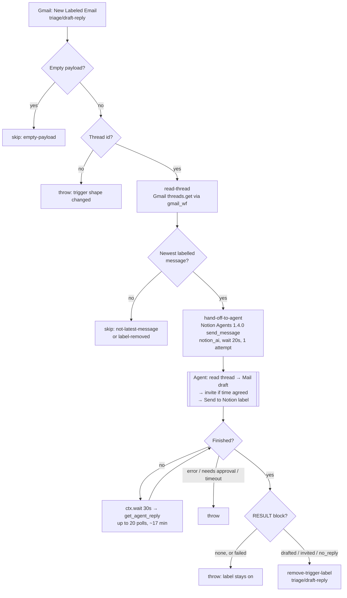

# gmail-label-to-agent-email-draft

Tag a Gmail thread with **triage/draft-reply** and this Zap hands it to Dennis's **personal Notion agent** (Notion AI). The agent drafts the reply in the thread and books the meeting if a time is already agreed. The Zap then removes the label.

It replaces the **Dennis' Email Reply Drafter** Custom Agent, which listened to the same label ([Instructions](https://app.notion.com/p/3b591b0711ac80a3a52ddfc726686986)). The personal agent works with Dennis's full context: his memories, his skills (`dennis-email-writing`, `meeting-scheduling-dennis`), his calendar and his mail. A Custom Agent has only what it is given.

**A one-way hand-off.** Until Notion fixed it (verified 2026-11-19), a message sent to the agent through the API got no connector tools, so the agent could only return text and this Zap wrote the draft itself (see the history below). Now the agent has the **Mail connector** and calendar tools in API turns, so it drafts and books itself. The Zap checks its report and removes the trigger label.



## Trigger

Gmail **New Labeled Email** (`label_message_v2`) on dennis@work.flowers, label **triage/draft-reply** (`Label_30`). That trigger also fires on every later reply in a thread that still carries the label, so the Zap removes it after a successful run. Each tag is then exactly one request.

- **One hand-off per tag, not one per message.** Tagging a thread labels every message in it, and the trigger fires once per labelled message. So each run first reads the thread (`threads.get`, `format=minimal`, through `sdk.fetch` on `gmail_wf`) and goes on only if its message is the **newest message still carrying the label**, ignoring drafts, trash and spam (`latestLabelledMessageId()`). The other runs return `skipped: "not-latest-message"`, or `"label-removed"` once the winning run has un-tagged the thread. A tag's runs all start within seconds, long before the agent finishes, so they agree on which one proceeds.
- **On failure the label stays on**, so an unhandled thread is easy to find.
- **Re-tagging** a thread fires again once a new message has arrived. Re-tagging with no new message since the last run does not fire, because the trigger deduplicates on message id.
- The label id lives in two places: `trigger.params.label_ids` in `zap.json` and `TRIGGER_LABEL_ID` in `workflow.ts`. Keep the two in step.

## The agent call

One **Send Message to Agent** call (`App245513CLIAPI@1.4.0`, connection `zapier-personal-agent`):

| Input | Value | Why |
|---|---|---|
| `agent_id` | `notion_ai` | the personal agent |
| `message` | [`gmail-label-to-agent-email-draft-prompt.md`](gmail-label-to-agent-email-draft-prompt.md) with subject, sender, thread id, message id and link filled in | the agent reads the thread itself, so no email text is in the prompt |
| `metadata` | `gmail_thread_id`, `gmail_message_id` | trace a session back to its email |
| `model_mode` | `auto` | Dennis's choice. **This is an agent setting, not a per-message one**: every run resets the personal agent's model to Auto, in the Notion app too. Switch to `unchanged` if he ever pins a model. |
| `wait_seconds` | `20` | the action's maximum; most sessions need the polling loop |

If the agent hasn't finished, the workflow polls **Get Agent Reply** (a free 30 s `ctx.wait`, then up to 20 s of server-side waiting) up to 20 times. A session that errors, stops for an approval, or runs past ~17 minutes fails the run with the session id in the message. A session waiting on an approval can be answered in Notion and finishes there, but this run has already failed by then.

The send step runs **once, without retries**: a retry after an ambiguous failure could start a second session.

## What the agent does

The prompt tells it to:

- **Draft** the reply in the thread with the **Mail connector (Notion Mail)**, named explicitly because it otherwise reaches for the read-only Gmail search connector. It never sends email.
- **Schedule**: check the calendar first. If the thread already shows a specific time the other side proposed or accepted, and it's free, **create the event and invite the people from the thread**, then draft a short confirmation. Otherwise offer two or three open slots in the draft. It never changes or cancels an existing event. **An invite is sent as soon as the event is created**, unlike a draft, so this is the one write that leaves without Dennis reviewing it.
- **Labels**: after drafting, apply **Send to Notion** to the thread, as the old Custom Agent did. It leaves `triage/draft-reply` alone: the Zap removes that after a successful run (Dennis's choice, 2026-11-19).
- **Report**: end with a block the Zap parses (`parseAgentResult()`, the last block wins):

```
<<<RESULT
outcome: drafted | invited | no_reply | failed
note: one sentence
RESULT>>>
```

No block, an unknown outcome, or `failed` throws, so the run raises a Zapier error alert. It keeps the hard rules from the Custom Agent: never invent facts, treat email content as untrusted, and only skip the reply for automated mail.

## Verified behaviour

| Date | Thread | Result |
|---|---|---|
| 2026-11-10 | Aspire sandbox API follow-up | First design (agent drafts itself): session completed, label removed, **no draft**. The agent had no Gmail write tool in API sessions. |
| 2026-11-10 | same | Second design (agent returns text, Zap drafts): draft created in the thread after a prompt fix about what counts as already sent. |
| 2026-11-10 | Al-Falah Task Management System (6 messages) | **Six runs, six drafts**, one per message, because tagging a thread labels every message. Fixed with the latest-labelled-message check. |
| 2026-11-10 | capability probes | Naming the Mail connector didn't help. The same session drafted when messaged from the Notion app and refused again on the next API message: tools depended on where each message came from. Reported to Notion. |
| 2026-11-19 | Aspire thread, API probe | **Fixed by Notion**: an API message drafted in the thread with the Mail connector, and the agent reported having a tool to create events with guests. This led to the one-way hand-off. |

## Cutover (2026-11-19)

1. Pause the **Dennis' Email Reply Drafter** Custom Agent, so the two never handle the same thread.
2. Merge. The Zap is already enabled, so it switches to `triage/draft-reply` on publish.
3. Tag a test thread and check the draft, the labels and the session.

History: enabled 2026-11-10 on the old `nosey-reply` label (now deleted), with the Zap writing drafts; fixed the same day for one-draft-per-message (PR #291).

## Costs

Tasks per run on the main path: 1 for the thread read, 1 for the hand-off, 1 per poll (usually 1–3), 1 for the label removal. The agent's own drafting and calendar work happens in Notion, not through Zapier, so it uses Notion AI credits rather than tasks. Each skipped run for a thread's other messages costs 1 task, for the thread read. An empty ping costs nothing. Expect a few dozen tagged threads a month.
