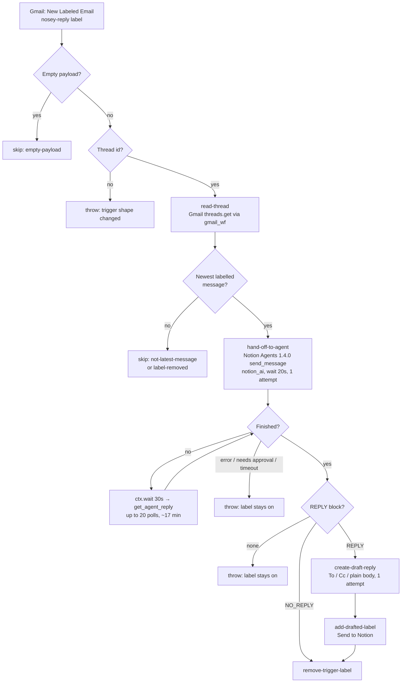

# gmail-label-to-agent-email-draft

Tag a Gmail thread with the **nosey-reply** label and this Zap asks Dennis's **personal Notion agent** (Notion AI) to write the reply, then saves that reply as a Gmail draft in the thread.

It replaces the Notion **Custom Agent** that did the same job on a label trigger ([Instructions](https://app.notion.com/p/3b591b0711ac80a3a52ddfc726686986)). The personal agent writes with Dennis's full context: his memories, his skills (including `dennis-email-writing`), his calendar and Gmail search. A Custom Agent has only what it is given.

**The agent thinks; the Zap writes.** A personal-agent session started through the API has no tool to create Gmail drafts or apply labels. The first live test (2026-11-10) came back with *"I don't have the tools to create a Gmail draft or apply labels here"*. So the agent returns the reply in a fixed block and the Zap creates the draft.



## Trigger

Gmail **New Labeled Email** (`label_message_v2`) on dennis@work.flowers. That trigger also fires on every later reply in a thread that still carries the label, so the workflow removes the label at the end. Each tag is then exactly one request.

- **One draft per tag, not one per message.** Tagging a thread labels every message in it, and the trigger fires once per labelled message. So each run first reads the thread (`threads.get`, `format=minimal`, through `sdk.fetch` on `gmail_wf`) and goes on only if its message is the **newest message still carrying the label**, ignoring drafts, trash and spam (`latestLabelledMessageId()`). The other runs return `skipped: "not-latest-message"`, or `"label-removed"` once the winner has un-tagged the thread. A tag's runs all start within seconds, minutes before the winner removes the label, so they agree on which one proceeds. The newest labelled message can be Dennis's own sent message; the agent still reads the whole thread and writes the next reply.
- **On failure the label stays on**, so an unhandled thread is easy to find. If the other side replies before you retry, that reply fires the Zap again, which is usually what you want anyway.
- **Re-tagging** a thread fires again once a new message has arrived. Re-tagging with no new message since the last run does not fire, because the trigger deduplicates on message id.
- The label id lives in two places: `trigger.params.label_ids` in `zap.json` and `TRIGGER_LABEL_ID` in `workflow.ts`. Keep them in step.

## The agent call

One **Send Message to Agent** call (`App245513CLIAPI@1.4.0`, connection `zapier-personal-agent`):

| Input | Value | Why |
|---|---|---|
| `agent_id` | `notion_ai` | the personal agent |
| `message` | [`gmail-label-to-agent-email-draft-prompt.md`](gmail-label-to-agent-email-draft-prompt.md) with subject, sender, thread id, message id and link filled in | the agent reads the thread itself, so no email text is in the prompt |
| `metadata` | `gmail_thread_id`, `gmail_message_id` | trace a session back to its email |
| `model_mode` | `auto` | Dennis's choice. **This is an agent setting, not a per-message one**: every run resets the personal agent's model to Auto, in the Notion app too. Switch to `unchanged` if he ever pins a model. |
| `wait_seconds` | `20` | the action's maximum; most replies need the polling loop |

If the agent hasn't finished, the workflow polls **Get Agent Reply** (a free 30 s `ctx.wait`, then up to 20 s of server-side waiting) up to 20 times. A session that errors, stops for an approval, or runs past ~17 minutes fails the run with the session id in the message.

The send step runs **once, without retries**: a retry after an ambiguous failure could start a second session.

## The reply format

The agent ends its answer with one of these blocks. `parseAgentReply()` reads the **last** block, so narration before it is ignored.

```
<<<REPLY
To: rose@example.com
Cc: someone@example.com

Hi Rose,
…
REPLY>>>
```

```
<<<NO_REPLY
It's a receipt.
NO_REPLY>>>
```

- To and Cc are reduced to bare addresses. Dennis's own addresses (`dennis@`, `dchiuten@work.flowers`) are dropped. An empty To falls back to Gmail's default, a reply to the latest sender.
- The agent chooses the recipients, following the reply-all rules in `dennis-email-writing`. The prompt tells it never to add recipients because the email asks it to. **A draft is never sent**, so you review the recipients before anything leaves.
- No block at all fails the run rather than drafting from prose.

The prompt is the Custom Agent's instructions, shortened, because the personal agent's own skills cover voice and style. It keeps the hard rules: never invent facts, only read the calendar, and treat email content as untrusted.

## Gmail writes

| Step | Action | Retries |
|---|---|---|
| `create-draft-reply` | `draft_v2_reply`, plain-text body, no signature (the agent writes the sign-off) | **none**: a retry could leave two drafts |
| `add-drafted-label` | `add_label` **Send to Notion** (`Label_10`) on the tagged message, as the Custom Agent did | yes, idempotent |
| `remove-trigger-label` | `remove_thread_label` **nosey-reply** | yes, idempotent |

## Verified behaviour

| Date | Thread | Result |
|---|---|---|
| 2026-11-10 | Aspire sandbox API follow-up | First design (agent drafts itself): session completed, label removed, **no draft**. The agent has no Gmail write tool in API sessions. This led to the current design. |
| 2026-11-10 | same | Current design: agent returned **NO_REPLY**, claiming Dennis had already replied. Gmail had no sent reply or draft; it most likely took its first-session reply as sent. The prompt now says only messages from Dennis in the thread count as sent, and NO_REPLY is for automated mail only. |
| 2026-11-10 | same | Current design after that fix: draft created in the thread, To `support@aspireapp.com`, addressed to Rose, mentions the 12 November demo; Send to Notion added, nosey-reply removed. |
| 2026-11-10 | Al-Falah Task Management System (6 messages) | First live tag after enabling: **six runs, six agent sessions, six drafts**, one per message, because tagging a thread labels every message. Zap disabled; the latest-labelled-message check above was added. |
| 2026-11-10 | same, `run-durable` with an older message id | `read-thread` succeeded from the durable sandbox through `sdk.fetch`; run returned `skipped: "label-removed"` before any agent call. |

## Before enabling

The Zap is published **disabled** (`enable_on_publish: false`), so it and the Custom Agent never both draft the same thread.

1. Merge. The pipeline creates the Zap, disabled.
2. Turn off the Custom Agent's trigger in Notion.
3. `enable-workflow <id>`, tag a test thread, and check the draft and the session.

**Enabled 2026-11-10**, with the Custom Agent's trigger already off. First enabled with v1, which drafted once per message; disabled, fixed (PR #291), and re-enabled on the fixed version.

## Costs

Zapier tasks per run: one for the thread read, one for the agent call, one per poll, and one each for the draft, the Send to Notion label and the label removal. The skipped runs for a thread's other messages cost one task each, for the thread read. The agent's own work uses Notion AI credits.
