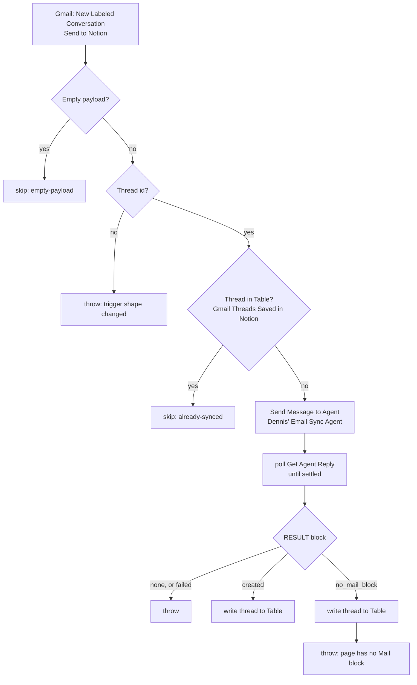

# gmail-label-to-email-sync-agent

Tag a Gmail thread with **Send to Notion** and this Zap hands it to the **Dennis' Email Sync Agent** Custom Agent ([Instructions](https://app.notion.com/p/38991b0711ac80c4b5a3c354530ce02b)). The agent saves the thread to the **Emails** database (`1e491b07-11ac-80ce-8b86-000b29ba4f68`): a page from the default template, with the whole thread embedded as a Mail block. Mail blocks aren't in the public Notion API, so the agent still does the writing. This Zap only decides **when**.

**Why:** the agent's own mail-label trigger used to fire once per labelled thread. In November 2026 it started firing once per **message**, so a thread with several messages got several Emails pages. This Zap replaces that trigger.



## Trigger

Gmail **New Labeled Conversation** (`labeled_conversation`) on dennis@work.flowers, label **Send to Notion** (`Label_10`). Zapier describes it as firing "the first time a label is added to a conversation", and not for later replies. That's the difference from **New Labeled Email** (`label_message_v2`), which fires for every labelled message and is what [`gmail-label-to-agent-email-draft`](../gmail-label-to-agent-email-draft/) has to work around.

- **The record is just `{"id": "<thread id>"}`** (first live run, 2026-11-19). `extractThread()` takes the thread id from its `id` fallback, and the run's Message ID is empty. The id is the real thread id: it matched a two-message thread, and Gmail gives a thread the id of its first message.
- The label stays on. The agent never touches labels, and [`gmail-label-to-agent-email-draft`](../gmail-label-to-agent-email-draft/) applies it to threads it drafts in, so those get saved too.
- The label id (`Label_10`) lives only in `trigger.params.labelId` in `zap.json`. The workflow doesn't need it.

## Dedupe: Gmail Threads Saved in Notion

Before any paid call, the Zap looks the thread up in [Table] **Gmail Threads Saved in Notion** (`01JYG45PATFFM737HK63ZBC2D1`). If it's there, the run skips. After a successful hand-off it writes the thread there. Table reads and writes are free.

That covers a re-fire of the trigger, a thread re-tagged after its label was removed, and anything synced before this Zap:

- The Table belonged to a retired classic Zap, which wrote one row **per message** from 2025-06-24 to 2026-03-11 (1,530 rows, 326 threads). The lookup matches on Thread ID, so those rows still count.
- **Backfilled 2026-11-19:** Gmail had 619 threads labelled Send to Notion. 300 were already in the Table, and the other 319 were added with only Thread ID set. This assumes every labelled thread was already saved by the agent, which is what the label meant until now.

The Emails database's own **Gmail Thread ID** property isn't reliable for this: [`email-db-updates`](../email-db-updates/) fills it with the message id when it's empty, which it usually was. The prompt now asks the agent to set it to the real thread id.

**The agent does no duplicate check of its own.** The prompt tells it the check is done, and its Instructions should not ask for one: searching Emails on every run would cost Notion AI credits for a question the Table already answers for free (Dennis, 2026-11-19).

**Concurrency:** two runs for the same thread at the same moment would both find nothing and both hand off. With a once-per-thread trigger that should not happen. If it does, the cleanup is the same as for today's duplicates.

## The agent call

One **Send Message to Agent** call (`App245513CLIAPI@1.4.0`, connection `zapier-personal-agent`, which lists every Custom Agent in the workspace):

| Input | Value | Why |
|---|---|---|
| `agent_id` | `38991b07-11ac-8046-a76d-0092353ee522` | Dennis' Email Sync Agent |
| `message` | [`gmail-label-to-email-sync-agent-prompt.md`](gmail-label-to-email-sync-agent-prompt.md) with the thread id filled in | ~530 characters. The agent's Instructions do the rest, and it has no tool to send email, so the prompt carries no safety rules or email details |
| `metadata` | `gmail_thread_id`, `gmail_message_id` | trace a session back to its email |
| `model_mode` | `unchanged` | the model is an agent setting, so anything else would rewrite the Custom Agent's model on every run |
| `wait_seconds` | `20` | the action's maximum; most sessions need the polling loop |

If the agent hasn't finished, the workflow polls **Get Agent Reply** (a free 30 s `ctx.wait`, then up to 20 s of server-side waiting) up to 20 times. A session that errors, stops for an approval, or runs past ~17 minutes fails the run with the session id in the message. The send step runs **once, without retries**, because a retry after an ambiguous failure could start a second session and a second page.

The agent ends with a block the Zap parses (`parseAgentResult()`, the last block wins):

```
<<<RESULT
outcome: created | no_mail_block | failed
page: URL or none
note: one sentence
RESULT>>>
```

| Outcome | Table row | Run |
|---|---|---|
| `created` | written | succeeds |
| `no_mail_block` | written, since a page exists and a re-tag must not make another | fails, so the alert prompts a manual fix |
| `failed`, or no valid block | not written | fails |

## Verified behaviour

| Date | Case | Result |
|---|---|---|
| 2026-11-19 | `zapier-personal-agent` connection, `agent_id` choices | lists Dennis' Email Sync Agent |
| 2026-11-19 | Table lookup on a backfilled thread id (exact match) | 1 hit |
| 2026-11-19 | Helper unit tests (empty pings, payload shapes, `$` in subjects, RESULT parsing) | pass |
| 2026-11-19 | First live run: a two-message thread tagged Send to Notion | **One run, one page.** Outcome `created`. The page has a Mail block holding both messages and Gmail Thread ID `1a1ee74490639481` (the real thread id), and the thread is in the Table. So the Custom Agent does get the Mail connector through the API. |


## Cutover (done 2026-11-19)

1. Update the agent's [Instructions](https://app.notion.com/p/38991b0711ac80c4b5a3c354530ce02b) so step 1 ("Confirm the trigger is a mail label event…") also accepts a message from this automation. The prompt already says the message stands in for the label event, but instructions that contradict it are a risk.
2. Turn off the agent's native mail-label trigger, so the two never handle the same thread.
3. Merge. The Zap is created and enabled on publish. (PR #310. The publish job created and enabled it, then failed writing ids back to `zap.json`, which were hand-synced afterwards.)
4. Tag a test thread with several messages. Check that exactly one Emails page appears, with a Mail block and the real thread id in Gmail Thread ID, and that the thread is in the Table. Check the run log for which field the thread id came from.

## Costs

Tasks per run on the main path: 1 for the hand-off, plus 1 per poll (usually 1–3). The Table read and write are free. The agent's own work happens in Notion and uses Notion AI credits, not tasks. A skipped run (`already-synced`, empty ping) costs nothing. Expect a few dozen tagged threads a month: Gmail holds 619 labelled threads, most from the last 17 months.
