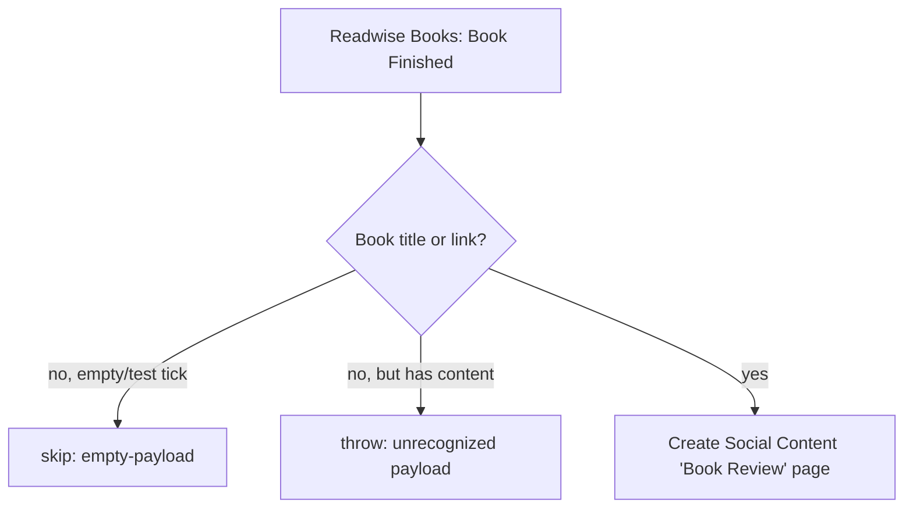

# goodreads-reviews-to-notion

Migrated from the classic two-step Zap **"Log Book Reviews in Notion"**. The directory keeps its original name; the trigger moved from Goodreads to Readwise Books on 2026-11-23.

When Dennis marks a book **Finished** in **Readwise Books**, this durable creates a **"Book Review"** idea in the work.flowers Notion **Social Content** data source — a finished book becomes a LinkedIn content idea.

## Trigger

- **Readwise (Unofficial) — "Book Finished"** (`App233252CLIAPI@2.0.0` / `book_finished`), work.flowers' private CLI integration. Source: [work-flowers/zapier-readwise](https://github.com/work-flowers/zapier-readwise).
- A polling trigger (Readwise Books has no webhooks) on `GET readwise.io/books/api/v1/books`, at the durable default (~1/min). That's one request per poll against Readwise's 20/min limit for that endpoint, and polls cost no tasks.
- **Dedupes on `<book id>-finished`**, so each finished book fires exactly once — no dedup ledger is needed. A re-read moved back to Finished does not fire again.
- Ignores books whose shelf change is dated more than 30 days back, so a book logged late with an old finish date won't fire.
- Replaced RSS by Zapier "New Item in Feed" on the Goodreads read-shelf feed (`RSSCLIAPI@1.1.0` / `new_feed`).

## What it writes

A Social Content page:

| Property | Value |
| --- | --- |
| Name (title) | `Book Review: <title> by <author>` (the `by <author>` clause is dropped if the book has no author) |
| Type (select) | `Book Review` |
| Channel (multi-select) | `LI@dchiuten` |
| Author (people) | Dennis |

Page creation uses `template_mode: "default"` (repo rule 5); the Social Content data source has no default template today, so the create falls back to no-template.

## Flow

## Maintenance notes

- **No dedup ledger by design** — the trigger delivers each finished book once. Default posture otherwise: idempotent-ish write, accept the rare duplicate a whole-run replay could produce (acceptable for a low-volume personal feed).
- **Unrecognized-payload posture: throw** (repo default). A payload with real content but no extractable book title or link is treated as a trigger schema change and raises. An empty/test tick skips silently.
- **The trigger connection** is Dennis's Readwise (Unofficial) connection (`trigger.authentication_id`), holding his Readwise access token.
