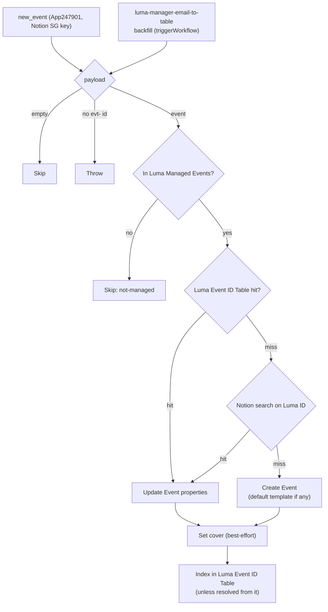

# Luma hosted event → Notion Events

Durable workflow. Trigger: **`new_event`** on the private **Luma Calendar API** integration (`App247901CLIAPI@1.0.0`, source [`work-flowers/zapier-luma-hosted`](https://github.com/work-flowers/zapier-luma-hosted)), connected with the **Notion Singapore** calendar's API key.

It upserts a Notion **Events** record (`65490a1e-…`, the same data source the retired [`luma-event-to-notion`](../luma-event-to-notion/) used) for each Notion SG event that **Dennis manages**. It replaces that retired Zap for events Dennis co-hosts on a calendar he doesn't own. The retired Zaps relied on workFlowers' own Luma Plus, which has lapsed.

## What it does

1. Skip an empty payload. Throw on a non-empty one without an `evt-` id: that is a payload we failed to understand, never a silent skip.
2. **Skip unless the event is in the Luma Managed Events Table** (`01M4ZRWQAHCB41XGGJ263S9BDH`). The integration emits *every* event on the calendar because Luma's API can't say which ones Dennis hosts (hidden hosts aren't listed). [`luma-manager-email-to-table`](../luma-manager-email-to-table/) fills the Table from Luma's host-invite and event-live emails.
3. Resolve the page: the free `Luma Event ID → Notion Page ID` Table first, then a Notion search on `Luma ID`.
4. **Create** (with the data source's default template, `createItemWithTemplate`; Events has none today) or **update**: `Event` title, `Luma ID`, `Type`, `Date` start/end, `Event page` URL.
5. Set the page cover from `cover_url` (best-effort `PATCH /v1/pages/{id}`).
6. Index a newly found page in the Table, so the guest workflow resolves it without a Notion call.

### Trigger mapping

| Notion property | Integration field (`new_event`) | Retired `LumaCLIAPI` field |
| --- | --- | --- |
| `Event` (title) | `name` | `name` |
| `Luma ID` | `id` (`evt-…`) | `id` / `api_id` |
| `Date` | `start_at` → `end_at` | same |
| `Event page` | `url` (`https://luma.com/<slug>`) | `url` |
| `Type` | `location_type`: `offline` → In-person, anything else → Virtual. If absent, In-person when `full_address`/`geo_address_json`/`coordinate` is set | `address`/`latitude` present → In-person |
| page cover | `cover_url` | `cover_url` |
| page body | **not synced**: Luma's events *list* has no description | `description_markdown` |

### What changed from the retired Zap

- **No update path.** The item id is the bare event id, and durables deliver an id once ever, so later edits to the event on Luma never reach this Zap. The retired pair had an `event_updated` deployment, but it suffered from the same dedupe bug. A re-sync happens only when the backfill fires it again.
- **No body sync**, for the reason in the mapping table. The page body is left alone, so notes written there are safe.
- **Fired two ways**: by the trigger, and by `luma-manager-email-to-table`'s backfill (`source: "backfill"`), which replays an event the trigger delivered before Dennis was its manager. The input shape is the same.

## Verified (2026-10-15, `run-durable`)

| Input | Result |
| --- | --- |
| Build Bar event, not yet in the managed Table | `skipped: not-managed` |
| Build Bar event, managed | Event page `3fa91b07-11ac-81a4-9e00-e032b0821f8f` created, In-person, cover set, indexed |

## First enable

Enabling the trigger seeds the dedupe silently rather than replaying existing events (see [`luma-manager-email-to-table`](../luma-manager-email-to-table/#first-enable-behaviour)). Events that already exist come in through the backfill, not the trigger.
