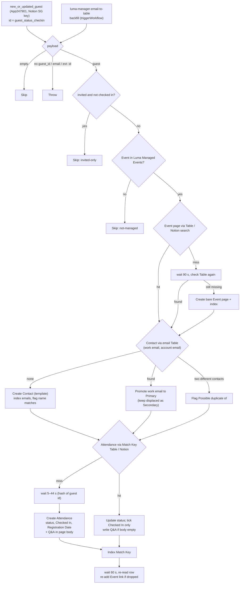

# Luma hosted guest → Notion Event Attendance

Durable workflow. Trigger: **`new_or_updated_guest`** on the private **Luma Calendar API** integration (`App247901CLIAPI@1.0.0`, [`work-flowers/zapier-luma-hosted`](https://github.com/work-flowers/zapier-luma-hosted)), connected with the **Notion Singapore** calendar's API key.

For guests of Notion SG events that **Dennis manages**, it upserts the Contact and the **Event Attendance** record in the same work.flowers data sources the retired Luma Zaps used. One workflow replaces both [`luma-guest-registered-to-event-attendance`](../luma-guest-registered-to-event-attendance/) and [`luma-guest-updated-to-event-attendance`](../luma-guest-updated-to-event-attendance/): a single trigger now carries both registrations and updates, so the race between them is gone too.

## Why one trigger covers new *and* updated guests

The integration sets each item's `id` to **`<guest id>_<approval_status>_<latest check-in | none>`**. Durables dedupe on the raw top-level id (`CLAUDE.md` → "Known Zapier bug", W6ZE93-VMEWP), so a versioned id is what lets an approval change or a check-in fire again. **No write is keyed on that id.** Notion writes key on the Luma event id, the guest's email (through the email Table) and the Event + Contact pair. Limitation, inherited from the integration: a guest who returns to a state they were already in (approved → declined → approved) does not fire again.

## What it does

1. Skip an empty payload. Throw on a non-empty one that lacks `guest_id`, an email or an `evt-` event id.
2. **Skip invited-only guests** (`approval_status: invited` and not checked in). Notion SG events are bulk-invited (231 of 254 on Build Bar), and a Contact per invitee would swamp the CRM. A guest arrives as soon as they register or check in, because that changes the trigger id. *(Dennis, 2026-10-15.)*
3. **Skip unless the event is in the Luma Managed Events Table**, for the same reason as the event workflow: the integration can't tell which events Dennis hosts. See [`luma-manager-email-to-table`](../luma-manager-email-to-table/).
4. **Event**: the `Luma Event ID` Table, then a Notion search on `Luma ID`. On a miss it waits 90 s for [`luma-hosted-event-to-notion`](../luma-hosted-event-to-notion/) and checks the Table again, and only then creates a bare page from the six event fields the guest item carries.
5. **Contact**: unchanged from the retired registered workflow. It looks up the work-email answer and the Luma account email in the email Table. If neither is found it creates the contact with the Contacts default template and **`Lead Source` = `Event`**, indexes every address, and flags `Possible duplicate of` against name-equivalent contacts. A work-email answer is promoted to `Primary Email` and whatever it displaces is kept as a Secondary. A cross-contact collision gets a review flag.
6. **Attendance**: the Match Key Table, then a Notion search on Event + Contact, then a create (`Approval Status`, `Checked In`, `Registration Date`) or an update (`Approval Status`, and `Checked In` only ever ticked). `Attended` wins over the approval status once the guest has checked in (`resolveAttendanceStatus`, unchanged).

   - **Registration answers go in the page body.** Questions differ per event, so instead of mapping them to properties, every question and answer is written into the Attendance page body under `## Registration answers`, in the order Luma asked them (`formatRegistrationAnswers`). A new row gets them on create, in the second call `createItemWithTemplate` makes. An existing row gets them **once, and only if its body is empty**, so notes written on the row are never touched. Answer shapes: text and select are shown as typed, multi-select is comma-joined, company is `Company — Job title`, terms and agree boxes are `Yes`/`No`, LinkedIn becomes a full URL. Markdown a guest typed is escaped, and each answer is capped at 1,800 characters. Q&A pairs are separated by single newlines, so they render as one compact paragraph with each question in bold. Blank lines would each become an empty paragraph block. The 22 existing Build Bar rows with answers were filled by hand on 2026-10-15 using the same formatter (one guest answered nothing). *(Dennis, 2026-10-15; a related Questions database was considered and rejected: one task per answer, and labels differ per event anyway.)*
7. **Event-link guard.** `Event Attendance.Event` is a two-way relation, so every create also appends to the Event page's own list, and Notion drops links when several land on one Event page in the same second. That includes rows that already existed. Before creating a row the workflow waits 5–44 s, derived from the guest id (`staggerSeconds`), so guests from one poll are spread out. On every run it then waits 60 s, re-reads its own row, and re-adds the Event link if it was dropped (`eventLink.repaired` in the output). A failed repair throws.

`Lead Source` is set on **create only**: it records how we first met someone, so an existing contact's value is never overwritten (the same convention as `contact-us-form-to-notion-contact`). The 18 contacts the first Build Bar backfill created were set to `Event` by hand on 2026-10-15, where empty.

**Not ported:** the Buttondown newsletter opt-in. These are Notion community events, not workFlowers newsletter sign-ups. *(Dennis, 2026-10-15.)*

### Trigger mapping

| Used for | Integration field (`new_or_updated_guest`) | Retired `LumaCLIAPI` field |
| --- | --- | --- |
| guest key (logging only) | `guest_id` (`gst-…`) | `api_id` |
| Luma account email | `email` (alias of `user_email`) | `email` |
| Name / First / Last | `name` (alias of `user_name`), `user_first_name`, `user_last_name` | `name`, `first_name`, `last_name` |
| `Approval Status` | `approval_status`: `approved`, `pending_approval`, `waitlist`, `declined`, `invited` (skipped), `session` (→ Approved, the default) | same values |
| `Checked In` | `checked_in_at` (the integration lifts the latest `event_tickets[].checked_in_at`) or `joined_at` | `checked_in_at`, `tickets[].checked_in_at`, `joined_at` |
| `Registration Date` | `registered_at` | `registered_at` |
| Work email | `registration_answers[]` matched on label meaning (unchanged matcher) | same |
| Event | `event.id`, `event.name`, `event.start_at`, `event.end_at`, `event.url` | nested `event` |

Build Bar's only email question is *"What email do you use for Notion?"*. It has no work-ish word, so it is correctly **not** treated as a work email. That is asserted in the test run.

## Verified (2026-10-15)

Parser tests against the real Build Bar guest list (254 guests): all 254 parse, and 23 pass the invited-only filter (14 approved, 7 pending, 2 declined). The invited filter matches the backfill's selection, and every required empty/malformed shape is handled: `{}`, `null` and `""` skip; an unrelated object, `{"data":{}}` and `{"data":{"id":""}}` throw. `run-durable`:

| Input | Result |
| --- | --- |
| Approved guest, event not yet managed | `skipped: not-managed` |
| `{"unrelated": true}` | Throws `Unrecognised Luma guest payload…` |
| Approved guest, event managed | Event resolved from the Table; Contact `3fa91b07-11ac-8178-…` created; Attendance `3fa91b07-11ac-8122-…` created as Approved |
| Same guest again | No new Contact; Attendance found through the Match Key Table and updated (idempotent) |

### Incident: dropped Event links on the first backfill (2026-10-15)

The first Build Bar backfill created 23 Attendance rows in two bursts of 10, and only 9 stayed linked to the Event. Each row was created with the link, then lost it when another create rewrote the Event page's relation list. The test row, which was only being *updated*, lost its link too. The 14 rows were re-linked one at a time by hand. The fix is the guard in step 7, plus the backfill now firing guests one at a time, 20 s apart. Verified by clearing one row's link and rerunning its guest: `eventLink.repaired: true`, link restored.

## First enable

Enabling the trigger seeds the dedupe silently and does not replay the existing guests (see [`luma-manager-email-to-table`](../luma-manager-email-to-table/#first-enable-behaviour)). Guests who registered before an event became managed come in through the backfill.
