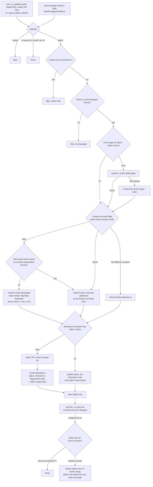

# Luma hosted guest → Notion Event Attendance

Durable workflow. Trigger: **`new_or_updated_guest`** on the private **Luma Calendar API** integration (`App247901CLIAPI@1.0.0`, [`work-flowers/zapier-luma-hosted`](https://github.com/work-flowers/zapier-luma-hosted)), connected with the **Notion Singapore** calendar's API key.

For guests of Notion SG events that **Dennis manages**, it upserts the Contact and the **Event Attendance** record in the same work.flowers data sources the retired Luma Zaps used. One workflow replaces both [`luma-guest-registered-to-event-attendance`](../luma-guest-registered-to-event-attendance/) and [`luma-guest-updated-to-event-attendance`](../luma-guest-updated-to-event-attendance/): a single trigger now carries both registrations and updates, so the race between them is gone too.

## Why one trigger covers new *and* updated guests

The integration sets each item's `id` to **`<guest id>_<approval_status>_<latest check-in | none>`**. Durables dedupe on the raw top-level id (`CLAUDE.md` → "Known Zapier bug", W6ZE93-VMEWP), so a versioned id is what lets an approval change or a check-in fire again. **No write is keyed on that id.** Notion writes key on the Luma event id, the guest's email (through the email Table) and the Event + Contact pair. Limitation, inherited from the integration: a guest who returns to a state they were already in (approved → declined → approved) does not fire again.

## What it does

1. Skip an empty payload. Throw on a non-empty one that lacks `guest_id`, an email or an `evt-` event id.
2. **Skip invited-only guests** (`approval_status: invited` and not checked in). Notion SG events are bulk-invited (231 of 254 on Build Bar), and a Contact per invitee would swamp the CRM. A guest arrives as soon as they register or check in, because that changes the trigger id. *(Dennis, 2026-10-15.)*
3. **Skip unless the event is in the Luma Managed Events Table**, for the same reason as the event workflow: the integration can't tell which events Dennis hosts. See [`luma-manager-email-to-table`](../luma-manager-email-to-table/).
4. **Event**: the `Luma Event ID` Table, then a Notion search on `Luma ID`. On a miss it waits 90 s for [`luma-hosted-event-to-notion`](../luma-hosted-event-to-notion/) and checks the Table again, and only then creates a bare page from the six event fields the guest item carries.
5. **Contact**: every address the guest gave is a candidate: the Luma account email plus any email typed into a registration answer, except questions about someone else ("your manager's email", "referred by"). Each candidate is looked up in the email Table, and the first hit is the contact. Answers are tried first, "work email" labels ahead of the rest.
   - **No address resolved → [same name at the same organisation](#same-name-at-the-same-organisation)?** If exactly one live contact has the guest's name and shares an organisation email domain with them, that contact is **reused**, and is then treated as an existing contact (below).
   - **New contact → [Primary Email by domain](#primary-email-by-domain-jev).** Created with the Contacts default template and `Lead Source` = `Event`. The chosen address becomes Primary, the rest become Secondary, and every address is indexed. The contact is flagged `Possible duplicate of` against [likely duplicates](#possible-duplicate-flags-jev): exact name matches, plus looser candidates Jev judges to be the same person.
   - **Existing contact → its Primary is left alone.** Any of the guest's addresses it doesn't carry yet are added to `Secondary Email` and indexed. *(Dennis, 2026-10-15: the domain rule is for new contacts only.)*
   - **Collision:** if the addresses resolve to different contacts, each other contact is flagged `Possible duplicate of` the first one.
6. **Attendance**: the Match Key Table, then a Notion search on Event + Contact, then a create (`Approval Status`, `Checked In`, `Registration Date`) or an update (`Approval Status`, and `Checked In` only ever ticked). `Attended` wins over the approval status once the guest has checked in (`resolveAttendanceStatus`, unchanged).

   - **Registration answers go in the page body.** Questions differ per event, so instead of mapping them to properties, every question and answer is written into the Attendance page body under `## Registration answers`, in the order Luma asked them (`formatRegistrationAnswers`). A new row gets them on create, in the second call `createItemWithTemplate` makes. An existing row gets them **once, and only if its body is empty**, so notes written on the row are never touched. Answer shapes: text and select are shown as typed, multi-select is comma-joined, company is `Company — Job title`, terms and agree boxes are `Yes`/`No`, LinkedIn becomes a full URL. Markdown a guest typed is escaped, and each answer is capped at 1,800 characters. Q&A pairs are separated by single newlines, so they render as one compact paragraph with each question in bold. Blank lines would each become an empty paragraph block. The 22 existing Build Bar rows with answers were filled by hand on 2026-10-15 using the same formatter (one guest answered nothing). *(Dennis, 2026-10-15; a related Questions database was considered and rejected: one task per answer, and labels differ per event anyway.)*
7. **Event-link guard.** `Event Attendance.Event` is a two-way relation, so every create also appends to the Event page's own list, and Notion drops links when several land on one Event page in the same second. That includes rows that already existed. Before creating a row the workflow waits 5–44 s, derived from the guest id (`staggerSeconds`), so guests from one poll are spread out. On every run it then waits 60 s, re-reads its own row, and re-adds the Event link if it was dropped (`eventLink.repaired` in the output). A failed repair throws.
8. **Duplicate-create guard.** Two runs for one guest can overlap: a registration approved within one poll interval arrives as two trigger items (pending, then approved), both runs find no Attendance row, and both create one. That happened on 2026-10-19 (ATT-357/358, 20 s apart; ATT-358 was trashed by hand). A run that **created** its row therefore re-queries the Event+Contact pair after the 60 s settle and keeps the **lowest ATT number** (`pickAttendanceWinner`), so every run picks the same row. Only the losing run acts: it copies its status onto the winner when that status is further along (`Invited` < `Pending Approval`/`Waitlist` < `Approved`/`Declined` < `Attended`, with a tie keeping the winner's value) and ticks `Checked In` if it had it, deletes its own Match Key row, then trashes its own page (`attendanceDedupe` in the output). The loser always sees the winner, because the winner was created first. A failed query is logged and the run carries on, so at worst the duplicate is left in place. A failed merge or trash throws.

`Lead Source` is set on **create only**: it records how we first met someone, so an existing contact's value is never overwritten (the same convention as `contact-us-form-to-notion-contact`). The 18 contacts the first Build Bar backfill created were set to `Event` by hand on 2026-10-15, where empty.

**Not ported:** the Buttondown newsletter opt-in. These are Notion community events, not workFlowers newsletter sign-ups. *(Dennis, 2026-10-15.)*

### Trigger mapping

| Used for | Integration field (`new_or_updated_guest`) | Retired `LumaCLIAPI` field |
| --- | --- | --- |
| guest key (logging only) | `guest_id` (`gst-…`) | `api_id` |
| Luma account email | `email` (alias of `user_email`) | `email` |
| Name / First / Last | `name` (alias of `user_name`), `user_first_name`, `user_last_name` | `name`, `first_name`, `last_name` |
| `Approval Status` | `approval_status`: `approved`, `pending_approval`, `waitlist`, `declined`, `invited` (skipped), `session` (→ Approved, the default) | same values |
| `Checked In` | `checked_in_at` (the integration lifts the latest `event_tickets[].checked_in_at`) or `joined_at` | `checked_in_at`, `tickets[].checked_in_at`, `joined_at` |
| `Registration Date` | `registered_at` | `registered_at` |
| Work email | `registration_answers[]` matched on label meaning (unchanged matcher) | same |
| Event | `event.id`, `event.name`, `event.start_at`, `event.end_at`, `event.url` | nested `event` |

Build Bar's only email question is *"What email do you use for Notion?"*. It has no work-ish word, so it is correctly **not** treated as a work email. That is asserted in the test run.

## Same name at the same organisation

Contacts are resolved by **exact** email, through the email Table. The usual miss is a second address format at the same company. Manuel Denoual registered on 2026-10-19 as `manuel@aheadgaining.com`, while his contact carried only `manuel.denoual@aheadgaining.com`, so he got a duplicate contact. A name match alone still never reuses a record, because two people share a name often enough. When no address resolves, `pickSameOrgNameMatch` reuses an existing contact only if **all three** hold:

1. exactly one live contact has the guest's name (the sorted-token `normalizeNameKey` match). A contact carrying `Duplicate of` is the losing half of a merge and doesn't count. A second same-name contact means we can't tell which, so we create and flag as before;
2. one of the guest's addresses shares a domain with an address on that contact;
3. that domain is an **organisation's**, per the same [Jev verdict](#primary-email-by-domain-jev) as below. Two people both on `gmail.com` prove nothing. Without a verdict, nothing is reused.

The reused contact keeps its Primary. The guest's new address is added as Secondary and indexed, so the next registration resolves by email. `sameOrgNameMatch` in the run output records the reuse.

**Replayed over all 1,047 live contacts (2026-10-20):** of the 6 same-name groups, the rule fires only on Manuel's pair. Grace Tang shares only `gmail.com`; Ian Lim, Nancy Chen and Pei Sai Yong differ in domain. Those stay as created and flagged. The cases are asserted in [`contact-match.test.mjs`](contact-match.test.mjs) (`npm test`).

## Possible-duplicate flags (Jev)

**Since 2026-10-21.** A new contact used to be flagged only against contacts with exactly its name (word order ignored). That missed the duplicates people actually create: an honorific ("Ustaz Syakir" / "Syakir Samsaimon"), a shortened name ("Appi" / "Appireddy Pamulapati"), a mangled Luma profile ("annag579 Gibeva" / "Anna Gibaeva"), a typo'd domain. Now:

1. **Find candidates** (`findFlagCandidates`, one Notion OR-query): Name contains any of the new contact's name words or the first three letters of its surname, or Primary Email contains one of its mailbox names. Trashed and merged-away (`Duplicate of` set) contacts are dropped. A result is a candidate if `flagCandidateReasons` finds any of: exact name, a name within two edits, the same surname with a compatible given name, the same mailbox name at another domain, a mailbox name spelling the other's full name, the same LinkedIn profile, or a rare name word they share (held by at most two other contacts).
2. **Decide** (`decideFlag`): never across two **different LinkedIn profiles**; always on an **exact name**; otherwise flag only when **Jev** puts P(same person) **≥ 0.6**.
3. **Jev** is asked one pair per call (`scoreFlagCandidates`), the strongest five candidates at most, with `JEV_SAME_PERSON_QUESTIONS`: the questions `merge-duplicate-contacts` used until 2026-10-21. Only `same_person` decides; `evidence` is logged. A failed or rate-limited call (retried twice) leaves that candidate unflagged, and none of this can fail the run.

The run output's `duplicateCheck` lists every candidate with its reasons, score and decision.

| Question | Type | Asks |
| --- | --- | --- |
| `same_person` | yes/no probability | Do `record_a` and `record_b` describe the same real person? True needs compatible names AND a specific identifier (same personal address, same mailbox name at related domains, a LinkedIn handle spelling the other's name, a note naming the other). |
| `evidence` | score 0–3 | How strong is the identifying evidence linking them? (logged only) |

### Offline comparison (2026-10-21, jev-1.13.0)

All 1,050 live contacts were exported read-only and the looser search produced **187 candidate pairs**, plus Anna Gibaeva's pair (since merged). 175 were labelled: 7 duplicates (Ustaz Syakir, Appi Pamulapati and Anna confirmed by Dennis; Sofie Yang, Jin Keat Lai, Alex Marin Gasga and Nancy Chen judged from the records), 168 different people. 13 could not be called.

| Rule | Caught | False flags | Missed |
| --- | --- | --- | --- |
| Exact name (the old rule) | 2 | 1 (two Grace Tangs, different LinkedIn) | 5 |
| Jev P(same) ≥ 0.6 | 6 | 0 | 1 (Nancy Chen, 0.44) |
| **Exact name or Jev ≥ 0.6, never across a LinkedIn conflict (shipped)** | **7** | **0** | **0** |

Real duplicates scored ≥ 0.80 and different people ≤ 0.46, so 0.6 sits in the gap; the merge Zap's old 0.85 bar would have missed Anna (0.84) and Alex (0.80). Replaying the live pairs through the shipped `flagCandidateReasons` + `decideFlag` reproduces 6/6 with no false flags, and `findFlagCandidates` was run read-only against live Notion for Anna's mangled name, Ustaz Syakir and Grace Tang.

**Caveats.** Seven duplicates is a small sample, and four labels are judgements. Offline, Jev saw two full records; at registration the new contact carries only a name and emails, so live scores may run lower. Re-check the bar against real flags before moving it. Cost: one Zapier task per Jev call, usually 0–2 per new contact, never more than 5.

## Primary Email by domain (Jev)

Guests often register on Luma with a personal address while a question asks for their work or Notion email. That was 91 of the 241 email answers across the Notion SG events on 2026-10-15. A new contact's Primary should be the organisation's address. Whether a **domain** is a personal provider or an organisation's own is judged by **Jev**, not a hardcoded list *(Dennis: no maintained list of personal domains)*, and each verdict is cached in the **Email Domain Types** Table (`01M4ZY38AWDS7FTRJ4PW9BY03F`). So `gmail.com` is judged once, ever, and a Jev call (one task, ~$0.0001 in TypeSafe tokens) happens only when a domain that matters is not cached yet: a new contact with an answer email, or a domain shared with a [sole same-name contact](#same-name-at-the-same-organisation). All unseen domains go in that one call.

`choosePrimaryEmail`, in order:
1. an answer to a "work email"-style question, at an organisation domain;
2. else the Luma account address, if its domain is an organisation's (it is already a work address, and other answers can be role addresses such as `manager@…` given as the Notion email);
3. else the first answer at an organisation domain (e.g. a company address given as the Notion email);
4. else nothing is an organisation's: the label rule the retired Zaps used, a "work email" answer, else the Luma address.

If Jev is unavailable the run uses step 4 alone, so it never fails or waits on Jev. A 429/5xx is retried by the step.

### The Jev question

| | |
| --- | --- |
| Type | `noul` (yes/no probability), one question per unseen domain (`d0`, `d1`, …) in one call |
| Instructions | ``Is the email domain `dN` a personal (consumer) email provider?`` |
| True | A consumer mailbox provider: anyone can sign up for a personal address there (a webmail service, an internet service provider or telco's customer mail, or a privacy/forwarding mail service). |
| False | A domain belonging to one specific organisation that issues addresses to its own people: a company, startup, agency, school or university, government body, non-profit or community group. |
| Threshold | `P(personal) ≥ 0.35` → personal |

### Offline comparison (2026-10-15, jev-1.13.0)

All **208 distinct domains** used by non-invited guests across the three Notion SG events, classified offline; the verdicts seed the cache Table.

| Band | Domains |
| --- | --- |
| ≥ 0.83 | gmail.com, hotmail.com, hotmail.fr, qq.com, 163.com, gmx.de, outlook.com, yahoo.com, msn.com, icloud.com, yahoo.com.sg, me.com, privaterelay.appleid.com (all consumer ✓) |
| 0.38–0.57 | live.in, gmail.con (a typo), zohomail.com, live.com.sg, asia.com (all consumer ✓; why the bar is 0.35, not 0.5) |
| ≤ 0.29 | every remaining domain: companies, startups, universities (`tum.de` 0.24, `u.nus.edu`, `e.ntu.edu.sg`) ✓. `kin.net` (0.29) is the one I can't place. |

Applied to all 409 non-invited guests, the rule gives the **same Primary as the label rule for 403** and changes 6, all of them improvements:

| Luma account | Answer | Was | Now |
| --- | --- | --- | --- |
| personal (gmail) | `…@ttprofession.com` as *Notion email* | gmail | ttprofession.com |
| personal (gmail) | `…@moso.haus` as *Notion email* | gmail | moso.haus |
| personal (gmail) | `…@hihs.edu.sg` as *Notion email* | gmail | hihs.edu.sg |
| `…@futurelinks.com` | hotmail as *work email* | hotmail | futurelinks.com |
| `…@skatechain.org` | outlook as *work email* | outlook | skatechain.org |
| `…@faberandfriends.de` | gmx.de as *work email* | gmx.de | faberandfriends.de |

Live checks (`run-durable`, 2026-10-15):
- **Existing contact:** a Build Bar guest's *Notion email* answer differs from her Luma address. It was added to `Secondary Email` and indexed, her Primary was untouched, and no Jev call was made.
- **`classifyDomains`** on `gmail.com`, `proton.me`, `fastmail.com`, `work.flowers`: `gmail.com` came from the cache, and the other three went to Jev in **one** call (personal 0.97, personal 0.95, organisation 0.09) and were written to the cache.
- **Not run live:** the new-contact path end to end, since every Build Bar guest already has a contact. Its rule is covered by the 409-guest comparison above and by unit tests.

A misjudged domain costs little either way. An organisation read as personal falls back to the label rule; a personal domain read as an organisation only ever wins over other personal addresses (step 3) or a non-work answer.

## Verified (2026-10-15)

Parser tests against the real Build Bar guest list (254 guests): all 254 parse, and 23 pass the invited-only filter (14 approved, 7 pending, 2 declined). The invited filter matches the backfill's selection, and every required empty/malformed shape is handled: `{}`, `null` and `""` skip; an unrelated object, `{"data":{}}` and `{"data":{"id":""}}` throw. `run-durable`:

| Input | Result |
| --- | --- |
| Approved guest, event not yet managed | `skipped: not-managed` |
| `{"unrelated": true}` | Throws `Unrecognised Luma guest payload…` |
| Approved guest, event managed | Event resolved from the Table; Contact `3fa91b07-11ac-8178-…` created; Attendance `3fa91b07-11ac-8122-…` created as Approved |
| Same guest again | No new Contact; Attendance found through the Match Key Table and updated (idempotent) |

### Incident: dropped Event links on the first backfill (2026-10-15)

The first Build Bar backfill created 23 Attendance rows in two bursts of 10, and only 9 stayed linked to the Event. Each row was created with the link, then lost it when another create rewrote the Event page's relation list. The test row, which was only being *updated*, lost its link too. The 14 rows were re-linked one at a time by hand. The fix is the guard in step 7, plus the backfill now firing guests one at a time, 20 s apart. Verified by clearing one row's link and rerunning its guest: `eventLink.repaired: true`, link restored.

## First enable

Enabling the trigger seeds the dedupe silently and does not replay the existing guests (see [`luma-manager-email-to-table`](../luma-manager-email-to-table/#first-enable-behaviour)). Guests who registered before an event became managed come in through the backfill.
