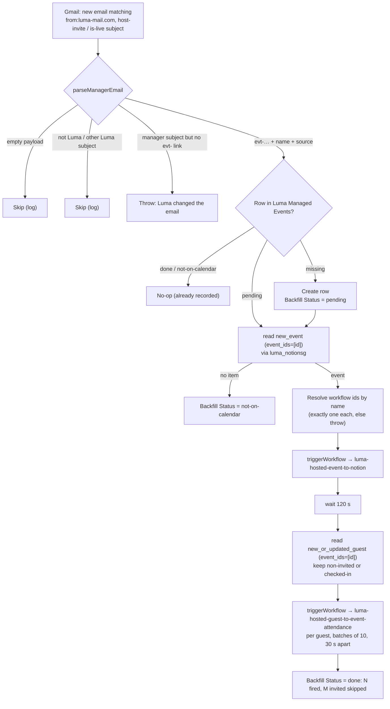

# Luma manager email → Luma Managed Events Table (+ backfill)

Durable workflow, Gmail trigger **`search`** (`GoogleMailV2CLIAPI@2.14.0`, query
`from:luma-mail.com subject:("Please join me as a host for" OR "is live on Luma")`).

It decides **which Luma events count as Dennis's**. The two Notion SG workflows,
[`luma-hosted-event-to-notion`](../luma-hosted-event-to-notion/) and
[`luma-hosted-guest-to-event-attendance`](../luma-hosted-guest-to-event-attendance/),
skip any event that is not in the **Luma Managed Events** Zapier Table
(`01M4ZRWQAHCB41XGGJ263S9BDH`), and this Zap is the only thing that writes to it.

## Why it exists

Dennis holds an API key for the **Notion Singapore** Luma calendar but isn't one of its managers, so Zapier's built-in Luma app (OAuth) can't see it. The private integration [`work-flowers/zapier-luma-hosted`](https://github.com/work-flowers/zapier-luma-hosted) polls it with the key instead. **Luma's API does not list hidden hosts**: Dennis is a hidden manager of Build Bar, and `event.hosts` shows only the three visible hosts. So the integration can't filter to Dennis's events and emits all of them. The filter is this Table, fed by the two emails Luma sends when someone becomes a manager:

| Email | Sent when | `Source` |
| --- | --- | --- |
| `Please join me as a host for <event>` | Someone adds Dennis as a host or manager (the access is immediate: "You have manage access to this event") | `host-invite` |
| `<event> is live on Luma` | Dennis creates an event | `created` |

Both carry `https://luma.com/event/manage/evt-…`, which is where the event id comes from. The subject has only the name, and names aren't unique.

## The backfill, and why the triggers alone are not enough

An event usually exists, with guests, before Dennis is added as a host. By then the polling triggers have **already delivered** the event and its guests, and the two workflows skipped them as unmanaged. Durables never re-deliver an id (`CLAUDE.md` → "Known Zapier bug"), so without a backfill the event and everyone who registered before the invite would be lost.

So after recording the event, this Zap:

1. Reads the event through the integration's `new_event` trigger, called as a **read action** with `event_ids: [id]` and `lookback_days: 30`. The integration's polling triggers are exposed as `read` actions to `sdk.runAction`. If it isn't on the Notion SG calendar (a host invite from workFlowers', Zapier's or Lenny's calendar), the key can't see it: the row is marked `not-on-calendar` and the run stops.
2. Resolves the two target workflows **by name** with `listWorkflows`, refusing on anything but exactly one match. They shipped in the same PR as this Zap, so their ids didn't exist to hardcode.
3. Fires `luma-hosted-event-to-notion` with the event (`source: "backfill"`), then waits 120 s so the Event page exists before any guest looks for it.
4. Reads every guest through `new_or_updated_guest` (same read-action trick) and fires `luma-hosted-guest-to-event-attendance` once per guest who is **not invited-only**, in batches of 10 with a 30 s pause, so Notion isn't hit in one burst.
5. Sets `Backfill Status` to `done: N guests fired, M invited skipped`.

`sdk.triggerWorkflow` is **not** subject to the trigger dedupe: two fires with the same top-level `id` both ran (verified 2026-10-15 on a probe). Both targets are idempotent upserts, so a guest that both the backfill and the live trigger deliver ends up in the same records. The one exception is a narrow race that could produce a second Attendance row if both runs land at the same moment (see "Concurrency" in the shared rules).

A second email for an already-recorded event (a re-invite, or an invite followed by "is live") is a no-op once its row says `done…` or `not-on-calendar`. A row still `pending` (a run that died mid-backfill) is retried.



## Verified (2026-10-15)

- **Parser**, against both real emails: Build Bar's host invite (`evt-WCXl3pOH3lRap1F`, `host-invite`) and *Automate your RevOps stack … is live on Luma* (`evt-ZFL2K9KLnSSXa1V`, `created`). An "Update for …" Luma email and a non-Luma sender skip. A manager subject with no manage link, and every required malformed shape, throw.
- **Read actions**: `new_event` with `event_ids` returns the one event, and `new_or_updated_guest` with `event_ids` returns all 254 Build Bar guests (live, read-only).
- **`triggerWorkflow`** into a polling-trigger durable works, and is not deduped on a repeated top-level `id`.
- **Not run end-to-end before merge**: it resolves its targets by name, and they don't exist until this PR publishes them. The first real run is the Build Bar backfill below.

## Seeded rows

The Table was created 2026-10-15 and seeded by hand with the one managed Notion SG event whose email predates this Zap:

| Luma Event ID | Event | Source | Backfill Status |
| --- | --- | --- | --- |
| `evt-WCXl3pOH3lRap1F` | Notion Build Bar Singapore | host-invite (2026-10-08) | `pending` |

**After merge, run its backfill once.** Fire this Zap with that Gmail message as input. Every write is an idempotent upsert, and the Event page plus one guest already exist from pre-merge testing.

```bash
zapier-sdk run-action gmail search message --connection 02dc1dc2-a395-8c45-8534-f6372752bb8c \
  --inputs '{"query":"from:luma-mail.com subject:\"Please join me as a host for Notion Build Bar Singapore\""}' --json \
  | jq -c '.data[0]' > /tmp/buildbar-email.json
zapier-sdk --stability experimental trigger-workflow <workflow_id> --input "$(cat /tmp/buildbar-email.json)" --json
```

## First-enable behaviour

Measured 2026-10-15 on a private, log-only probe durable (`luma-hosted-trigger-probe`) bound to `new_or_updated_guest` for Build Bar, which had 254 existing guests. It was published at 12:28 UTC, and the claim read back `active` with no error. **Enabling the trigger did not replay the existing guests**: there were zero trigger-delivered runs after enable, so the first poll seeds the dedupe silently, like a classic Zap. No guest changed during that window, so a run fired *by* a change is still unobserved; the PR records the follow-up.

Two consequences:
- **No need to park these Zaps disabled.** Enabling them neither replays the calendar's guests nor costs a run per existing guest. They publish enabled (`enable_on_publish: true`).
- **Old manager emails are not replayed either** (the Gmail trigger seeds the same way), which is why the Build Bar row above has to be backfilled by hand.

## Connections

| Alias | Connection | Used for |
| --- | --- | --- |
| *(trigger)* | Gmail `dennis@work.flowers` `02a57b11-…` | Polling the inbox |
| `luma_notionsg` | `Notion Singapore Community` `029a1f8f-fac5-8bc2-a786-741a6593d8e2` (App247901) | The two read actions in the backfill |

`listWorkflows` and `triggerWorkflow` run on the durable's ambient account credentials (`@zapier/zapier-sdk/experimental`), as in `zapier-error-email-to-triage`.

## Before touching it

- The workflow **names** `luma-hosted-event-to-notion` and `luma-hosted-guest-to-event-attendance` are load-bearing: renaming either breaks the backfill (it throws, so the failure is loud). Once both ids are stable they can be pinned in place of the name lookup.
- `isBackfillGuest` mirrors `isInvitedOnly` in the guest workflow. Keep them in step; the tests assert that they select the same 23 of 254 real guests.
