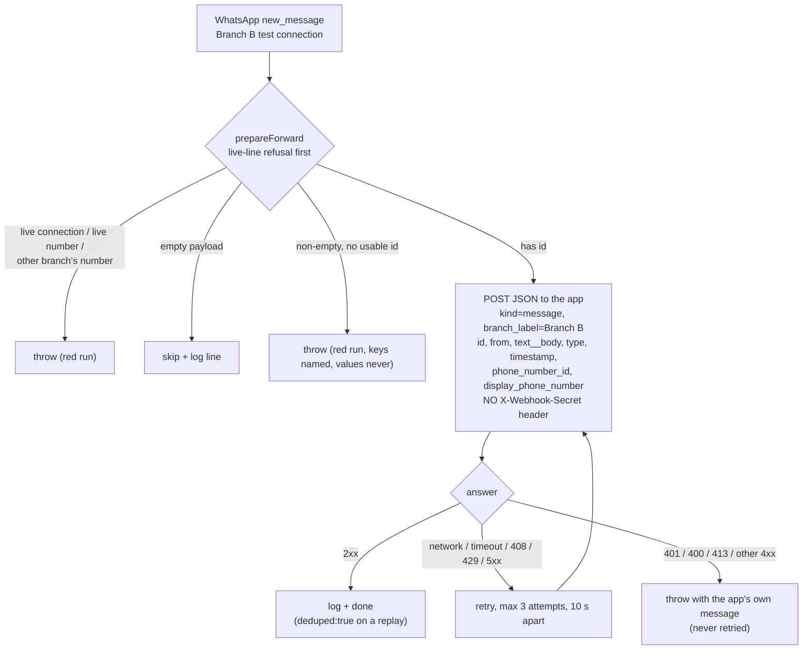

# multi-wavy-whatsapp-branch-b

Durable Zap for the Lovable WhatsApp multi-number spike (TKT-996). Every new inbound WhatsApp message on **Branch B (+1 711-921-8808)** is forwarded to the [`multi-wavy-numbers`](https://github.com/work-flowers/multi-wavy-numbers) app's inbound webhook, `https://multi-wavy-numbers.lovable.app/api/public/zapier/whatsapp`. Lovable allows only one WhatsApp connection per project, so the app uses Zapier as the provider for every number; outbound is already built in the app, and this is the inbound half. The sibling Zap [`multi-wavy-whatsapp-a`](../multi-wavy-whatsapp-a/) does the same for the other number; the two differ only in the constants at the top of `workflow.ts`. Shared logic lives in [`multi-wavy-whatsapp-forwarder/forwarder-core.ts`](../multi-wavy-whatsapp-forwarder/forwarder-core.ts).

- **Trigger:** WhatsApp Business (`App228834CLIAPI@1.4.6`) **New Message Received** (`new_message`), `only_replies: false`, `message_types` left unset (setting it silently drops `unsupported`, `location`, `sticker`, `contacts`, `reaction`). Bound to the Branch B test connection `025a64f5-1887-8d0a-8f36-f08c0183487b` through `trigger.authentication_id`.
- **Status events are not forwarded** (Dennis, 2026-10-17: the dedupe bug is not important), so there is no `message_status_updated` Zap.
- **Never the live line.** Connection `0240f561-4036-869d-bd75-4f2f28101022` (+65, the production [`whatsapp-slack-bridge`](../whatsapp-slack-bridge/) line) is refused in code, twice: the branch's connection id and display number are checked on every run before anything else, and a payload whose `display_phone_number` is the live number, or is not this branch's number, throws instead of forwarding.
- **State:** created and **enabled on merge** (`deploy.enable_on_publish: true`; Dennis, 2026-10-17: both connections are throwaway test numbers).



## What it sends

One JSON object, every value a string. `text__body` is the **flat** key the handler reads; the durable runtime delivers a nested `text.body`, so the core flattens it (`flatten` in `forwarder-core.ts`). Only these keys are sent:

`kind` (`"message"`), `branch_label` (`"Branch B"`), `id` (the wamid), `from`, `text__body`, `type`, `timestamp`, `phone_number_id`, `display_phone_number`.

The call is `sdk.fetch(url, { method: "POST", ... })` with **no `connection`**, the way every other durable in this repo makes an outbound HTTP call (Jev, Notion), minus a credential: it goes out through Zapier's Relay, which the durable sandbox allows (it blocks `hooks.zapier.com`).

## No webhook secret: the app rejects every POST for now

The handler requires `X-Webhook-Secret` and answers `401` (or `500` if the app has no `INBOUND_WEBHOOK_SECRET`) without it, logging a `rejected` row in `whatsapp_webhook_events`. Dennis decided the Zaps send **no** secret; the app's side of that is a separate change that has not landed. Until it does, **each inbound message produces a red run here and a Zapier error alert, by design (fail closed)**: nothing is stored in the app, and nothing is silently dropped. Do not paper over this by adding a header.

## Retry design

`forward-to-app` is one `ctx.step` with `maxAttempts: 3`, `retryDelaySeconds: 10`. Per `durables-sdk.md`, "retryable" must be a claim about why it failed, and a retry must not risk a double write:

- **Retried:** network failure, timeout, `408`, `429`, `5xx`, a relay error not marked non-retryable. These are ambiguous about whether the app wrote, which would normally forbid a retry. It is safe **here** because the handler is idempotent on the wamid: it upserts the event row on `delivery_id = zap:message:<wamid>` and the message row on `wa_message_id`, both `ignoreDuplicates`, so a replay answers `deduped: true` and writes nothing. Replaying lands in the same state. (Blind spot, the handler's and not fixable here: if attempt 1 stored the event row and then failed processing, the replay is deduped and does not re-process.)
- **Not retried, returned out of the step and thrown after it:** `401` (secret), `400` (contract), `413`, any other `4xx`, a relay `4xx` (for example the sandbox allowlist refusing the host), validation/auth errors. A replay cannot change those, and throwing them from inside the step would burn three attempts and replace the app's message with "exhausted all retry attempts". The run instead fails with `app rejected message <id> (<status>): <app's error>`.

`classifyAttempt` in `forwarder-core.ts` is the single pure function that decides, and is unit-tested.

## Empty and unrecognized payloads

The shared "skip an empty payload" rule exists because a public catch URL gets touched by hand. This is an **app trigger**, not a catch hook, so nothing public can hit it; the rules that do apply:

- **Empty** (`{}`, `null`, `""`, only empty wrapper keys such as `{"querystring":{}}`; an editor test or a bare `trigger-workflow`) **skips**, with a log line, and does not raise.
- **Non-empty with no usable `id`** (`{"data":{}}`, `{"data":{"id":""}}`, an unrelated object, a bare string) **throws**. That is a real event in a shape we do not understand (Meta or the WhatsApp app changed it), and the repo's default mechanism (CLAUDE.md) is a red run plus an alert, never a silent drop. The message names the keys it saw and never their values, since message text is private.
- A **missing `display_phone_number`** is tolerated (the app falls back to `branch_label`); a **present but wrong** one throws (see above).
- Non-text types (`image`, `audio`, `location`, `unsupported`...) forward as-is; the handler stores `[type]` when there is no text.

## Tests

`multi-wavy-whatsapp-forwarder/durable.test.ts` (plus the older `forward.test.ts`), `node --test`, Node >= 22.18:

```bash
cd multi-wavy-whatsapp-forwarder && node --test forward.test.ts durable.test.ts
# type-check per .claude/rules/durables-sdk.md, in a scratch dir with the pinned deps
# (@zapier/zapier-durable 0.14.1, @zapier/zapier-sdk 0.115.1, typescript, @types/node):
npx tsc --target es2022 --module nodenext --moduleResolution nodenext --strict --skipLibCheck --noEmit --noUnusedLocals --allowImportingTsExtensions workflow.ts
```

They cover a dozen payload shapes (flat, nested, media, emoji/quotes, numeric ids, double-encoded JSON, missing display number, extra fields not leaked), the six mandated empty shapes, the body replayed against a mirror of the handler's contract, the live-connection and live-number refusals, retry classification, and that this directory's `zap.json`, `workflow.ts` and the `forwarder-core.ts` copy agree with the canonical ones.

## Maintenance

- `forwarder-core.ts` here is a **byte-identical copy** of the canonical one in `multi-wavy-whatsapp-forwarder/` (the publisher only reads files inside a Zap's own directory). Edit the canonical file, copy it into both branch directories; the test fails if a copy drifts. It is published as an extra `source_files` entry, imported as `./forwarder-core.ts` (the explicit `.ts` specifier is required, see `durables-sdk.md`).
- This Zap is **not** a webhook-trigger durable: there is no catch URL and no `webhook_url` to record.
- The trigger's real field names (`text__body` vs nested `text.body`, `display_phone_number`) were **not** verified against a live delivery (no Zapier credentials in the build environment); both spellings are handled. After the first real message, read the run's input in the Zap history and confirm.

## Not verified offline

First-publish metadata (the version-pinned `selected_api`, the trigger claim), whether the durable sandbox's network allowlist lets `multi-wavy-numbers.lovable.app` through an unauthenticated `sdk.fetch`, and the app's answer (currently `401`). After merge: check `get-workflow` shows `enabled: true` and a non-empty `triggers[]`, send one message to +1 711-921-8808 from a personal phone, and expect a red run with `401` until the app's auth change lands, then a green run and a `wa_messages` row.
