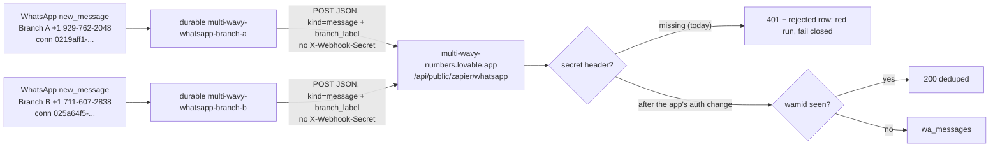
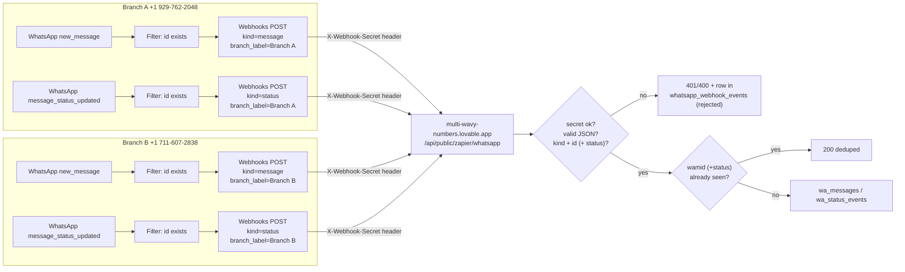

# multi-wavy-whatsapp-forwarder

> **Superseded plan. The build is now two DURABLE Zaps, not four classic ones.** On 2026-10-17 Dennis decided: one durable per WhatsApp connection (two total), `new_message` only (status events are ignored; the dedupe bug is not important), and **no webhook secret** sent. The durables are [`multi-wavy-whatsapp-branch-a`](../multi-wavy-whatsapp-branch-a/) (+1 929-762-2048) and [`multi-wavy-whatsapp-branch-b`](../multi-wavy-whatsapp-branch-b/), and they publish and **enable on merge** on the two throwaway test connections. The classic-Zap spec in [`forwarder-spec.json`](forwarder-spec.json) and the "Why classic Zaps" / "Build spec" / "End-to-end test" sections below are kept as a **historical record only**; do not build from them. This directory itself has no `zap.json` and is never published; it holds the shared, tested logic.

Spike **TKT-996**. Lovable allows only **one** WhatsApp connection per project, so the Lovable app [`multi-wavy-numbers`](https://github.com/work-flowers/multi-wavy-numbers) uses Zapier as the WhatsApp provider for **every** number. Outbound is already built (the app calls the SDK `runAction` with the branch's connection id). This directory covers **inbound**: forwarding each number's WhatsApp events to the app's webhook.

## Current plan: two durables



- **What is here:** [`forwarder-core.ts`](forwarder-core.ts) is the canonical, dependency-free logic both durables import (payload to body mapping, the live-connection and live-number refusal, empty/unrecognized-payload handling, retry classification). Each branch directory carries a **byte-identical copy** (the publisher only reads files inside a Zap's own directory); `durable.test.ts` fails if one drifts. [`forward.ts`](forward.ts) keeps the handler-contract mirror (`checkHandlerContract`) the new tests replay against, and re-exports `flatten`; its classic-spec helpers are superseded.
- **The app rejects every POST until its own auth change lands.** The Zaps send no `X-Webhook-Secret`, the handler requires it, so each inbound message is a red run with a `401` for now. That is expected and fail-closed; the app-side change is separate.
- **Never the live line** `0240f561-4036-869d-bd75-4f2f28101022`: refused in code and tested.
- Design, retry reasoning and the empty/unrecognized-payload rules are in each durable's README ([A](../multi-wavy-whatsapp-branch-a/README.md), [B](../multi-wavy-whatsapp-branch-b/README.md)).

## Historical: the classic-Zap design

## Flow



[`forwarder-spec.json`](forwarder-spec.json) is the machine-readable form of the four Zaps; [`forward.ts`](forward.ts) and [`forward.test.ts`](forward.test.ts) replay it against sample payloads and the handler contract.

## Why classic Zaps and not Durables

Researched offline (no Zapier credentials were available in the container), from this repo's rules, scripts and READMEs:

1. **A durable carries exactly one trigger.** `publish-workflow-version --trigger` takes a single JSON object ([`spot-project-request-to-notion/two-trigger-design.md`](../spot-project-request-to-notion/two-trigger-design.md): "One trigger per version means 'two triggers' is necessarily two workflows"). A trigger also binds one `authentication_id`, i.e. one number. Two numbers x two triggers = **four workflows**, durable or classic.
2. **The pipeline cannot create four from one directory.** The brand-new-Zap path (`readCreateSpec` in [`scripts/publish-changed-zaps.mjs`](../scripts/publish-changed-zaps.mjs)) reads a single top-level `deploy` block and `trigger` and publishes `workflow.ts`; multi-deployment directories such as [`whatsapp-slack-bridge`](../whatsapp-slack-bridge/) only work for deployments that already have a `workflow_id`. Four durables would mean four near-identical directories, or a pipeline change, or hand-creating them (which rule "never create a Zap by hand" forbids).
3. **A durable has no place to keep the secret.** There is no secret store or env-var mechanism for durables anywhere in the rules or skills (a repo-wide search finds none). The only secret-out-of-source pattern is the Jev one in [`CLAUDE.md`](../CLAUDE.md): `sdk.fetch` through an *API by Zapier* connection that holds the credential. It would work here only if an *API by Zapier* connection can carry a **custom header name** (`X-Webhook-Secret`) rather than a Bearer token. That is **unverified**, the connection does not exist, and it would have to be created by hand in the Zapier UI first. Until it exists, a pending-create PR would fail at publish.
4. **Status events collide with the durable dedupe bug.** CLAUDE.md records that durables dedupe app-trigger events on the raw event id (ticket W6ZE93-VMEWP) and drop a repeat. A WhatsApp status update's `id` is the message's wamid, and one message produces `sent`, `delivered` and `read` with that same id. A durable on `message_status_updated` risks forwarding only the first status per message. (The live bridge's status durable may be affected the same way; not investigated here.) The Lovable handler is built for the opposite, dedupe on **wamid + status**.
5. **Classic Zaps hold the secret in the Zap itself.** The Webhooks by Zapier step has a Headers field: the secret is typed there in the UI, so it is never in this repo, and an editor can rotate it without a code change. Header values are visible to anyone who can edit the Zap, which is the same exposure as an API by Zapier connection.
6. **The trigger's real field names can be read in the editor.** No CLI command exposes a trigger's output shape (noted in the root README's `esignatures-status-to-notion` row); in the Zap editor, "Test trigger" shows the exact keys before the mapping is built.

**Recommendation: four classic Zaps.** Cost: they are built by hand (creation of classic Zaps is not available from the CLI or MCP per the repo rules, which say classic Zaps can only be switched off in the UI), and each forwarded event costs about one task (the Webhooks step; triggers and Filters are normally free, confirm against the plan's task accounting). If the status-dedupe worry in point 4 is later cleared and an *API by Zapier* header connection is proven, four durables remain possible but would need pipeline support first.

## Build spec (do this in the Zapier UI, with the TEST connections only)

Build four Zaps. Names and connections come from [`forwarder-spec.json`](forwarder-spec.json); the table is the human copy.

| Zap name | Trigger event | Connection (explicit) | `kind` | `branch_label` |
| --- | --- | --- | --- | --- |
| Multi-Wavy WA \| Branch A \| new message | `new_message` | Branch A `0219aff1-73d3-866c-98a1-3f6cff9b4bf9` (+1 929-762-2048) | `message` | `Branch A` |
| Multi-Wavy WA \| Branch A \| message status | `message_status_updated` | Branch A (same) | `status` | `Branch A` |
| Multi-Wavy WA \| Branch B \| new message | `new_message` | Branch B `025a64f5-1887-8d0a-8f36-f08c0183487b` (+1 711-607-2838) | `message` | `Branch B` |
| Multi-Wavy WA \| Branch B \| message status | `message_status_updated` | Branch B (same) | `status` | `Branch B` |

> **NEVER** bind `0240f561-4036-869d-bd75-4f2f28101022`: the live +65 production line, and the default connection the Zapier UI/MCP may preselect. Pick the account explicitly in every trigger step and check the account label (WABA / number) before turning the Zap on. The live line is already consumed by the production [`whatsapp-slack-bridge`](../whatsapp-slack-bridge/). [`forward.test.ts`](forward.test.ts) asserts the spec never references it.

**Step 1, Trigger.** App **WhatsApp Business** (`App228834CLIAPI`, v1.4.6), event as in the table, the connection from the table.
- `new_message`: `only_replies` = false; leave `message_types` **unset** (setting it silently drops `unsupported`/`location`/`sticker`/`contacts`/`reaction`).
- `message_status_updated`: select all four `status_types` (`sent`, `delivered`, `read`, `failed`); confirm the choice values in the editor. The handler dedupes on wamid + status, so it wants every status. (The production bridge excludes `sent` for its own reasons; do not copy that.)
- Click **Test trigger** and confirm the sample carries the fields in the mapping below. Record the exact field names (the spec assumes the flattened `text__body`).

**Step 2, Filter by Zapier.** Only continue if **`id` Exists**. A real WhatsApp message or status always has a wamid; without one the handler would return `400 missing id` and log a rejected row. For the status Zaps add a second condition, **`status` Exists**.

**Step 3, Webhooks by Zapier, POST.**
- URL: `https://multi-wavy-numbers.lovable.app/api/public/zapier/whatsapp`
- Payload Type: **Json** (this makes Zapier escape quotes, newlines and emoji in the message text. Do **not** use a hand-written Custom Request body with `{{text__body}}` inside quotes, it breaks on the first `"`).
- Wrap Request In Array: **No**. **Unflatten: No**. This matters: with Unflatten on, Zapier splits `text__body` on the double underscore and sends `{"text":{"body":...}}`, but the handler reads the flat key `text__body`, so every message body would be lost and stored as `[text]`.
- Data (key = value; tokens in `{{ }}` are the trigger's fields, everything else is a literal):

| `kind: message` Zaps | `kind: status` Zaps |
| --- | --- |
| `kind` = `message` | `kind` = `status` |
| `branch_label` = `Branch A` or `Branch B` (literal) | `branch_label` = `Branch A` or `Branch B` (literal) |
| `id` = `{{id}}` | `id` = `{{id}}` |
| `from` = `{{from}}` | `status` = `{{status}}` |
| `text__body` = `{{text__body}}` | `recipient_id` = `{{recipient_id}}` |
| `type` = `{{type}}` | `timestamp` = `{{timestamp}}` |
| `timestamp` = `{{timestamp}}` | `phone_number_id` = `{{phone_number_id}}` |
| `phone_number_id` = `{{phone_number_id}}` | `display_phone_number` = `{{display_phone_number}}` |
| `display_phone_number` = `{{display_phone_number}}` | |

- Headers: `X-Webhook-Secret` = **the value of the app's `INBOUND_WEBHOOK_SECRET`**. Typed by Dennis in the Zapier UI. It is not known to this repo and must never be committed, pasted into a README, or logged. Add no other secret-bearing header.
- Basic Auth: empty. Leave **Send As Is**, **Follow Redirects** at defaults.

**Step 4.** Leave each Zap **off** until the end-to-end test (below). Turn on one branch at a time.

### What the handler checks (contract)

From [`src/lib/zapier-inbound.server.ts`](https://github.com/work-flowers/multi-wavy-numbers/blob/main/src/lib/zapier-inbound.server.ts) in `multi-wavy-numbers`: missing or wrong `X-Webhook-Secret` -> 401 (or 500 if the app has no secret configured); body over 256 KB -> 413; invalid JSON or a non-object -> 400; `kind` not `message`/`status` -> 400; missing `id` -> 400; `kind=status` without `status` -> 400. Every rejection is stored in `whatsapp_webhook_events` with the secret redacted. It maps the number by `phone_number_id` first and `branch_label` as fallback, and dedupes on `zap:message:<wamid>` and `zap:status:<wamid>:<status>`.

## Tests

```bash
cd multi-wavy-whatsapp-forwarder
node --test forward.test.ts durable.test.ts   # Node >= 22.18 strips the types itself
# type-check, per .claude/rules/durables-sdk.md (scratch dir with typescript + @types/node):
npx tsc --target es2022 --module nodenext --moduleResolution nodenext --strict --skipLibCheck --noEmit --noUnusedLocals --allowImportingTsExtensions forwarder-core.ts forward.ts forward.test.ts durable.test.ts
```

They cover: flat and nested text messages, media with no text, quotes/newlines/emoji surviving the JSON body, numeric timestamps, all four statuses, distinct dedupe ids for sent/delivered/read, status lower-casing, the six repo-mandated empty shapes (`{}`, `null`, `""`, an unrelated object, `{"data":{}}`, `{"data":{"id":""}}`) plus `{"querystring":{}}`, a mirror of the handler's rejection rules, and spec safety (four Zaps, one connection per branch, the live id refused, no secret value in the spec). The handler mirror in `forward.ts` is a copy: if the handler changes, update it.

**These tests do not touch Zapier, send nothing, and prove only the mapping and contract.** They cannot prove the trigger's real field names or that the Webhooks step reaches the app.

## End-to-end test (needs Dennis; not done)

1. Build and test-trigger the four Zaps as above (all off).
2. Turn on **Branch A** only. From a personal phone, message +1 929-762-2048. Expect: a `wa_messages` row with `branch_label` Branch A holding the real text (not `[text]`, which would mean the body was nested) and a `whatsapp_webhook_events` row `whatsapp.message` (`unmapped=true` until `zap_numbers.phone_number_id` is filled, see below).
3. Reply from the Lovable app through Branch A's connection. Expect `sent`, `delivered`, `read` rows in `wa_status_events` for the same wamid: **three rows**, which proves the status Zap forwards repeats of one id.
4. Repeat for Branch B. Check Branch A's Zaps do not fire for Branch B traffic.
5. Replay a duplicate (Zapier **Replay**) and confirm `deduped: true`.

## After the first inbound webhook: fill `zap_numbers.phone_number_id`

The handler maps by `phone_number_id` first, but `zap_numbers.phone_number_id` is empty until someone fills it, so early events arrive `unmapped` (mapped by `branch_label` fallback). After the first message per number, read `phone_number_id` from that event's `payload` in `whatsapp_webhook_events` (or the Zap's Webhooks step history) and write it to the matching `zap_numbers` row. It is one id per number and is **not** the same as the display number.

## Open questions

- Does the WhatsApp trigger deliver `text__body` flattened in the classic editor exactly as in the spike spec? (Confirm with Test trigger.)
- Are `error_code` / `error_message` available on `failed` status events? The handler reads them if sent, but the spec's status field list does not include them, so failures currently carry no error detail.
- Does a classic REST-hook trigger deliver repeat statuses for one wamid, or dedupe on id? Step 3 of the E2E test answers this.
- The webhook secret value (held by Dennis). Rotating it means editing four Zaps' headers and the app's `INBOUND_WEBHOOK_SECRET` together.
