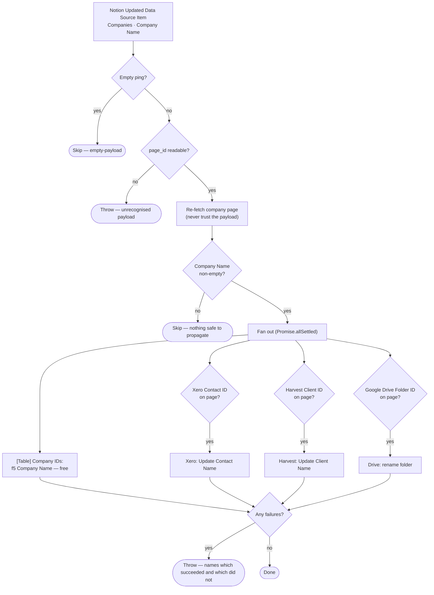

# notion-company-renamed-to-xero-harvest-drive

Notion **Company Name** changed → rename that
company in **Xero**, **Harvest**, **Google Drive** and **[Table] Company IDs** —
each only where that system's id is recorded on the page.

Migration of the classic Zap **"Sync Company Name Updates to Xero, Harvest, and
Zapier Table"**.

- **Workflow ID:** `01a028c7-92f0-747d-939f-2b147b4b3e18` (account-visible)
- **Trigger:** Notion `updated_data_source_item_properties` (`NotionCLIAPI@2.39.1`)
  on **Companies**, watching only **Company Name**, on the work.flowers Notion
  connection. Restored 2026-10-29 after Zapier fixed W6ZE93-VMEWP. From
  2026-10-15 to 2026-10-29 a classic hand-off Zap fed a catch hook instead,
  because durables fired this trigger **once per company, ever** (see
  [Classic hand-off](#classic-hand-off-retired-2026-10-29)).
- **Editor:** <https://zapier.com/durables-editor/01a028c7-92f0-747d-939f-2b147b4b3e18>

## Workflow

## What changed vs the classic Zap

- **Ids come off the Notion page, not the Table.** The classic Zap looked the
  four ids up in [Table] Company IDs and halted the entire run when the company
  had no row there. The durable reads them from the page it already has to
  fetch — fresher, one fewer lookup, and no dependency on the mirror having
  caught up. Same precedent as
  [`xero-contact-from-notion-deal`](../xero-contact-from-notion-deal/) and
  [`deal-to-client-drive-folder`](../deal-to-client-drive-folder/).
- **The four writes stay independent.** The classic Zap ran them as four
  parallel paths, so a Xero failure never blocked Harvest. `Promise.allSettled`
  over four `ctx.step`s keeps that: all four are attempted, each retried up to 3
  times, and the run then fails loudly with a message naming which targets
  succeeded and which did not. Steps that succeeded stay checkpointed, so a
  retry only redoes the failed one.
- **A blank Company Name skips.** Renaming a Xero contact, Harvest client or
  Drive folder to `""` is destructive, and a blank title is a real state for a
  freshly created row.
- **The Xero tenant is a source constant** (`62699a8c-…`), matching the other
  Xero Zaps here. The classic Zap pulled it from a Zap component variable, which
  has no durable equivalent.

## Classic hand-off (retired 2026-10-29)

> **Retired 2026-10-29.** Zapier fixed W6ZE93-VMEWP (verified 2026-10-28), so this durable is back on the native Notion trigger. Turn the classic Zap *"Company Renamed → hand off to durable"* **off** once the republish lands: its catch URL stops working when the trigger is replaced. The `classic-handoff` branch in `workflow.ts` stays, unused. The rest of this section is kept as a record.

**Why it exists:** durables add a dedupe layer keyed on the trigger record's raw
`id` (Zapier bug W6ZE93-VMEWP, confirmed 2026-09-08, no ETA). Notion's trigger
sends the bare page id, so this Zap fired once per company and then never again:
**48 of its 49 runs (2026-08-24 → 2026-10-14) fired on the day the company was
created**, so renames of established companies never reached Xero, Harvest or
Drive. Classic Zaps dedupe on a record's id *and* its edit time, so a thin
classic Zap watches Notion and forwards each rename here. Zapier Support
recommended this workaround on 2026-09-08 and again on 2026-10-14.

**The catch hook dedupes too.** A raw catch hook drops a second POST whose
top-level `id` it has already seen (proven 2026-10-01 on
[`save-tagged-docs-to-notion`](../save-tagged-docs-to-notion/)). So the hand-off
must **not** send the page id as `id`. It sends `<page id>_<last edited time>`,
and the page id goes in `page_id`. On this path the workflow never reads `id`.

**Payload contract** (Webhooks by Zapier POST, Payload Type `json`):

| Key | Value mapped in the classic Zap |
| --- | --- |
| `source` | `classic-handoff` (literal) |
| `id` | `{{ID}}_{{Last Edited Time}}`: the dedupe key, which must change on every edit |
| `page_id` | `{{ID}}` |
| `last_edited_time` | `{{Last Edited Time}}` (logged only) |

**Setup (Zapier UI; the CLI and MCP can't create classic Zaps):**

1. Start from the disabled classic Zap *"Sync Company Name Updates to Xero,
   Harvest, and Zapier Table"* (duplicate it) or a new Zap. Name it **"Company
   Renamed → hand off to durable"**.
2. **Trigger:** Notion → *Updated Data Source Item*. Connection: the
   work.flowers Notion account (never Knoxx). Data source **Companies**. Watch
   only **Company Name**.
3. **Delete every other step.** The durable does the renaming.
4. **Action:** Webhooks by Zapier → *POST*. URL = this Zap's catch URL from
   `zap.json` `trigger.webhook_url`. Payload Type `json`. Data = the table above.
   Leave *Wrap Request in Array* and *Unflatten* at **No**.
5. Test it by renaming a scratch company in Notion (rename it back afterwards),
   then check `list-workflow-runs` for a run with `renamed: [...]`. Rename the
   same company a second time and confirm a **second** run appears. That second
   run is the whole point of the hand-off.
6. Turn the classic Zap on.

**Cost:** 1 classic task per rename (the POST), plus the durable's usual tasks.
Renames are rare.

**When Zapier fixes W6ZE93-VMEWP:** switch this durable back to the native Notion
trigger in `zap.json`, re-verify with two renames of the same company, then turn
the classic Zap off. The hand-off branch can stay. A raw page id still works.

## Maintainer notes

- Connections: `notion_wf` = `02b73654-15c8-85c3-b16a-07304d2beb17` (work.flowers
  Notion — **never** the Knoxx connection), `xero_wf` =
  `02336808-1736-878b-a0a8-87e02bb0aec3`, `harvest_wf` =
  `02df9d5d-89ea-8dab-bb40-8ee0c2ac4362`, `gdrive` =
  `02eb8724-3fc7-8edc-9b30-be83af0b327f`.
- Xero and Harvest renames go through **custom actions** on those apps —
  `XeroCLIAPI` `ae:515080` (Update Contact Name) and `HarvestCLIAPI` `ae:541562`
  (Update Client Name), the same two the classic Zap called. Both are
  account-defined, so they will not appear in a fresh account; confirm with
  `list-actions <app> --action-type write` before assuming they moved.
- The Table write deliberately leaves `Notion Last Edited` alone, so
  [`notion-companies-to-zapier-table`](../notion-companies-to-zapier-table/)'s
  staleness guard keeps working. That mirror also carries the name across on its
  own webhook; this write just makes the rename land immediately, and is free.
- The Drive step passes no `drive`, matching the classic Zap — folder ids are
  global.

## Cutover

**Hand-off cutover: done 2026-10-15.** The classic Zap *"Company Renamed → hand
off to durable"* is live and POSTs to `…/Y69AnJjpYIfSVC1D/`. Two renames of
3 Cricket produced two runs (00:36Z and 00:40Z). Both renamed the Table, Xero,
Harvest and Drive, so the dedupe bug no longer blocks a second rename. On the
first run Xero's custom rename action hit Zapier's 180 s action limit and
succeeded on the step's retry. Watch for that if Xero renames start failing.

**Original migration: complete as of 2026-08-22.** The classic Zap **"Sync Company Name Updates to
Xero, Harvest, and Zapier Table"** was disabled and this durable enabled the
same day. The disable is **not machine-verifiable** — classic Zaps are exposed
by neither the SDK CLI nor the MCP connector — so it rests on Dennis's
confirmation. Verified on this side: `enabled: true` with the trigger `status:
active` and no trigger error.

## Testing

Not yet run. Every path in this workflow is a rename in a production system, so
there is no side-effect-free happy path to exercise with `run-durable`; the
skip path (a company with a blank name) proves nothing about the code after it.
Verified read-only instead: both custom actions' input fields
(`contactId`/`newName`/`xeroTenantId`, `clientId`/`newName`) against the live
connections, the Drive `update_file_name` fields, and that `title` is a real
`watched_properties` choice for the Companies data source. **Watch the first
live run after cutover.**

**Hand-off path (2026-10-15), offline only.** A harness with a fake `ctx` covered
`{}`, `null`, `""`, a wrapper-only body, an unrelated object, `{"data":{}}` and
`{"data":{"id":""}}`: the four empty shapes skip and the rest throw. A hand-off
with a `page_id` reaches the page fetch. A hand-off **without** one throws
instead of falling back to the composite `id`, and so does a non-UUID `page_id`.
A raw trigger page and a bare page-id string still work for replays. No
`run-durable` test: every path past the fetch is a production rename. **The
first real proof is the setup test in [Classic hand-off](#classic-hand-off-retired-2026-10-29):
rename one company twice and check that both renames produce a run.**

`tsc` reports two errors in this file (`TS2589`/`TS2322` on the
`defineDurable({ … inputSchema: z.unknown() })` object form). Both are
pre-existing and identical on the unmodified file. They come from
`@zapier/zapier-durable` bundling its own copy of zod. The deployed version runs,
and the analyzer accepts this form (probed 2026-10-15 with `validate-workflow`).
