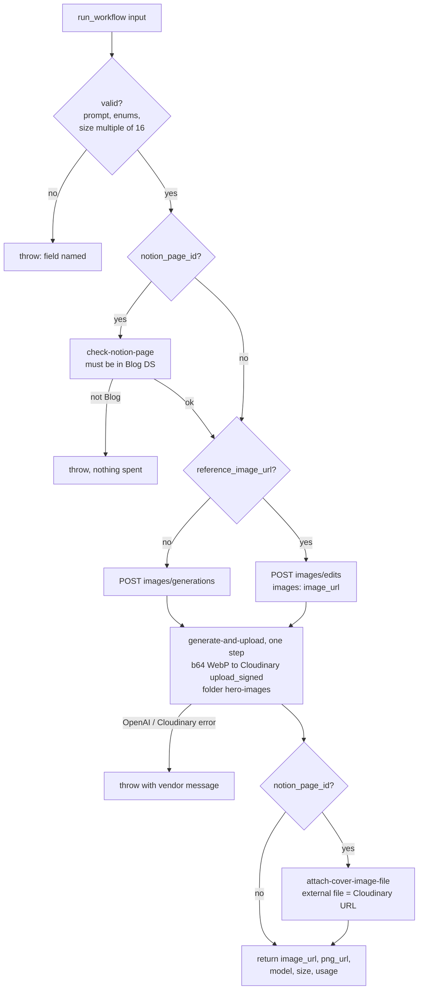

# openai-image-to-cloudinary

On-demand durable that generates an image with OpenAI **GPT Image 2.6** (`flare` or
`sunburst`), hosts it on **Cloudinary** in the `hero-images` folder, and **returns the
hosted URL** instead of base64. It can also attach that URL to a Blog page's
**Cover Image File** property in Notion.

It replaces the direct OpenAI calls in the `hero-image-prompting` skill. A raw GPT
Image response is a multi-megabyte `b64_json` string, too large to pass back through
the Zapier MCP connector. This Zap keeps the base64 inside one step and hands back a
short URL.

- **Start mode:** manual, with no trigger. The skill calls it with Zapier MCP
  `run_workflow` and reads the return value from the run, in the same session. A
  catch hook would be fire-and-forget and couldn't return the URL.
- **Workflow ID:** `01a1c8b3-5044-7297-b62c-8f412cbe6dfc` · account-visible · enabled
  (published 2026-11-11 via PR #293)
- **Editor:** https://zapier.com/durables-editor/01a1c8b3-5044-7297-b62c-8f412cbe6dfc
- **Connections:** `openai_wf` ChatGPT (OpenAI), `cloudinary_wf` Cloudinary
  ddvqw2xgc, `notion_wf` the work.flowers Notion workspace.



## How to call it

Zapier MCP `run_workflow` with `workflow: "01a1c8b3-5044-7297-b62c-8f412cbe6dfc"` and
`input` set to:

| Field | Required | Default | Notes |
| --- | --- | --- | --- |
| `prompt` | yes | | |
| `model` | | `gpt-image-2.6-flare` | or `gpt-image-2.6-sunburst` |
| `size` | | `1824x1024` | `WxH`, both sides multiples of 16 |
| `quality` | | `medium` | `low` / `medium` / `high` |
| `complexity` | | `low` | `low` / `medium` / `high` |
| `reference_image_url` | | | public http(s) URL; switches to `/v1/images/edits` |
| `filename` | | random | becomes the Cloudinary public id (extension and unsafe characters dropped); reusing a name overwrites |
| `notion_page_id` | | | Blog page; its **Cover Image File** is replaced with the Cloudinary URL |

`run_workflow` waits up to 50 s. Generations here took about 15–40 s; if it comes back
still running, call `check_workflow_run`, then `get_run_output` with
`include_results: true`.

A finished run returns:

```json
{
  "image_url": "https://res.cloudinary.com/ddvqw2xgc/image/upload/v…/hero-images/<name>.webp",
  "png_url":   "https://res.cloudinary.com/ddvqw2xgc/image/upload/v…/hero-images/<name>.png",
  "format": "webp", "model": "gpt-image-2.6-flare", "size": "1824x1024",
  "quality": "low", "complexity": "low", "mode": "generate",
  "public_id": "hero-images/<name>", "width": 1824, "height": 1024,
  "bytes": 573132, "base64_chars": 764176,
  "usage": { "input_tokens": 35, "output_tokens": 588, "…": "…" },
  "notion_page_id": null, "notion_updated": false
}
```

A failed run throws, so `run_workflow` returns `status: failed` and an `error` holding
the vendor's own message, for example
`OpenAI 400: Invalid size '16x16'. Requested resolution is below the current minimum pixel budget.`

## Behaviour notes

- **WebP, not PNG: a platform limit, not a preference.** Zapier caps an *outbound*
  request body at about 1 MB, for both `runAction` inputs and `sdk.fetch`. Probed
  2026-11-11: 900 KB went through and 1.5 MB came back as `HTTP 413`. A medium
  1824x1024 PNG measured 4.5 MB (6.1M base64 characters), so a PNG can never reach
  Cloudinary from a durable. The Zapier relay has no auth template for Cloudinary
  either, so a direct signed upload isn't possible, and Cloudinary's chunked upload
  needs chunks of at least 5 MB. OpenAI is therefore asked for `output_format: "webp"`
  at `output_compression: 80`, which came to 140–573 KB in testing. `png_url` is the same
  asset with a `.png` extension; Cloudinary converts it on delivery (verified:
  `content-type: image/png`). A response still over 950,000 base64 characters fails
  with a clear message rather than a bare 413.
- **Generate and upload are one step, deliberately.** The base64 never leaves the
  step, so it never lands in a step checkpoint or in the run output, which is the
  point of this Zap. The step runs **once** (`maxAttempts: 1`). A retry would pay
  OpenAI for a second image, and an exhausted retry hides the vendor's message behind
  "Step … exhausted all retry attempts". Errors come back from the step as data and
  are thrown, verbatim, from the workflow body.
- **`Content-Type: application/json` is sent explicitly.** OpenAI answers 400 without
  it. The edits endpoint takes JSON with `images: [{ image_url }]`; no multipart is
  needed. OpenAI is called with `sdk.fetch` on the `openai_wf` connection rather than
  the ChatGPT app's *API Request* action, which would put the base64 in an action
  result.
- **The Notion guard runs before the image is generated.** A `notion_page_id` outside
  the Blog data source (`1d791b07…`) throws before anything is spent. The property is
  *replaced* with one external file pointing at Cloudinary, whose URLs don't expire.
  The page cover is not touched; [`notion-blog-post-to-hero-image`](../notion-blog-post-to-hero-image/)
  still owns that.
- **No empty-ping guard is needed:** there is no catch URL, and an empty input has no
  `prompt`, so it throws before any write.

## Cost

OpenAI list price for both 2.6 models is $5/M text input, $8/M image input and $30/M
image output tokens (from secondary sources, not yet checked on OpenAI's own pricing
page). The `usage` block is returned, so the exact figure is always available.

| Test (2026-11-11) | Tokens | ≈ OpenAI cost |
| --- | --- | --- |
| flare, 1824x1024, `low`, text-only | 35 text in, 588 image out | $0.018 |
| flare, 1824x1024, `medium`, text-only (direct probe) | 35 text in, 997 image out | $0.030 |
| sunburst edit, 1824x1024, `low`, one reference | 57 text + 1,508 image in, 588 image out | $0.030 |

Each run also uses Zapier tasks for the action and fetch steps.

## Tested

**Acceptance, 2026-11-11, through Zapier MCP `run_workflow` + `get_run_output` on the
published v1 (`01a1c8b3-88b8-…`):**

- flare, `low`, text-only → `finished` in 17 s,
  `hero-images/acceptance-flare-low.webp` (run `01a1c8b3-d750-…`). `get_run_output`
  returns the same output.
- sunburst edit, `low`, reference = the image above → `finished` in 20 s,
  `hero-images/acceptance-sunburst-edit.webp` (run `01a1c8b4-36bf-…`).

The operations journal shows `max_attempts: 5` on the completed generate step. That is
the server's default on a *completed* checkpoint (durable 0.14.1 doesn't send it on
success). The client enforces the step's `maxAttempts: 1` when deciding whether to retry.

Before publish, 2026-11-11 with `run-durable` (hosted, same runtime as production):

- flare, `low`, text-only → `hero-images/zap-test-flare-low.webp`, 1824x1024; both
  `image_url` and `png_url` serve.
- sunburst edit, `low`, reference = the image above → `hero-images/zap-test-sunburst-edit.webp`;
  the output visibly keeps the reference scene and applies the edit.
- `notion_page_id` on a scratch Blog page → Cover Image File holds the Cloudinary URL.
- `notion_page_id` on a Tasks page → throws before generating.
- `size: "16x16"` → throws with OpenAI's 400 message.
- The first attempt, with PNG output, failed with Cloudinary `HTTP 413`, which is
  what established the limit above.
