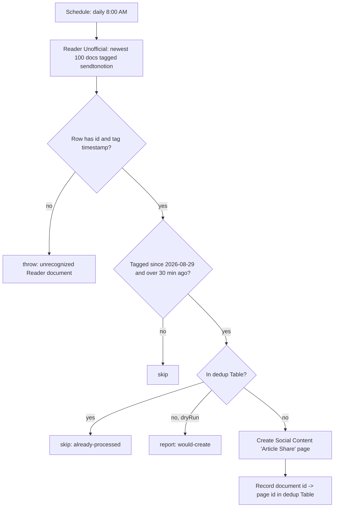

# save-tagged-docs-sweep

> **⏸️ Disabled 2026-10-28.** Zapier fixed W6ZE93-VMEWP: the trigger Zap now re-fires when a document it has already seen is tagged again (verified in run history from 2026-10-22), so this backstop is redundant. The workflow is kept, disabled, in case a late tag is ever missed again.

Daily backstop for [`save-tagged-docs-to-notion`](../save-tagged-docs-to-notion/). It lists the Readwise Reader documents tagged **`sendtonotion`** and creates the **"Article Share"** Social Content page for any the shared dedup ledger is missing.

## Why it exists

The trigger Zap's Readwise trigger is deduped on the document id by the durable runtime (Zapier bug W6ZE93-VMEWP, confirmed 2026-09-08, no ETA), so it fires **once per document, ever**. Reader auto-tags articles when they're saved, which usually uses up that one firing, so a `sendtonotion` tag added later never reaches the workflow. Nothing errors. Missed tags were backfilled by hand on 2026-10-01 and 2026-10-14 before this sweep existed.

**Retired 2026-10-28**, after Zapier shipped the fix (see the note at the top).

## Why no Readwise token is needed

The README of the trigger Zap used to say a sweep needed a stored Readwise access token, because Zapier's relay won't attach the official Readwise connection's credentials to `sdk.fetch`, and the official app (`App228555CLIAPI`) has no list or search action. This sweep uses a different app: work.flowers' own private **Readwise Reader (Unofficial)** app (`App233250CLIAPI`). Its `new_tagged_document` read returns the newest 100 documents carrying a tag, called with `sdk.runAction` on the existing connection (`reader`). Verified through the MCP connector on 2026-10-14.

## Trigger

**Schedule by Zapier** `everyDay` at 8:00 AM account time, weekends included. The tick payload is ignored.

A manual run with `{"dryRun": true}` lists and classifies without writing anything.

## What it does

1. Reads the clock in a step, then lists the newest 100 `sendtonotion` documents (one read task).
2. Keeps a document only if its `sendtonotion` tag was applied:
   - **on or after 2026-08-29**, when the classic Zap was paused. The ledger was verified complete from that date, while older tags predate its coverage and would be recreated.
   - **more than 30 minutes ago**, so a fresh tag is left to the trigger Zap rather than raced. Tomorrow's sweep picks it up if the trigger didn't.
3. For each document kept, looks it up in the ledger (free). If it's missing, creates the page with the **same properties** as the trigger Zap (see that README), then writes the ledger row.

A `source_url` carrying an `access_token` query parameter (Stratechery does this) has it stripped before it reaches Notion.

## Maintenance notes

- **Shared ledger.** Table `01KKNC03EA4Z5Y0KR8H6TP2A8K` is owned by the trigger Zap. Both Zaps check it before creating and write it after, so whichever creates a page first wins and the other skips. The only race is a tag applied in the same instant as a sweep, which the 30-minute grace rules out.
- **A failed ledger write throws here**, unlike in the trigger Zap. A page without a ledger row would be recreated on the next day's sweep, so it has to show up as a red run.
- **Unrecognized-payload posture: throw** (repo default). A listed row without an id, or without a `sendtonotion` timestamp, means Reader's response shape changed.
- **The 100-document window is ordered by save date, not tag date.** A document saved long before the newest 100 and tagged later is beyond the window. That's about six months of saves today. If that ever matters, add a `since` input to the unofficial app's read.
- **Cost:** one read task a day, plus one Notion write task for each page it actually creates. Ledger reads and writes are free.
- The page properties and the target IDs are copied from `save-tagged-docs-to-notion/workflow.ts`. Change both together.
- **The trigger Zap does not strip `access_token`**: only this sweep does, and the trigger Zap still writes whatever URL Reader delivers.
