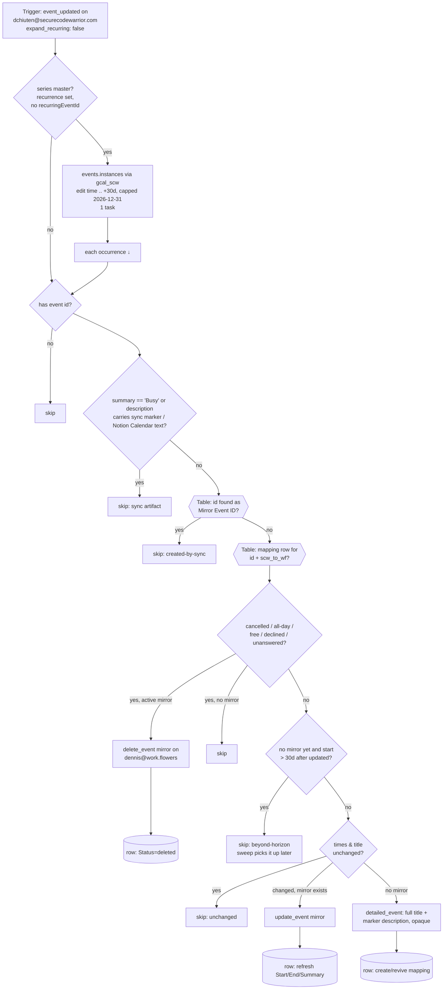

# scw-events-to-workflowers-block

One half of the two-way calendar-blocking pair between Dennis's two Google Calendars. Watches **dchiuten@securecodewarrior.com** (`event_updated` with `expand_recurring: false`; a whole-series edit is expanded in the workflow, see [Recurring series](#recurring-series-since-2026-10-31)) and mirrors every timed, busy, accepted-or-tentative occurrence onto **dennis@work.flowers** **with its full title**, so SCW meetings visibly block work.flowers time. Since Zapier fixed W6ZE93-VMEWP (verified 2026-10-28) the trigger re-fires on every update, so the move/rename/delete branches below run live; [`gcal-block-sweep`](../gcal-block-sweep/)'s daily reconcile pass is now a backstop. **Cancellations were dropped by this trigger** while it ran `expand_recurring: true` (proven 2026-08-31; see [`scw-cancellations-to-workflowers-unblock`](../scw-cancellations-to-workflowers-unblock/)), so deletion propagation lives in that companion Zap; the cancel branch here is kept as a belt.

Siblings: [`workflowers-events-to-scw-busy`](../workflowers-events-to-scw-busy/) (the reverse direction, bare "Busy" blocks), [`scw-cancellations-to-workflowers-unblock`](../scw-cancellations-to-workflowers-unblock/) (deletion propagation for this direction) and [`gcal-block-sweep`](../gcal-block-sweep/) (daily horizon backstop + cutover backfill). All three share the **GCal Sync Map** Zapier Table (`01M13QPJ5GRJV33096MBNSN1Q5`).

## Recurring series (since 2026-10-31)

The trigger runs with **`expand_recurring: false`**. Until 2026-10-31 it ran with `true`, which made sense while `event_updated` fired only once per occurrence. Once Zapier fixed W6ZE93-VMEWP (verified 2026-10-28), every edit to a recurring series re-delivered **every expanded occurrence**, years ahead: one edit to a daily standup produced thousands of runs, each skipping at the horizon guard. On 2026-10-30 those bursts across the calendar Zaps exhausted the account's **daily compute-spend limit**, and every Zap in the account was refused (`compute_spend_exceeded`) until 00:00 UTC.

Now Google delivers three shapes, and the workflow handles each:

| Arrives as | Looks like | Handled by |
| --- | --- | --- |
| One-off event | plain id, no `recurrence` | `mirrorOccurrence`, as before |
| Individually edited occurrence | `<seriesId>_<startUTC>Z`, `recurringEventId` set | `mirrorOccurrence`, as before |
| Whole-series edit | the **series master**: `recurrence` set, no `recurringEventId` | `mirrorSeries`: one Google `events.instances` call through the `gcal_scw` alias for the window *[edit time, edit time + 30 days)*, **capped at 2026-12-31** (the end of the SCW engagement), then `mirrorOccurrence` per occurrence |

Shapes verified 2026-10-31 by a read-only `event_v2` probe with `expand_recurring: false` on dennis@work.flowers (same Google API shapes on any calendar) (masters carry `recurrence`; edited occurrences carry `recurringEventId`; a "this and following" split shows up as a new master `<seriesId>_R<start>`), and the `events.instances` call returned `200` through `sdk.fetch` from the durable sandbox via both connections (see Verified cases below). A whole-series edit therefore costs **one run and one task** (the instances call) plus a task per mirror actually created, moved or deleted, instead of one run per occurrence for a decade.

Still the sweep's job: occurrences rolling into the 30-day horizon later, and the vanished occurrences of a series truncated with "this and following" (the old master's instances call simply stops returning them).

## Loop guards (why this never ping-pongs)

1. **Structural** — this Zap only reads SCW and only writes work.flowers; the reverse Zap does the opposite. A guard miss can travel at most one hop.
2. **Table** — every mirror's event id is recorded as `Mirror Event ID`; an incoming event whose id is found there is the sync's own output (this also catches the sparse cancelled tombstone of a mirror, which carries no summary/description).
3. **Content** — a bare `Busy` summary (the reverse direction's mirrors, and legacy Notion Calendar blocks) or a description containing `[gcal-block]` / `Event blocked with` is never mirrored.

## Maintainer notes

- **A series truncated with "this and following" leaves its future mirrors standing.** The old series gets an `UNTIL`, the vanished occurrences produce no `event_updated` and (mostly) no `event_cancelled`, so neither this Zap nor its unblock companion can react. [`gcal-block-sweep`](../gcal-block-sweep/) reconciles the coming week daily and deletes those orphans; a reschedule more than a week out is caught as it rolls in.
- **The horizon guard is load-bearing.** It bounds both a series expansion (only occurrences inside 30 days are fetched) and one-off events far out (left for [`gcal-block-sweep`](../gcal-block-sweep/) to mirror as they roll in). Under the old `expand_recurring: true` a weekly series expanded ~14 years (~730 instances) in one poll (2026-08-28). Keep `HORIZON_DAYS` in lockstep across all three workflows.
- **Task cost per run**: 0 for every skip path (Table reads are free), 1 for a create/update/delete.
- **Change guard**: written on the assumption that `event_updated` fires on every touch (RSVPs, description edits, Gemini notes). The run history says otherwise — no occurrence has ever fired twice — so this branch has never executed live; it stays as a belt, and [`gcal-block-sweep`](../gcal-block-sweep/) carries the same start/end/title comparison for the coming week. Confirmed as a durables bug by Zapier Product Escalations on 2026-09-08 (ticket W6ZE93-VMEWP: an extra dedupe layer keyed on the raw event id; fix filed, no ETA). When Zapier reports the fix shipped, re-verify with a live reschedule before trusting this branch again.
- A mirror hand-deleted on work.flowers is recreated on the source's next edit (the `update_event` "not found" is caught inside the step, so it doesn't spin retries).
- Skip-worthy transitions (event declined later, changed to all-day, changed to Free) delete an existing mirror — they behave like cancellations.
- **RSVP filter (2026-10-14):** only invites Dennis has accepted or marked tentative ("maybe") are mirrored. A declined or not-yet-answered (`needsAction`) invite is skipped, and an existing mirror is deleted. An event with no self attendee (his own event, no guests) has no RSVP and is mirrored. Accepting an invite later re-fires the trigger and creates the mirror then (since the W6ZE93 fix); `gcal-block-sweep`'s daily reconcile is the backstop.
- Never key anything on `iCalUID` — it's series-wide. `id` is the per-occurrence key (see [`gcal-event-updated-to-meeting-note`](../gcal-event-updated-to-meeting-note/)'s README for the war story).
- Mirrors created on work.flowers also fire [`gcal-event-updated-to-meeting-note`](../gcal-event-updated-to-meeting-note/); that Zap only updates meeting notes that already exist in its map table, so the mirrors fall through its `no-meeting-note-for-event` skip harmlessly.

## Verified cases — series expansion (2026-10-31)

The series path is the same code as [`workflowers-events-to-scw-busy`](../workflowers-events-to-scw-busy/#verified-cases--series-expansion-draft-runs-2026-10-31-every-write-stubbed), which ran write-stubbed against real series. For this direction the open question was whether `events.instances` answers through the **SCW** connection: a read-only draft probe with `gcal_scw` on "COE-IT standup (weekly)" (`43q2mtkvav6brst6h6sp9v554k`, the series behind 56 of this Zap's `compute_spend_exceeded` failures on 2026-10-30) returned `200` with **4 occurrences** for November, each with its per-occurrence id and `recurringEventId`.

## Verified cases (run-durable, 2026-08-28, pre-publish)

| Case | Result |
| --- | --- |
| New timed SCW event | mirror created on wf with title + marker, opaque, no reminders; row written |
| Same payload replayed | `skipped: unchanged`, 0 tasks |
| Time moved + renamed | mirror updated, row refreshed |
| Payload whose id is a known mirror id | `skipped: created-by-sync` |
| Occurrence starting 90d out | `skipped: beyond-horizon` |
| All-day / transparent / self-declined / summary "Busy" | skipped (correct reasons) |
| `status: cancelled` tombstone | mirror deleted, row marked `deleted` |
