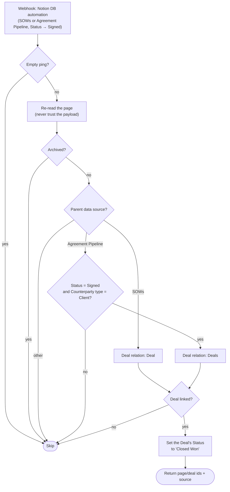

# sow-signed-to-deal-won

When an SOW, or a Client agreement in **Agreement Pipeline** (since TKT-1089), reaches **Signed** in
Notion, mark its related Deal **Closed Won**.

**Status:** enabled on Zapier, and the Notion SOWs automation posts to it. Turning the classic Zap
off is still unconfirmed; see below.

Migration of the classic Zap **"SOW Signed -> Mark Deal as Won"**. The last hop
of the deal lifecycle these Zaps drive:
[`esignatures-status-to-notion`](../esignatures-status-to-notion/) sets the Deal
to *In signing* when the SOW goes out (since 2026-11-25; before that
[`esignatures-send-for-signing`](../esignatures-send-for-signing/) did it at
draft time) and advances the SOW's own status, and — once a human or that Zap lands the SOW on **Signed** —
this one closes the Deal.

## What it does

1. Skips empty pings of the catch URL (`{skipped: "empty-payload"}` — wiring-up
   test clicks must not raise error alerts).
2. Re-reads the page from Notion — never trusts the webhook snapshot; the
   payload may not carry the Deal relation at all, and it may be stale.
3. Picks the rule by the page's parent data source:

   | Source | Deal relation | Also requires |
   |---|---|---|
   | SOWs `07e4d8c1…` (legacy, until the cutover task) | `Deal` | nothing (unchanged) |
   | Agreement Pipeline `42491b07-11ac-8198…` | `Deals` | `Status` = Signed and `Counterparty type` = Client |

   The pipeline holds every kind of agreement, so the Counterparty type gate keeps consultant, vendor and
   other agreements away from Deals, and the Status re-check means a broadly configured automation
   can't close a Deal early.
4. Skips if the page is archived/trashed, belongs to any other data source (including one it can't
   read: an empty parent now skips, where it used to pass), fails its source's gate, or has no Deal
   relation (normal — not every agreement hangs off a deal; parity with the classic Zap's "Related
   Deal Exists" filter).
5. Sets the Deal's `Status` to **Closed Won**. One agreement, one deal: the first
   id is written, any extras are only reported in the run output (matching
   `esignatures-status-to-notion`, which moves the first Deal to In signing).



## Trigger

Webhooks by Zapier Catch Hook (`WebHookCLIAPI@1.2.2` / `hook_v2`, no auth), fed
by a **Notion DB automation on the SOWs data source** that fires when `Status`
becomes `Signed`. The matching automation on **Agreement Pipeline** is created in
the legal-workflow cutover task, posting to the same catch URL; until then no
pipeline row reaches this Zap. A payload with content but no page id throws loudly.

## Cutover

1. ✅ The Notion SOWs automation posts to this workflow's catch URL,
   `https://hooks.zapier.com/hooks/catch/20495893/8DfHFErXShjCLRNn/`. Confirmed 2026-11-02: the Sakana
   AI SOW reaching Signed produced a run here 10 s later with `source.type: "automation"`
   (automation `32891b07-11ac-80a2-82c6-004def8c7cb8`), which closed DEAL-85.
2. ⏳ Turn the classic Zap **"SOW Signed -> Mark Deal as Won"** off in the Zapier UI. Not
   verifiable from the CLI. A Notion automation can carry several webhook actions, so check the
   classic Zap's run history too: no run at 2026-11-02 01:40Z means nothing still posts to it.

## Connections

| Alias | App key | Connection | Connection id |
|---|---|---|---|
| `notion_wf` | `NotionCLIAPI` | `work.flowers \| Dennis` | `02b73654-15c8-85c3-b16a-07304d2beb17` |

## Cost

About 2 real runs a month (5 runs between 2026-11-02 and 2026-11-27, from
`list-workflow-runs`; agreements are signed a few times a month).

| Path | Tasks |
| --- | --- |
| Empty ping | 0 |
| Skip after the page read (other source, not Signed, not Client, no Deal) | 1 (the `sdk.fetch` read) |
| Deal closed | 2 (read + the `update_database_item` write) |

So 2–4 tasks a month. Accepting pipeline rows adds no call: the gate uses the page read that was
already there.

## Maintainer notes

- **Runtime:** SDK 0.115.1 / durable 0.14.1 since TKT-1089 (from 0.99.0 / 0.12.5; Zapier refuses
  publishes below SDK 0.107.0).
- The Deal status write is idempotent — re-marking a won deal is a no-op, so a
  duplicate delivery or a manual re-fire is safe.
- Verified live 2026-08-14 via `run-durable`: main path against the Terrascope
  SOW (deal already Closed Won, so the write changed nothing), no-deal skip
  (SCW Amendment), and the empty-ping skip.
- Verified 2026-11-27 for TKT-1089 via `run-durable` on SDK 0.115.1 / durable 0.14.1, no writes:
  a Draft pipeline row → `not-signed` (the page's parent resolved to Agreement Pipeline), a Tasks
  page → `not-an-agreement`, an empty ping → `empty-payload`. Closing a Deal from a pipeline row is
  left to the TKT-1089 end-to-end test: closing a Deal fires the Deals automations
  (newsletter subscriber, Xero contact, Drive folder, Slack channel), so it isn't run on a real Deal.

## Test

```bash
SOURCE_FILES="$(jq -n --rawfile workflow workflow.ts '{"workflow.ts": $workflow}')"
zapier-sdk --experimental run-durable "$SOURCE_FILES" \
  --dependencies '{"@zapier/zapier-sdk":"0.115.1","zod":"4.4.3"}' \
  --zapier-durable-version '0.14.1' \
  --connections '{"notion_wf":{"connectionId":"02b73654-15c8-85c3-b16a-07304d2beb17"}}' \
  --input '{"data":{"id":"<sow-page-id>"}}' \
  --private
```

Use an SOW or pipeline row whose deal is **already Closed Won** so the live write is idempotent.
