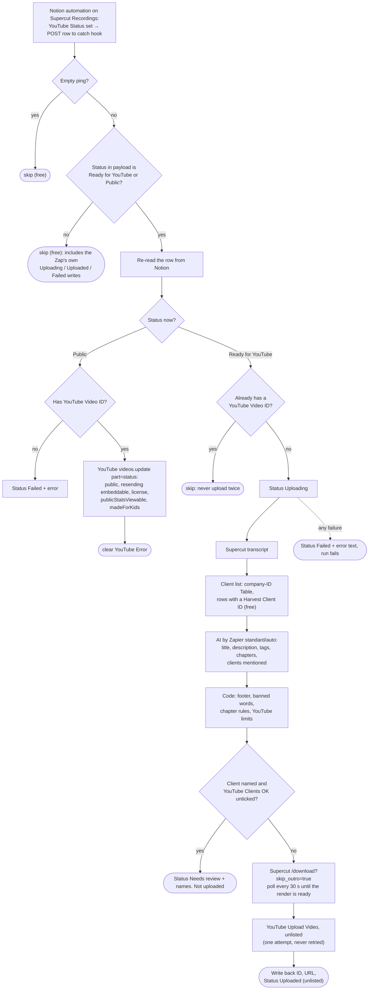

# supercut-to-youtube

Publishes a Supercut recording to the workFlowers YouTube channel from Notion (TKT-1069). Supercut stays the place for recording, editing and private sharing; YouTube is the marketing channel.

- Set a **Supercut Recordings** row's **YouTube Status** to **Ready for YouTube**. The Zap uploads the video **unlisted**, with an AI-written title, description, tags and chapters, then writes the **YouTube Video ID** and **YouTube URL** back and sets the status to **Uploaded (unlisted)**.
- Review the video on YouTube, then set **YouTube Status** to **Public**. The Zap makes it public.

**Status:** enabled on Zapier since 2026-11-20 (workflow `01a1f6dd-198a-722f-96e6-e11cecdaea47`). Nothing fires until the Notion automation below is set up. Catch URL: `https://hooks.zapier.com/hooks/catch/20495893/LY4BVo4YwqgHkKKS/`.

## Workflow

## Trigger

Webhooks by Zapier catch hook (`hook_v2`). The URL goes into `zap.json` as `trigger.webhook_url` after the first publish.

**One-time setup after the first publish (manual, in Notion):** on Supercut Recordings, add a database automation: *When* **YouTube Status** is set to **Ready for YouTube** or **Public** → *Send webhook* to `trigger.webhook_url`, including the YouTube Status, YouTube Video ID and Recording ID properties. The conditions keep the Zap's own status writes from firing it; the Zap also skips those for free if they get through. Saving or testing the automation sends an empty ping, which the Zap skips.

Not yet verified: that a database automation fires on a database a Notion Worker syncs. If it does not, add a button property that sets YouTube Status to Ready for YouTube and sends the same webhook.

## The Supercut Recordings columns

The **supercut-sync** worker manages this database and every property it declares is read-only. These five were added by hand on 2026-11-20 and are not declared by the worker, so people and this Zap can write them. They must never be added to the worker's `worker.database()`.

| Property | Type | Written by |
| --- | --- | --- |
| YouTube Status | select: Ready for YouTube, Uploading, Uploaded (unlisted), Public, Needs review, Failed | you (Ready, Public) and the Zap (the rest) |
| YouTube Video ID | text | the Zap. The match key the YouTube Videos sync uses to link back |
| YouTube URL | url | the Zap |
| YouTube Error | text | the Zap: why the last attempt failed or needs review |
| YouTube Clients OK | checkbox | you, after reviewing a Needs review flag |

The six videos uploaded by hand on 2026-11-20 were backfilled with their IDs and URLs.

## Things to know before touching it

- **Never uploads twice.** A row that already has a YouTube Video ID is skipped. The upload step runs once with no retry, because a retry after an ambiguous failure could put a second copy on the channel. If the upload fails, the row says Failed; check YouTube Studio before setting Ready again.
- **Client check.** The AI step gets the names of every company with a Harvest Client ID and reports any the transcript names as a client (not as a tool, such as Notion or LinkedIn). Code keeps only names that are on the list. A hit stops the run before rendering, sets **Needs review**, and writes the names into YouTube Error. If it's fine, tick **YouTube Clients OK** and set Ready for YouTube again.
- **Code enforces the format; the prompt asks for content.** The footer line, removing "quietly" and "silently", stripping `<` and `>`, the chapter rules (first at 0:00, at least three, at least 10 seconds apart, inside the duration; otherwise no chapters at all), and YouTube's title, description and tag limits are all applied in `workflow.ts`, so the model can't break them.
- **Download.** `skip_outro=true` drops Supercut's branded outro; it needs Supercut's download-options plan feature, and the run fails with a clear error if the plan loses it. The render is asynchronous: the Zap polls every 30 seconds for up to 10 minutes. The signed URL expires within hours, so it's used in the same run and never stored in Notion.
- **Recordings with no speech.** When Supercut reports the transcript as `unavailable` (a silent or music-only cut), the Zap still publishes: the AI step writes the title, description and tags from the working title alone, and there are no chapters. Expect a thin description and edit it in YouTube Studio before going Public. A transcript that is still `pending` or `processing` stops the run with Failed; set Ready for YouTube again a few minutes later. Music-only cuts with sung vocals risk Content ID claims (TKT-1069), so keep those off YouTube unless the track is licensed.
- **Edits.** Supercut's `/download` serves the default edit if one is set, while the transcript is the original recording's. If an edit cuts a lot, chapter times can drift; check them before going public.
- **Making it public** resends every `status` field, because `videos.update` resets any field you leave out.
- **Connections.** `supercut` is an *API by Zapier* connection holding Dennis's personal Supercut token (`sk_u_…`); `/download` requires a personal token. `youtube` is the workFlowers channel.
- **Preview mode.** `run-durable` with `{"pageId": "<row id>", "previewOnly": true}` runs the read, transcript, client list and AI steps and returns the metadata. It writes nothing and uploads nothing, whatever the row's status.

## AI step

AI by Zapier, `standard/auto`. The prompt lives in [`supercut-to-youtube-prompt.md`](supercut-to-youtube-prompt.md); edit it there and run `node scripts/check-prompts.mjs --fix`. TKT-1069 asked for Claude; on 2026-11-20 Dennis chose the repo default instead.

### Verified cases (preview runs, 2026-11-20)

The no-speech row was added after its first live run failed on the missing transcript; a second preview of the personal-agent recording confirmed the normal path didn't change.

| Recording | Title produced | Chapters | Clients flagged |
| --- | --- | --- | --- |
| Calling your Notion Personal Agent from a Zap! | Call Your Notion Personal Agent from a Zapier Automation | 4 | none ✅ |
| Nextgen Zaps with Notion OS | Build a Zapier Operations Dashboard in Notion with Next Gen Zaps | 6 | none ✅ |
| Notion CRM Custom UI | Notion CRM: Build a Custom UI with Data Validation and Deal Guardrails | 5 | none ✅ |
| ZapMap: Interactive Zapier Flows | Map Connected Zapier Workflows with a Coding Agent | 5 | none ✅ |
| Notion Custom Agent Widget | Build a Notion Custom Agent Chat Widget with Lovable | 3 | none ✅ |
| Custom Block Dashboard (~50 s) | Notion Custom Block Analytics Dashboard for Email Newsletters | none (too short for three) ✅ | none ✅ |
| Database Page Layout Cleanup Skill for Notion AI (28 s, no speech) | Notion AI Database Page Layout Cleanup Skill | none (no transcript) ✅ | none ✅ |
| Knoxx Innovations Custom App Demo | Custom R&D App Demo: Projects, Formulations, Materials & Vendors | n/a | Knoxx Innovations Pty Ltd ✅ |

Not yet exercised live: the upload, write-back, Needs review write, Failed write and Public paths. The first real Ready for YouTube after merge is that test.

## Expected cost

Runs are human-paced: a handful of publishes a month, each followed by one Public.

| Path | Tasks |
| --- | --- |
| Empty ping, or any status other than Ready / Public in the payload (including the Zap's own writes) | 0 |
| Publish | ~9: read row 1, Uploading 1, transcript 1, AI 1, download polls 2–4, upload 1, write-back 1. The client Table read is free |
| Needs review | 5: read, Uploading, transcript, AI, Needs review write |
| Make public | 3: read row, videos.update, clear error |
| Failure | whatever ran before it, plus 1 for the Failed write |
