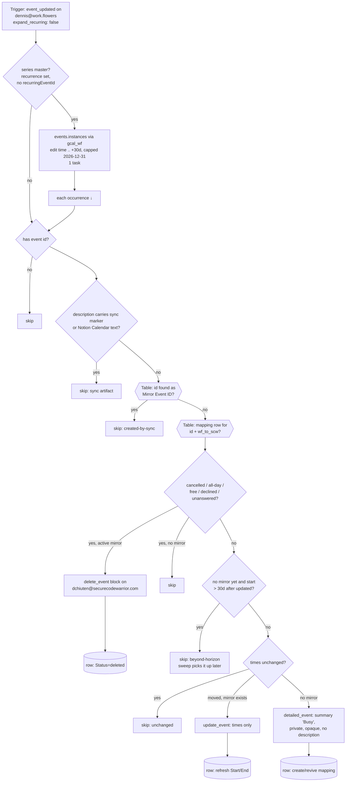

# workflowers-events-to-scw-busy

One half of the two-way calendar-blocking pair between Dennis's two Google Calendars. Watches **dennis@work.flowers** (`event_updated` with `expand_recurring: false`; a whole-series edit is expanded in the workflow, see [Recurring series](#recurring-series-since-2026-10-31)) and mirrors every timed, busy, accepted-or-tentative occurrence onto **dchiuten@securecodewarrior.com** as a **private, bare "Busy" block** — no title, description, location or attendees leak into the SCW workspace; only the time span crosses. Since Zapier fixed W6ZE93-VMEWP (verified 2026-10-28) the trigger re-fires on every update, so the move/rename/delete branches below run live; [`gcal-block-sweep`](../gcal-block-sweep/)'s daily reconcile pass is now a backstop. **Cancellations were dropped by this trigger** while it ran `expand_recurring: true` (proven 2026-08-31, when a deleted 9 AM work.flowers event left its SCW block standing), so deletion propagation lives in [`workflowers-cancellations-to-scw-unblock`](../workflowers-cancellations-to-scw-unblock/); the cancel branch here is kept as a belt.

Replaces **Notion Calendar's built-in event blocking**, which SCW IT cut off on 2026-08-28 (its old frozen blocks are cleaned up by the sweep's `cleanup_notion_blocks` mode).

Siblings: [`scw-events-to-workflowers-block`](../scw-events-to-workflowers-block/) (the reverse direction, full titles) and [`gcal-block-sweep`](../gcal-block-sweep/) (daily horizon backstop + cutover backfill). All three share the **GCal Sync Map** Zapier Table (`01M13QPJ5GRJV33096MBNSN1Q5`).

## Recurring series (since 2026-10-31)

The trigger runs with **`expand_recurring: false`**. Until 2026-10-31 it ran with `true`, which made sense while `event_updated` fired only once per occurrence. Once Zapier fixed W6ZE93-VMEWP (verified 2026-10-28), every edit to a recurring series re-delivered **every expanded occurrence**, years ahead: one edit to a daily standup produced thousands of runs, each skipping at the horizon guard. On 2026-10-30 those bursts across the calendar Zaps exhausted the account's **daily compute-spend limit**, and every Zap in the account was refused (`compute_spend_exceeded`) until 00:00 UTC.

Now Google delivers three shapes, and the workflow handles each:

| Arrives as | Looks like | Handled by |
| --- | --- | --- |
| One-off event | plain id, no `recurrence` | `mirrorOccurrence`, as before |
| Individually edited occurrence | `<seriesId>_<startUTC>Z`, `recurringEventId` set | `mirrorOccurrence`, as before |
| Whole-series edit | the **series master**: `recurrence` set, no `recurringEventId` | `mirrorSeries`: one Google `events.instances` call through the `gcal_wf` alias for the window *[edit time, edit time + 30 days)*, **capped at 2026-12-31** (the end of the SCW engagement), then `mirrorOccurrence` per occurrence |

Shapes verified 2026-10-31 by a read-only `event_v2` probe with `expand_recurring: false` on dennis@work.flowers (masters carry `recurrence`; edited occurrences carry `recurringEventId`; a "this and following" split shows up as a new master `<seriesId>_R<start>`), and the `events.instances` call returned `200` through `sdk.fetch` from the durable sandbox. A whole-series edit therefore costs **one run and one task** (the instances call) plus a task per mirror actually created, moved or deleted, instead of one run per occurrence for a decade.

Still the sweep's job: occurrences rolling into the 30-day horizon later, and the vanished occurrences of a series truncated with "this and following" (the old master's instances call simply stops returning them).

## Privacy posture

The block sent to SCW is `summary: "Busy"`, `visibility: private`, `transparency: opaque`, no description, no attendees, no reminders — verified live (see table below). The **source title is stored only in the Sync Map table** (`Summary`, f7) for Dennis's own debugging; deliberately no sync marker is written into the SCW event (Dennis's choice), so the reverse direction's loop belts are its `Busy`-summary check plus the table.

## Loop guards

Same three layers as the sibling — structural (one direction per Zap), the shared table (`Mirror Event ID` lookup, which also catches sparse cancelled tombstones of mirrors), and content (`[gcal-block]` marker / `Event blocked with` text on the work.flowers side). A hand-made bare "Busy" event on work.flowers *is* mirrored (it's a real commitment); a bare "Busy" on SCW is never mirrored back by the sibling.

## Maintainer notes

- **The horizon guard is load-bearing** — see the sibling README; keep `HORIZON_DAYS` (30) in lockstep across all three workflows.
- Task cost: 0 for every skip path, 1 per create (and, if the trigger ever does re-fire, per move/delete). Renames and description edits on the source change nothing on a bare Busy block, so the sweep's reconcile pass compares times only in this direction.
- Skip-worthy transitions (declined later, changed to all-day, changed to Free) delete an existing block.
- **RSVP filter (2026-10-14):** only invites Dennis has accepted or marked tentative ("maybe") are mirrored. A declined or not-yet-answered (`needsAction`) invite is skipped, and an existing mirror is deleted. An event with no self attendee (his own event, no guests) has no RSVP and is mirrored. Accepting an invite later re-fires the trigger and creates the mirror then (since the W6ZE93 fix); `gcal-block-sweep`'s daily reconcile is the backstop.
- This Zap polls the same calendar as [`gcal-event-updated-to-meeting-note`](../gcal-event-updated-to-meeting-note/); they coexist (separate workflows, separate dedupe).

## Verified cases — series expansion (draft runs, 2026-10-31, every write stubbed)

A write-stubbed copy of this file ran as a draft on this workflow (draft runs are free; the draft was discarded). Table reads and the `events.instances` call were real.

| Input | Result |
| --- | --- |
| Series master "Team Awesome: Daily Standup for India team" (`10cedj0ts404i45as6tvrsfn1a`, edited 2026-10-30T21:40Z, the edit behind 2026-10-30's burst) | 1 run, 1 instances call, **16 occurrences** in 30 Oct–29 Nov, all `skipped:declined-by-self`, no writes. Under `expand_recurring: true` the same edit was one run per occurrence out to 2029 and beyond. |
| Series master "IT & Data Team - Weekly Sync" (`sntotkc5ul86le2eajobj0atmr_R20261019T063000`, a "this and following" split), accepted | 4 occurrences: 3 `skipped:unchanged` (mirrors already at the right time), 1 `skipped:declined-by-self`. |
| One-off event `d3a9oegp5u3ampvba966bgshlg` (not a master) | Took the original single-event path; `skipped:created-by-sync` (it is a scw→wf mirror), so the loop guard still fires first. |

## Verified cases (run-durable, 2026-08-28, pre-publish)

| Case | Result |
| --- | --- |
| New timed wf event (confidential title + description) | SCW block created: "Busy", private, opaque, no description, no reminders; row written |
| Event carrying the `[gcal-block]` marker (a scw→wf mirror) | `skipped: sync-artifact-not-mirrored` |
| `status: cancelled` tombstone | block deleted, row marked `deleted` |
