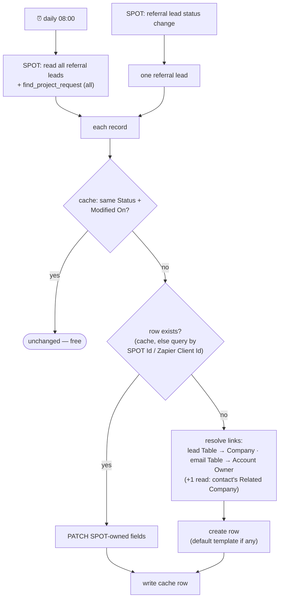

# zapier-partner-lead-status-to-notion

Keeps the Notion **Partner Leads** database in step with Zapier's **Solution Partner Operations Tool** (SPOT). Each SPOT record gets one row: every **referral lead** on the account (clients we registered with Zapier), and every **project request** Zapier has sent us. Each row has its current status, reason, expiry, converted date, commission rate and Y1/Y2 payout windows, and is linked to the Company, Account Owner contact and Deal where those can be resolved.

The directory name predates the 2026-11-24 restructure, when lead tracking moved off **Companies** properties into its own database so that a company can have more than one lead. The name was kept so the deployed workflow and its history stay continuous.

**Status (2026-11-24):** rewritten in PR #323 and published the same day (`status-trigger` re-pinned to `@1.5.3`; `daily-sweep` created, workflow `01a20cf1-4f69-7f23-9c7b-5dec40831032`). Partner Leads database `42291b07-11ac-8142-af6a-000bf3227cd9` created on the CRM page. Backfill started by `run-durable` on the same source before merge (see [Backfill](#backfill)). Siblings: [`register-zapier-partner-lead`](../register-zapier-partner-lead/) (the Register Lead button, now on Partner Leads rows), [`spot-project-request-to-notion`](../spot-project-request-to-notion/) and [`spot-accepted-sweep-to-notion`](../spot-accepted-sweep-to-notion/) (which file an accepted project request's Contact, Company and Deal).

## Two deployments, one source

| Deployment | Trigger | Payload | What it does |
| --- | --- | --- | --- |
| `status-trigger` | SPOT `referral_lead_status_change` (polling, `App227952CLIAPI@1.5.3`) | one referral lead | Upserts that lead's row. This is the near-real-time path. |
| `daily-sweep` | Schedule by Zapier, every day at 08:00 SGT | no lead | Reads **every** referral lead and project request (one SPOT task each) and upserts whatever changed. This is the backstop for anything the trigger misses, and its first runs did the backfill. |

Both deployments run the same `syncRecord` code path and share a free Zapier Table cache, so they are safe to run side by side: whichever handles a change first records it, and the other finds nothing to do. A payload with a `lead_id` is an event. Any other payload is treated as a sweep, which is idempotent, so an extra run only costs its two SPOT reads.



## What gets written

The fields SPOT owns are written on every sync: `Lead Name`, `Type`, `Program`, `SPOT Id`, `Status`, `Status Reason`, `Zapier Client Id`, `Lead Email`, `Source` (project requests), `Submitted On`, `Status Changed On`, `Expires`, `Converted On`, `Commission %`, `Payout Year 1/2`, and `Owner` (partner contact → Notion user through the User IDs Table). **Only fields the record carries are written, and nothing is ever cleared.** SPOT sends a different subset per status: an expiry only on Approved and Expired, and the payout windows only on Converted.

The relations are written differently depending on the record type:

- **Referral lead:** `Company` and `Account Owner` are set **only when the row is created**. After that the row belongs to whoever curates it. Company comes from the register Zap's lead Table, then from the legacy `Zapier Client Id` on Companies, then from the Account Owner's single `Related Company`. When a lead Table row exists, `Source` is set to `Notion CRM` (the lead was registered from Notion).
- **Project request:** `Deal`, `Company` and `Account Owner` come from the *SPOT Project Requests* Table that the intake Zaps write. They are rewritten on every sync, because they only appear once a request is Accepted and filed. A request that was never filed is linked only to the requester's contact, if one exists.

An unknown status or source is never written, because writing an unrecognised select option creates a new one. It is logged instead.

## Cost

| Path | Tasks |
| --- | --- |
| Status trigger fires, nothing changed | 0 (the trigger and Table reads are free) |
| A record changed, row exists | 1 (PATCH) |
| A new record | 2–3 (duplicate-guard query, create, and a contact read when the owner is in the CRM) |
| Daily sweep, nothing changed | 3 (two SPOT reads and one Companies query) |

That works out to about 90 tasks a month for the sweep, plus one or two per real status change. The 263 referral leads are mostly event sign-ups that expired in October, so real changes are rare. Each sweep is capped at `MAX_WRITES_PER_RUN = 60` writes. Records over the cap are reported as `deferred` and picked up by the next run.

## Backfill

The first sweep has about 276 records to create (263 referral leads and 13 project requests as at 2026-11-24). With the 60-write cap that takes 5 runs. These were run by hand with `run-durable` on this exact source before the PR merged, because durables are not billed in tasks until 2026-12-01. To repeat it, run the same command until the output shows `deferred: 0`:

```bash
npx zapier-sdk-experimental run-durable "$(jq -n --rawfile w zapier-partner-lead-status-to-notion/workflow.ts '{"workflow.ts": $w}')" --input '{}' --dependencies '{"zod":"4.4.3","@zapier/zapier-sdk":"0.91.0"}' --zapier-durable-version 0.10.1 --connections '{"notion_wf":{"connectionId":"02b73654-15c8-85c3-b16a-07304d2beb17"},"spot":{"connectionId":"02a5085e-1d27-853d-89b7-115a57fc4d32"}}'
```

This replaces `scripts/backfill-zapier-partner-leads.mjs`, which was deleted along with the adoption policy it mirrored. That policy only adopted an untracked lead at `Converted`, so event leads wouldn't put Zapier fields on most of the company list. With leads in their own database there is nothing to pollute: every lead gets a row, and the default **Active** view hides `Expired`.

## The trigger, and why the sweep exists

`referral_lead_status_change` was pinned to SPOT `@1.5.0`. On 2026-11-24 it reported `status: active` with no error but had **zero runs**, although SPOT showed status changes from September on. Seven of the nine companies then tracked in Notion were stale: Tannin Road was "Approved" but Converted, Maintain It was "Submitted" but Rejected, and three companies were "Approved" but had expired on 9 Nov. The most likely cause is the dedupe-on-a-stable-id defect Zapier fixed for project requests in `@1.5.2` (ticket `9NPEKP-739EJ`), so the trigger is re-pinned to `@1.5.3`.

**That is unverified** until a real status change fires a run. SPOT can't be made to change a lead's status on demand, so the test is the next real expiry or conversion: check `list-workflow-runs` on the `status-trigger` deployment. If it never fires, the sweep keeps Notion correct within a day. In that case, raise it with Zapier.

## Tables

| Table | Use |
| --- | --- |
| `01M86D6X6RPBV57GGHXYKTQ9P8` *Partner Leads (SPOT sync)* | **Owned here.** SPOT Id → Page ID, plus last-synced Status and Modified On. This is the change detector. |
| `01KPZFHX4RP6SER3AEK4YJ62BF` *Register Zapier Lead Table* | Client id → Company page id, written by the register Zap |
| `01JYEPSEARXB2Z6BJRCMFGXBC2` | email → Contact page id (`contact-emails-to-zapier-table`) |
| `01KYV1R8BWAZ697HQ8P1QV80AF` *SPOT Project Requests* | request id → Deal/Contact/Company (`spot-project-request-to-notion`) |
| `01JM3J9SG5X6S8GBSSC8AS28AT` *User IDs* | partner contact id ↔ Notion user id |

## Maintainer notes

- **Raw Notion API, not `NotionCLIAPI`.** `create_database_item` and `update_database_item` address properties through a cached schema that lags new properties. The raw API names them directly. Creates pass `template: {type: "default"}` and retry without it **only** on the "no default template" 400 (`isNoDefaultTemplateError`), so a default template added to Partner Leads later is picked up with no code change (repo rule 5).
- **The duplicate guard throws** if two rows already match one SPOT id or client id. Two rows for one lead is a data problem a person should see. Picking one, or creating a third, would hide it.
- **The cache is written last**, and a failed cache write is logged rather than retried: the Notion row is already right, and the next sync finds it through the duplicate guard.
- **Step ids carry the SPOT id**, so they live in `syncRecord(ctx, …)`. The publish-time analyzer rejects template-literal step ids in the workflow body but doesn't follow `ctx` into a helper, and it requires every step name in the body to be unique, which is why the event path's partner-contacts step is named `event-partner-contacts`.
- **`@zapier/zapier-durable` stays pinned to 0.10.1.** A publish on a release under a day old failed with `Dependency installation failed`, because the runtime's pnpm enforces a minimum release age.
- **The Companies lead fields were deleted on 2026-11-24** at Dennis's request, the same day as cutover: `Zapier Lead Status`, `Zapier Lead Status Reason`, `Zapier Lead Expires`, `Zapier Lead Converted On`, `Zapier Commission %`, `Zapier Payout Year 1/2`, `Referral Lead Id`, the `Zapier Account Owner` relation and its three `Account Owner …` rollups. `Partner Lead Status` (a rollup) and `Partner Leads` (a relation) replace them on Companies and Deals. **Kept on purpose:** `Zapier Client Id` and `Account Owner Email Override`, because `spot-project-request-to-notion` and `spot-accepted-sweep-to-notion` write both on company create, and this Zap reads `Zapier Client Id` to link older leads.
